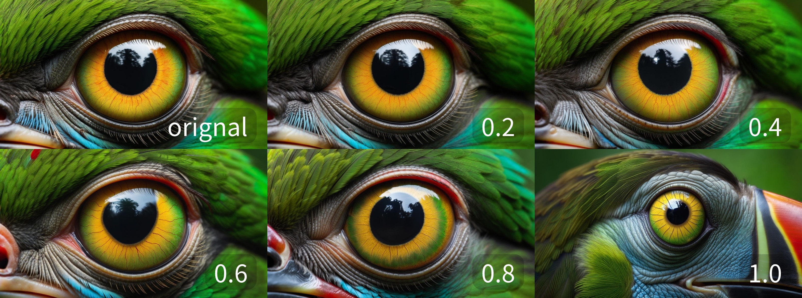
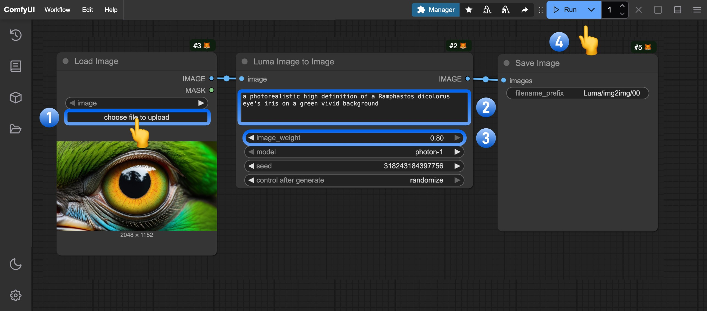

import ReqHint from "/snippets/ru/tutorials/partner-nodes/req-hint.mdx";
import UpdateReminder from "/snippets/ru/tutorials/update-reminder.mdx";

Узел Luma Image to Image позволяет изменять существующие изображения на основе текстовых промптов с помощью технологии Luma AI, сохраняя некоторые особенности и структуры исходного изображения.

## Для чего хорошо подходит Luma Image to Image

- **Редактирование изображений по промпту**: изменяет существующие изображения на основе текстовых промптов, сохраняя некоторые особенности и структуры оригинала
- **Изменение объектов и форм**: узел хорошо справляется с изменением объектов и форм, но может не подойти для изменения цвета
- **Настраиваемое влияние входа**: параметр `image_weight` управляет тем, насколько сильно входное изображение определяет результат; меньшие значения остаются ближе к оригиналу

## Примеры выходов

Результаты при разных значениях `image_weight`, показывающие, насколько сильно входное изображение влияет на сгенерированный результат:

<ReqHint/>
<UpdateReminder/>

## Рабочий процесс с партнёрскими узлами Luma Image to Image

<Tip>
Эта функция хорошо справляется с изменением объектов и форм. Однако она может не подойти для изменения цвета. Рекомендуем использовать меньшие значения веса, около 0.0-0.1.
</Tip>

### 1. Скачать файл рабочего процесса

Скачайте и перетащите следующее изображение в ComfyUI, чтобы загрузить рабочий процесс (информация о рабочем процессе включена в метаданные изображения):

Скачайте это изображение, чтобы использовать его как входное:

### 2. Выполнить шаги рабочего процесса

Выполните эти пронумерованные шаги:
1. Нажмите **Upload** на узле `Load Image`, чтобы загрузить входное изображение
2. (Необязательно) Измените промпты рабочего процесса
3. (Необязательно) Настройте `image_weight`, чтобы изменить влияние входного изображения (меньшие значения остаются ближе к оригиналу)
4. Нажмите `Run` или используйте сочетание клавиш `Ctrl(cmd) + Enter`, чтобы сгенерировать изображение
5. После того как API вернёт результаты, просмотрите сгенерированное изображение в узле `Save Image`. Изображения сохраняются в каталог `ComfyUI/output/`

### 3. Результаты с разными значениями `image_weight`

