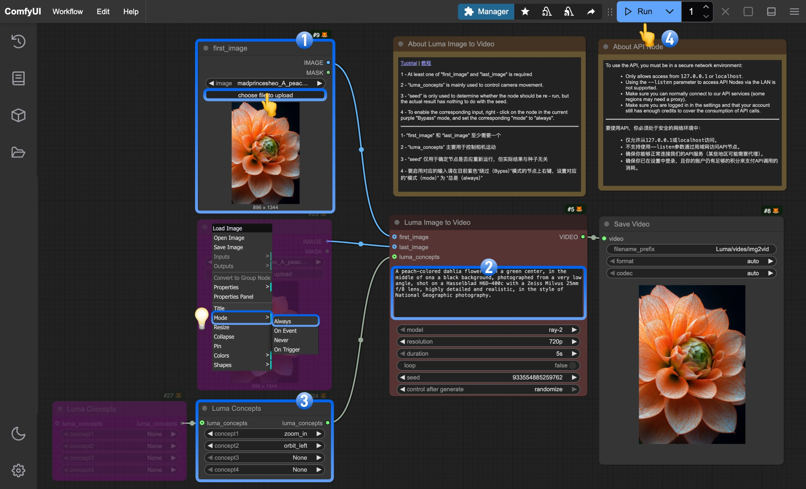

import ReqHint from "/snippets/ru/tutorials/partner-nodes/req-hint.mdx";
import UpdateReminder from "/snippets/ru/tutorials/update-reminder.mdx";

<Warning>
  **Устаревший узел**: классический узел **Luma Image to Video** устарел, и Luma отключает используемые им эндпоинты 24 октября 2026 года. Вместо него используйте узел [**Luma Ray 3.2 Image to Video**](/ru/built-in-nodes/LumaRay32ImageToVideoNode).
</Warning>

Узел Luma Image to Video позволяет превращать статичные изображения в плавные динамичные видео с помощью передовых технологий Luma AI, оживляя ваши изображения и добавляя им движение.

## В чём сильные стороны Luma Image to Video

- **Анимация изображений**: преобразует статичные изображения в плавные динамичные видео, добавляя жизнь и движение вашим изображениям
- **Управление движением через промпты**: текстовые промпты определяют эффекты движения в видео
- **Управление камерой**: функция Luma Concepts управляет движением камеры для профессиональной кинематографии
- **Гибкие входы изображений**: работает с `first_image`, `last_image` или обоими
- **Настраиваемый результат**: разрешение и длительность видео можно настроить, а разные модели генерации видео можно выбрать через параметр модели

<ReqHint/>
<UpdateReminder/>

## Рабочий процесс Image to Video с партнёрскими узлами Luma

Узлу Luma Image to Video требуется хотя бы один вход изображения (`first_image` или `last_image`) вместе с текстовыми промптами, которые определяют эффекты движения в видео. В этом руководстве мы создали пример с использованием `first_image` и `luma_concepts`, чтобы продемонстрировать возможности генерации видео Luma AI.

### 1. Скачать рабочий процесс

На этой странице описаны снятый с поддержки узел **Luma Image to Video** и поставлявшийся с ним пример рабочего процесса, в котором был выбран `ray-2`. Luma прекращает обслуживать эту модель 24 октября 2026 года, поэтому ни узел, ни пример не смогут работать. Пример и его пошаговое руководство остаются в исходном коде этой страницы в виде комментария.

Замена выполнена в виде отдельного узла. Его руководство:

<CardGroup cols={1}>
  <Card title="Luma Ray 3.2: Image to Video" icon="film" href="/ru/built-in-nodes/LumaRay32ImageToVideoNode">
    См. заменяющий узел и его входы.
  </Card>
</CardGroup>

{/*
Классический пример рабочего процесса и пошаговое руководство для снятого с поддержки узла. В нём был выбран `ray-2`, который Luma перестанет обслуживать 24 октября 2026 года, поэтому он не сможет запуститься. Восстановите или создайте заново этот блок с узлами Ray 3.2.

Информация о рабочем процессе включена в метаданные видео ниже. Скачайте его и перетащите в ComfyUI, чтобы загрузить рабочий процесс.

Скачайте следующее изображение, чтобы использовать его в качестве входного:

### 2. Выполнить шаги рабочего процесса

Выполните следующие основные шаги, чтобы запустить рабочий процесс:
1. Загрузите входное изображение в узле `first_image`
2. (Необязательно) Напишите промпты в узле Luma Image to Video, чтобы описать, как вы хотите анимировать изображение
3. (Необязательно) Измените узел `Luma Concepts`, чтобы управлять движением камеры для профессиональной кинематографии
4. Нажмите `Run` или используйте `Ctrl(cmd) + Enter`, чтобы сгенерировать видео
5. Когда API вернёт результаты, просмотрите сгенерированное видео в узле `Save Video`. Видео также будет сохранено в каталог `ComfyUI/output/`
*/}

### 2. Дополнительные примечания

- **Требования к входным изображениям**: требуется хотя бы один из `first_image` или `last_image`, максимум 1 изображение на вход
- **Luma Concepts**: управляет движением камеры для профессиональных видеоэффектов
- **Параметр Seed**: определяет только, нужно ли перезапустить узел, и не влияет на результаты генерации
- **Включение входных узлов**: щёлкните правой кнопкой мыши по фиолетовым узлам в режиме «Bypass» и установите для «mode» значение «always», чтобы включить входы
- **Выбор модели**: разные модели генерации видео имеют уникальные характеристики, которые можно настроить с помощью параметра модели
- **Разрешение и длительность**: настройте разрешение и длину выходного видео с помощью параметров разрешения и длительности
