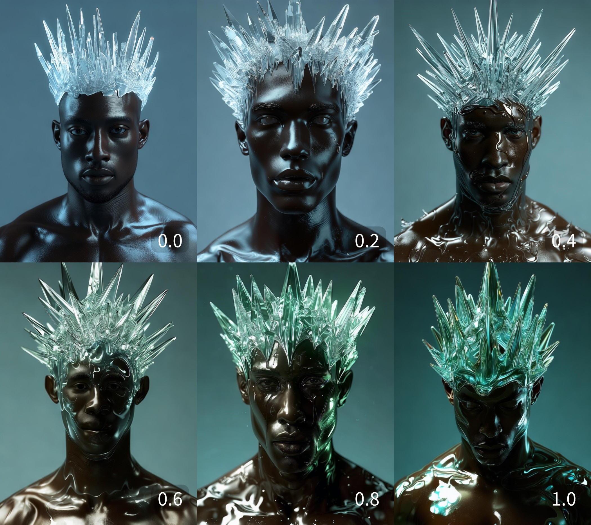
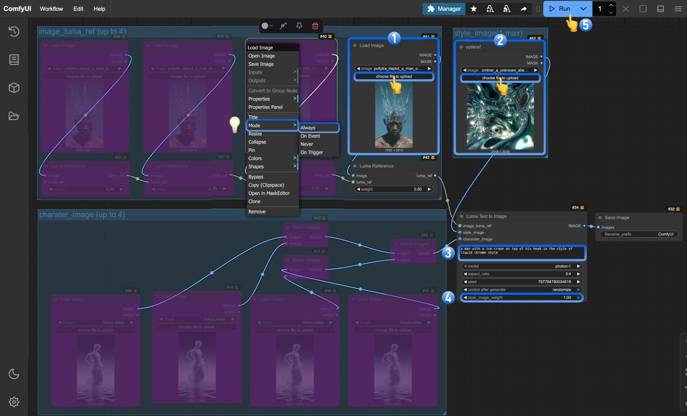

import ReqHint from "/snippets/ru/tutorials/partner-nodes/req-hint.mdx";
import UpdateReminder from "/snippets/ru/tutorials/update-reminder.mdx";

Узел Luma Text to Image позволяет генерировать высококачественные изображения по текстовым промптам с помощью передовых технологий Luma AI, создавая фотореалистичный контент и изображения в художественном стиле.

## Сильные стороны Luma Text to Image

- **Высококачественная генерация текст-в-изображение**: создаёт фотореалистичные изображения и изображения в художественном стиле по текстовым промптам.
- **Референсы стиля**: вход `style_image` определяет внешний вид результата, а `style_image_weight` управляет влиянием референсного изображения стиля.
- **Референсы изображений и персонажей**: вход `image_luma_ref` поддерживает генерацию с опорой на референсы; можно одновременно использовать до 4 референсных изображений и референсы персонажей.

## Примеры выходов

Генерация с управлением стилем при разных значениях `style_image_weight`, демонстрирующая влияние референсного изображения стиля:

<ReqHint/>
<UpdateReminder/>

## Рабочий процесс партнёрских узлов Luma Text to Image

Когда узел `Luma Text to Image` используется без входных изображений, он работает как рабочий процесс текст в изображение. В этом руководстве мы создали примеры с использованием `style_image` и `image_luma_ref`, чтобы продемонстрировать превосходные возможности обработки изображений Luma AI.

### 1. Скачать файлы рабочего процесса

Информация о рабочем процессе включена в метаданные изображения ниже. Скачайте его и перетащите в ComfyUI, чтобы загрузить рабочий процесс.

Скачайте эти изображения для входов:

### 2. Выполнить шаги для запуска рабочего процесса

Следуйте пронумерованным шагам на изображении, чтобы выполнить базовый рабочий процесс:
1. Загрузите референсное изображение в узле `Load image`
2. Загрузите референсное изображение стиля в узле `Load image (renamed to styleref)`
3. (Необязательно) Измените промпты в узле `Luma Text to Image`
4. (Необязательно) Настройте `style_image_weight`, чтобы управлять влиянием референсного изображения стиля
5. Нажмите кнопку `Run` или используйте сочетание клавиш `Ctrl(cmd) + Enter`, чтобы сгенерировать изображение
6. После того как API вернёт результаты, просмотрите сгенерированное изображение в узле `Save Image`. Изображения сохраняются в каталог `ComfyUI/output/`

### 3. Дополнительные примечания

- Узел допускает до 4 референсных изображений и референсов персонажей одновременно.
- Чтобы включить несколько входных изображений, щёлкните правой кнопкой мыши по фиолетовым узлам «Bypassed» и установите их `mode` в значение `always`
