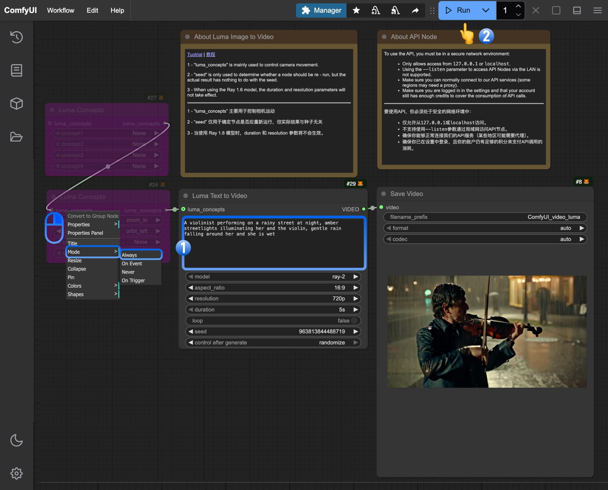

import ReqHint from "/snippets/ru/tutorials/partner-nodes/req-hint.mdx";
import UpdateReminder from "/snippets/ru/tutorials/update-reminder.mdx";

<Warning>
  **Устаревший узел**: классический узел **Luma Text to Video** устарел, а Luma отключает используемые им эндпоинты 24 октября 2026 года. Вместо него используйте [узел **Luma Ray 3.2 Text to Video**](/built-in-nodes/LumaRay32TextToVideoNode).
</Warning>

Узел Luma Text to Video позволяет создавать высококачественные плавные видео по текстовым описаниям с помощью инновационной технологии генерации видео от Luma AI.

## Для чего подходит Luma Text to Video

- **Генерация «текст в видео»**: создаёт высококачественные плавные видеоролики по текстовому описанию сцен, субъектов, действий и настроения
- **Управление камерой**: функция Luma Concepts добавляет движения камеры для профессиональных видеосъёмок и кинематографии
- **Выбор модели**: разные видеомодели с разными возможностями можно выбрать через параметр model
- **Настройка вывода**: разрешение и длительность видео можно настроить (кроме модели Ray 1.6, для которой эти параметры не применяются)

<ReqHint/>
<UpdateReminder/>

## Рабочий процесс Text to Video с партнёрскими узлами Luma

Узлу Luma Text to Video требуются текстовые промпты, описывающие содержимое видео. В этом руководстве мы создали примеры с использованием `prompt` и `luma_concepts`, чтобы показать превосходные возможности генерации видео от Luma AI.

### 1. Скачать рабочий процесс

На этой странице описан устаревший узел **Luma Text to Video** и пример рабочего процесса, который с ним поставлялся и использовал `ray-2`. Luma прекращает обслуживать эту модель 24 октября 2026 года, поэтому ни узел, ни пример не могут запуститься. Пример и пошаговое руководство остаются в исходном коде страницы в виде комментария.

Замена: это отдельный узел. Его собственное руководство:

<CardGroup cols={1}>
  <Card title="Luma Ray 3.2: Text to Video" icon="film" href="/built-in-nodes/LumaRay32TextToVideoNode">
    Ознакомьтесь с узлом-заменой и его входами.
  </Card>
</CardGroup>

{/*
Классический пример рабочего процесса и пошаговое руководство для устаревшего узла. Он использовал `ray-2`, которую Luma прекращает обслуживать 24 октября 2026 года, поэтому запустить его нельзя. Восстановите или пересоздайте этот блок с узлами Ray 3.2.

Информация о рабочем процессе включена в метаданные видео ниже. Скачайте видео и перетащите его в ComfyUI, чтобы загрузить рабочий процесс.

### 2. Выполнить шаги

Выполните эти основные шаги, чтобы запустить рабочий процесс:
1. Напишите промпт в узле `Luma Text to Video`, описывающий желаемое содержимое видео
2. Нажмите кнопку `Run` или используйте сочетание клавиш `Ctrl(cmd) + Enter`, чтобы сгенерировать видео
3. После того как API вернёт результаты, вы можете просмотреть сгенерированное видео в узле `Save Video`. Видео также будет сохранено в каталог `ComfyUI/output/`

> (Необязательно) Измените узел `Luma Concepts`, чтобы управлять движением камеры и добавить профессиональные кинематографические приёмы
*/}

### 2. Дополнительные примечания

- **Написание промптов**: Подробно описывайте сцены, объекты, действия и настроение для лучших результатов
- **Luma Concepts**: В основном используется для управления камерой, чтобы создавать профессиональные видеокадры
- **Параметр seed**: Определяет только, нужно ли перезапускать узел, и не влияет на результаты генерации
- **Выбор модели**: Разные видеомодели имеют разные возможности, которые настраиваются через параметр модели
- **Разрешение и длительность**: Настраивайте разрешение и длину выходного видео с помощью этих параметров
- **Примечание о модели Ray 1.6**: Параметры длительности и разрешения не работают при использовании модели Ray 1.6. Luma прекратила обслуживать Ray 1.6 в сентябре 2026 года, поэтому этот вариант больше не запускается.
