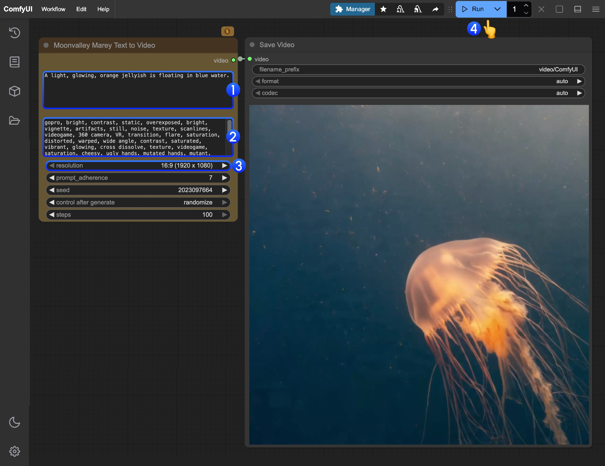
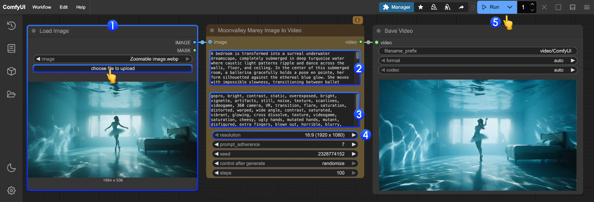
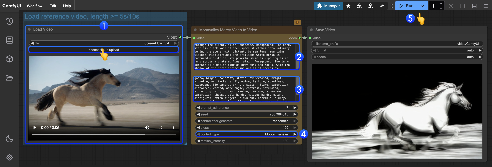

import ReqHint from "/snippets/ru/tutorials/partner-nodes/req-hint.mdx";
import UpdateReminder from "/snippets/ru/tutorials/update-reminder.mdx";

<Warning>
  **Сервис недоступен**: API-сервис Moonvalley больше не доступен. Эти узлы устарели и могут работать не так, как ожидается.
</Warning>

<iframe
  className="w-full aspect-video rounded-xl"
  src="https://www.youtube.com/embed/8Z8X9fFKapQ?si=lK_KFSzDcT0Mepk9"
  title="ComfyUI Selection Toolbox New Features"
  allow="accelerometer; clipboard-write; encrypted-media; gyroscope; picture-in-picture"
  allowFullScreen
></iframe>

Moonvalley Marey Realism v1.5 представляет собой модель генерации видео с помощью ИИ, созданную для кинематографичного контента. Модель **обучена исключительно на коммерчески лицензированном контенте**, что обеспечивает **соблюдение авторских прав и коммерческую безопасность**.

## В чём Moonvalley хорош

- Исключительное понимание промптов: точно интерпретирует сложные инструкции промпта.
- Нативное качество HD 1080p: набор данных для обучения основан на видео **1080P**, что обеспечивает точный и детализированный результат.
- Реалистичная физика и динамика: точно моделирует физические модели движения и естественную динамику, обеспечивая реализм профессионального уровня.
- Сложное разделение сцены на слои и расширенные эффекты освещения: поддерживает разделение на передний план, средний план и фон в сложных сценах с интеллектуальным пониманием пространственных связей.
- Элементы управления продакшн-уровня, такие как перенос движения и позы: автоматически создаёт реалистичное освещение для композитных сцен.

В настоящее время партнёрские узлы Moonvalley поддерживаются в ComfyUI нативно. Вы можете напрямую использовать в ComfyUI соответствующие возможности «текст в видео», «изображение в видео» и «видео в видео».

<Warning>
  **Сервис недоступен**: API-сервис Moonvalley больше не доступен. Эти узлы устарели и могут работать не так, как ожидается.
</Warning>

<ReqHint/>
<UpdateReminder/>

## Рабочий процесс генерации видео из текста Moonvalley

### 1. Скачать файл рабочего процесса

<video
  controls
  className="w-full aspect-video"
  src="https://raw.githubusercontent.com/Comfy-Org/example_workflows/refs/heads/main/api_nodes/moonvalley/api_moonvalley_text_to_video.mp4"
></video>

<a className="prose"  target='_blank'  href="https://raw.githubusercontent.com/Comfy-Org/example_workflows/refs/heads/main/api_nodes/moonvalley/api_moonvalley_text_to_video.json" style={{ display: 'inline-block', backgroundColor: '#0078D6', color: '#ffffff', padding: '10px 20px', borderRadius: '8px', borderColor: "transparent", textDecoration: 'none', fontWeight: 'bold'}}>
    
Скачать файл рабочего процесса в формате JSON

</a>

### 2. Выполните шаги, чтобы запустить рабочий процесс

1. Введите позитивный промпт (содержимое, которое должно появиться в видео)
2. Введите негативный промпт (содержимое, которое не должно появиться в видео)
3. Измените разрешение выходного видео
4. Нажмите кнопку `Run` или используйте сочетание клавиш `Ctrl(cmd) + Enter`, чтобы запустить генерацию видео
5. После того как API вернёт результат, вы сможете посмотреть сгенерированное видео в узле `Save Video`. Видео также будет сохранено в каталоге `ComfyUI/output/`

## Рабочий процесс Moonvalley для создания видео из изображения

### 1. Скачать файл рабочего процесса

<video
  controls
  className="w-full aspect-video"
  src="https://raw.githubusercontent.com/Comfy-Org/example_workflows/refs/heads/main/api_nodes/moonvalley/api_moonvalley_image_to_video.mp4"
></video>

<a className="prose"  target='_blank'  href="https://raw.githubusercontent.com/Comfy-Org/example_workflows/refs/heads/main/api_nodes/moonvalley/api_moonvalley_image_to_video.json" style={{ display: 'inline-block', backgroundColor: '#0078D6', color: '#ffffff', padding: '10px 20px', borderRadius: '8px', borderColor: "transparent", textDecoration: 'none', fontWeight: 'bold'}}>
    
Скачать файл рабочего процесса в формате JSON

</a>

Скачайте изображение ниже и используйте его как входное изображение

### 2. Выполнить шаги для запуска рабочего процесса

1. Загрузите входное изображение в узле `Load Image`
2. Введите положительный промпт (содержимое, которое вы хотите видеть в видео)
3. Введите негативный промпт (содержимое, которое вы не хотите видеть в видео)
4. Измените разрешение выходного видео
5. Нажмите кнопку `Run` или используйте сочетание клавиш `Ctrl(cmd) + Enter`, чтобы начать генерацию видео
6. После того как API вернёт результат, вы можете просмотреть сгенерированное видео в узле `Save Video`. Видео также будет сохранено в каталоге `ComfyUI/output/`

## Рабочий процесс видео-в-видео Moonvalley

Узел `Moonvalley Marey Video to Video` позволяет подать на вход референсное видео для перерисовки видео. Вы можете использовать движение или позы персонажей из референсного видео для генерации видео.

### 1. Скачать файл рабочего процесса

<video
  controls
  className="w-full aspect-video"
  src="https://raw.githubusercontent.com/Comfy-Org/example_workflows/refs/heads/main/api_nodes/moonvalley/api_moonvalley_video_to_video.mp4"
></video>

<a className="prose"  target='_blank'  href="https://raw.githubusercontent.com/Comfy-Org/example_workflows/refs/heads/main/api_nodes/moonvalley/api_moonvalley_video_to_video.json" style={{ display: 'inline-block', backgroundColor: '#0078D6', color: '#ffffff', padding: '10px 20px', borderRadius: '8px', borderColor: "transparent", textDecoration: 'none', fontWeight: 'bold'}}>
    
Скачать файл рабочего процесса в формате JSON

</a>

Скачайте видео ниже и используйте его как входное видео:

<video
  controls
  className="w-full aspect-video"
  src="https://raw.githubusercontent.com/Comfy-Org/example_workflows/refs/heads/main/api_nodes/moonvalley/api_moonvalley_video_to_video_input.mp4"
></video>

### 2. Выполните шаги, чтобы запустить рабочий процесс

1. Загрузите референсное видео (или собственный материал) в узле `Load Video`
    - Если итоговая длительность видео 5s, входное видео должно быть длиннее 5s
    - Если итоговая длительность видео 10s, входное видео должно быть длиннее 10s
2. Введите положительный промпт (содержимое, которое вы хотите видеть в видео)
3. Введите негативный промпт (содержимое, которое вы не хотите видеть в видео)
4. Задайте параметр `control_type`, чтобы выбрать тип референса для перерисовки видео
    -  `Motion Transfer`: генерация на основе движения в референсном видео
    -  `Pose Transfer`: генерация на основе поз персонажей в референсном видео
5. Нажмите кнопку `Run` или используйте сочетание клавиш `Ctrl(cmd) + Enter`, чтобы запустить генерацию видео
6. После того как API вернёт результат, вы можете просмотреть сгенерированное видео в узле `Save Video`. Видео также будет сохранено в каталог `ComfyUI/output/`
