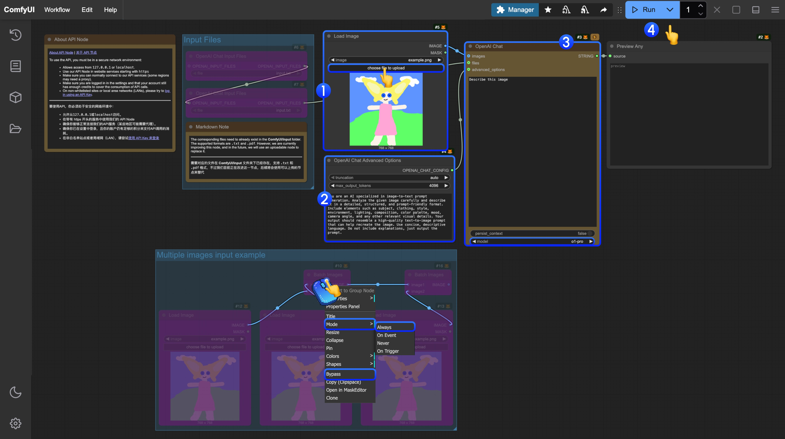

import ReqHint from "/snippets/ru/tutorials/partner-nodes/req-hint.mdx";
import UpdateReminder from "/snippets/ru/tutorials/update-reminder.mdx";

OpenAI — компания, специализирующаяся на генеративном ИИ и предоставляющая мощные возможности для ведения диалогов. Сейчас ComfyUI интегрирован с OpenAI API, поэтому вы можете напрямую использовать соответствующие узлы в ComfyUI для работы с чат-функциями.

## В чём хорош OpenAI Chat

- **Интеллектуальные диалоги**: общайтесь с расширенными языковыми моделями OpenAI напрямую в ComfyUI
- **Понимание изображений**: загрузите изображение, чтобы ИИ мог его интерпретировать и ответить
- **Управление задачами**: настройте `OpenAI Chat Advanced Options`, чтобы ИИ выполнял конкретные задачи, например анализировал изображение и генерировал промпт
- **Выбор модели**: выбирайте разные модели OpenAI в узле `OpenAI Chat`
- **Ввод нескольких изображений**: объедините несколько изображений в пакет, когда требуется интерпретация ИИ для более чем одного изображения

<ReqHint/>
<UpdateReminder/>

## OpenAI: ChatGPT {#api_openai_chat}

Используйте расширенные языковые модели OpenAI для интеллектуальных диалогов.

<CardGroup cols={2}>
  <Card title="Запустить в Comfy Cloud" icon="cloud" href="https://cloud.comfy.org/?template=api_openai_chat&utm_source=docs&utm_medium=referral&utm_campaign=chat">
    Открыть в Comfy Cloud
  </Card>
  <Card title="Скачать рабочий процесс" icon="download" href="https://github.com/Comfy-Org/workflow_templates/blob/main/templates/api_openai_chat.json">
    Скачать JSON или найдите «OpenAI: ChatGPT» в библиотеке шаблонов
  </Card>
</CardGroup>

**Входные материалы**

Загрузите этот файл в соответствующий узел `LoadImage`:

<CardGroup cols={2}>
  <Card title="example.png" icon="image" href="https://raw.githubusercontent.com/Comfy-Org/workflow_templates/main/input/example.png">
    Узел `LoadImage` 5 · `example.png`
  </Card>
</CardGroup>

  

## Выполнить рабочий процесс по шагам

<Note>
В соответствующем шаблоне мы уже настроили роль для анализа генерации промпта.
</Note>

Вы можете ориентироваться на номера на изображении, чтобы выполнить базовый рабочий процесс «текст в изображение»:
1. В узле `Load Image` загрузите изображение, которое ИИ должен интерпретировать
2. (Необязательно) При необходимости вы можете изменить настройки в `OpenAI Chat Advanced Options`, чтобы ИИ выполнял конкретные задачи
3. В узле `OpenAI Chat` можно изменить `Prompt`, задав промпт беседы, или изменить `model`, выбрав другую модель
4. Нажмите кнопку `Run` или используйте сочетание клавиш `Ctrl(cmd) + Enter`, чтобы выполнить беседу.
5. После того как API вернёт результат, вы можете просмотреть соответствующий ответ ИИ в узле `Preview Any`.

## Дополнительные примечания

- В настоящее время узел ввода файлов `OpenAI Chat Input Files` требует, чтобы файлы сначала были загружены в каталог `ComfyUI/input/`. Этот узел дорабатывается, и мы изменим шаблон после обновлений.
- В рабочем процессе приведён пример с использованием `Batch Images` для ввода. Если у вас есть несколько изображений, которые нужно интерпретировать с помощью ИИ, можно обратиться к схеме шагов и с помощью правой кнопки мыши установить для соответствующего узла режим `Always`, чтобы включить его.
