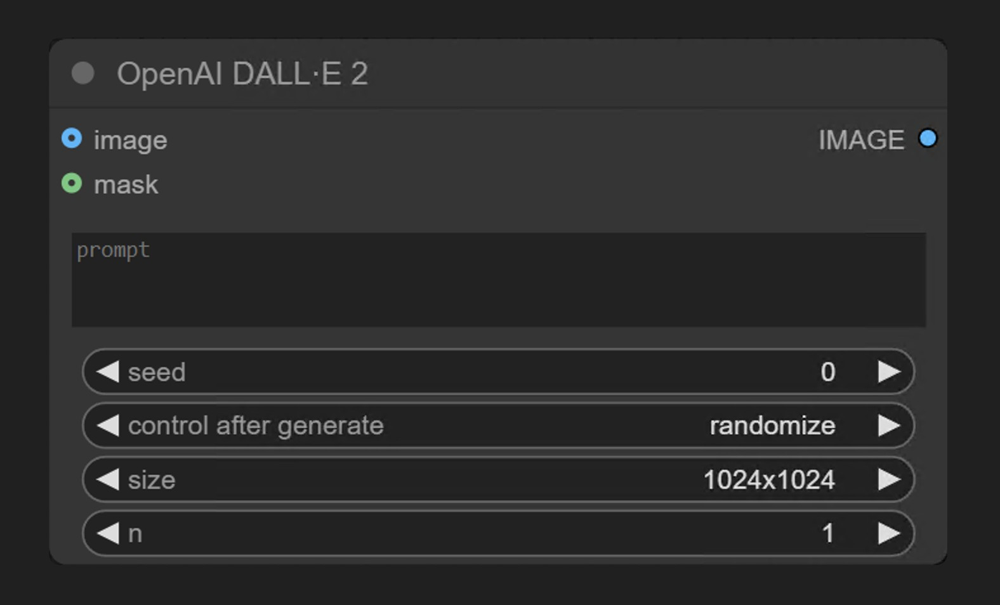
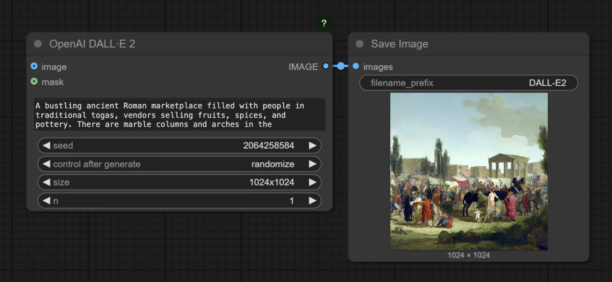
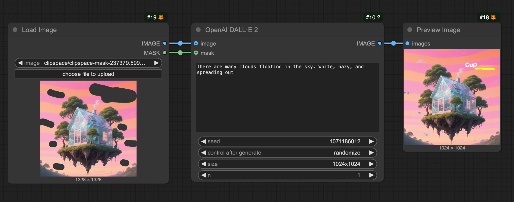

import Faq from "/snippets/ru/tutorials/partner-nodes/faq.mdx";
import ReqHint from "/snippets/ru/tutorials/partner-nodes/req-hint.mdx";
import UpdateReminder from "/snippets/ru/tutorials/update-reminder.mdx";

<Warning>
  **Устарело**: OpenAI больше не поддерживает модель DALL·E 2. Узел **OpenAI DALL·E 2** выведен из эксплуатации и удалён из ComfyUI. Вместо него используйте узел **GPT Image**. Эта страница сохранена только для справки.
</Warning>

OpenAI DALL·E 2 входит в серию Партнёрских узлов ComfyUI и позволяет пользователям генерировать изображения с помощью модели **DALL·E 2** от OpenAI.

Узел **OpenAI DALL·E 2** синхронно генерирует изображения через API генерации изображений OpenAI. Он принимает текстовые промпты и возвращает изображения, соответствующие описанию.

## Для чего подходит DALL·E 2

- Генерация изображений: текст в изображение
- Редактирование изображений: инпейтинг с помощью масок

## Примеры выходов

Генерация «текст в изображение» по одному текстовому промпту:

Инпейтинг: замена маскированной области входного изображения на основе текстового промпта:

<ReqHint/>
<UpdateReminder/>

## Описание параметров

### Обязательные параметры

| Параметр | Описание                                                              |
|----------|-----------------------------------------------------------------------|
| `prompt` | Текстовый промпт, описывающий содержимое изображения для генерации    |

### Параметры виджетов

| Параметр | Описание                                                                     | Параметры/Диапазон                 | Значение по умолчанию |
|----------|------------------------------------------------------------------------------|------------------------------------|-----------------------|
| `seed`   | Значение seed для генерации изображения (в настоящее время не реализовано в бэкенде) | от 0 до 2^31-1                     | 0                     |
| `size`   | Размеры выходного изображения                                                | "256x256", "512x512", "1024x1024"  | "1024x1024"           |
| `n`      | Количество генерируемых изображений                                          | от 1 до 8                          | 1                     |

### Необязательные параметры

| Параметр | Описание                                                                     | Параметры/Диапазон                 | Значение по умолчанию |
|----------|------------------------------------------------------------------------------|------------------------------------|-----------------------|
| `image`  | Необязательное изображение-референс для редактирования изображения           | Любой вход с изображением          | Нет                   |
| `mask`   | Необязательная маска для локального инпейтинга                               | Вход маски                         | Нет                   |

## Примеры рабочих процессов

Этот партнёрский узел сейчас поддерживает два рабочих процесса:

- Текст в изображение
- Инпейтинг

<Note>
Рабочий процесс «Изображение в изображение» не поддерживается
</Note>

### Пример «Текст в изображение»

На изображении ниже показан простой рабочий процесс «текст в изображение». Скачайте соответствующее изображение и перетащите его в ComfyUI, чтобы загрузить рабочий процесс.

Соответствующий пример очень прост

Вам достаточно загрузить узел `OpenAI DALL·E 2`, ввести описание изображения, которое вы хотите сгенерировать, в узле `prompt`, подключить узел `Save Image` и запустить рабочий процесс.

### Рабочий процесс инпейтинга

DALL·E 2 поддерживает функцию редактирования изображений: с помощью маски можно указать область, которую нужно заменить. Ниже приведён простой пример рабочего процесса инпейтинга:

#### 1. Скачать файл рабочего процесса

Скачайте изображение ниже и перетащите его в ComfyUI, чтобы загрузить соответствующий рабочий процесс.

В качестве входа будем использовать изображение ниже:

#### 2. Инструкции по использованию файла рабочего процесса

Поскольку этот рабочий процесс довольно прост, если вы хотите собрать его вручную самостоятельно, выполните следующие шаги:

1. Используйте узел `Load Image`, чтобы загрузить изображение
2. Нажмите правой кнопкой мыши на узле `Load Image` и выберите `MaskEditor`
3. В редакторе масок с помощью кисти закрасьте область, которую хотите перерисовать
4. Подключите загруженное изображение ко входу `image` узла **OpenAI DALL·E 2**
5. Подключите маску ко входу `mask` узла **OpenAI DALL·E 2**
6. Отредактируйте промпт в узле `prompt`
7. Запустите рабочий процесс

**Примечания**

- Если вы хотите использовать функцию редактирования изображений, необходимо передать и изображение, и маску (оба параметра обязательны)
- Маска и изображение должны быть одного размера
- При подаче больших изображений узел автоматически изменит размер изображения до подходящего
- URL-адреса, возвращаемые API, действуют недолго, поэтому сохраняйте результаты своевременно
- Каждая генерация расходует кредиты, которые списываются в зависимости от размера и количества изображений

## Часто задаваемые вопросы

<Faq/>
