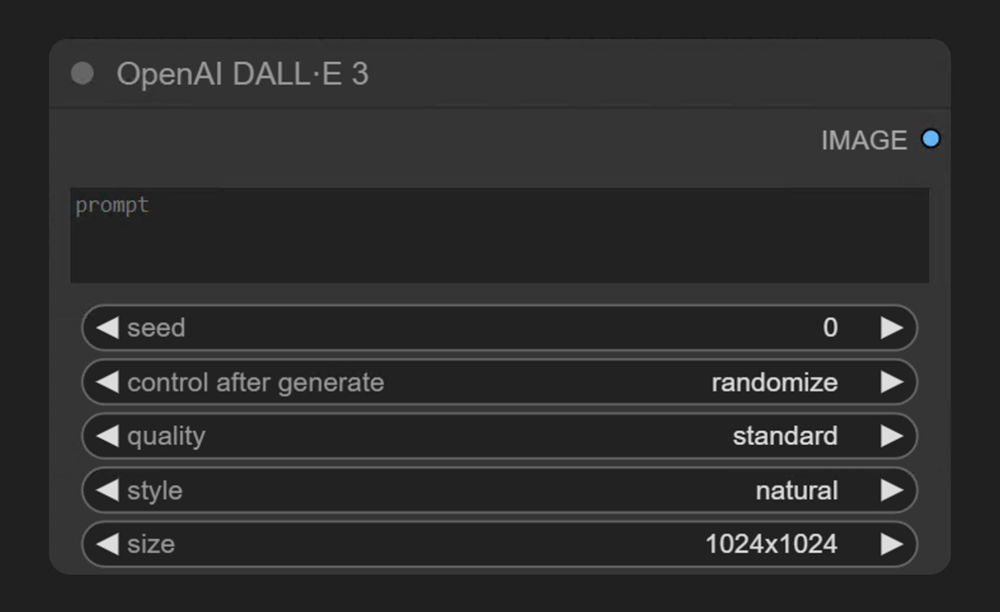
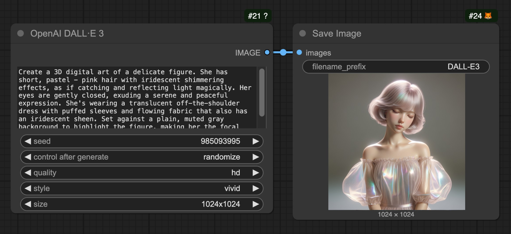

import Faq from "/snippets/ru/tutorials/partner-nodes/faq.mdx";
import ReqHint from "/snippets/ru/tutorials/partner-nodes/req-hint.mdx";
import UpdateReminder from "/snippets/ru/tutorials/update-reminder.mdx";

<Warning>
  **Устаревший узел**: OpenAI прекратила поддержку модели DALL·E 3. Узел **OpenAI DALL·E 3** выведен из эксплуатации и удалён из ComfyUI. Используйте вместо него узел **GPT Image**. Эта страница сохранена только для справки.
</Warning>

OpenAI DALL·E 3 входит в серию «Партнёрские узлы» ComfyUI и позволяет генерировать изображения с помощью модели **DALL·E 3** от OpenAI. Этот узел поддерживает генерацию изображений из текста.

DALL·E 3 — последняя модель генерации изображений от OpenAI, способная создавать детализированные изображения высокого качества по текстовым промптам. С помощью этого узла в ComfyUI вы можете напрямую использовать возможности генерации DALL·E 3, не покидая интерфейс ComfyUI.

Узел **OpenAI DALL·E 3** генерирует изображения синхронно через API генерации изображений OpenAI. Он принимает текстовые промпты и возвращает изображения, соответствующие описанию.

## Что DALL·E 3 делает хорошо

- **Генерация «текст в изображение»**: создаёт детализированные изображения высокого качества по текстовым промптам, с поддержкой многострочных промптов, подробно описывающих содержимое изображения
- **Контроль качества**: выбор между выводом standard и hd, при этом hd генерирует изображения более высокого качества
- **Контроль стиля**: выберите vivid для гиперреалистичных и драматичных изображений или natural для более естественных, менее утрированных изображений
- **Гибкие размеры**: генерация квадратных или прямоугольных изображений в разных ориентациях (1024x1024, 1024x1792, 1792x1024)

## Примеры выходов

Генерация по схеме «текст в изображение» из одного текстового промпта:

<ReqHint/>
<UpdateReminder/>

## Детали параметров

### Обязательные параметры

| Параметр | Тип | Описание |
|-----------|------|------------------------------------------------------------------------------------------------------------------------------|
| prompt    | Текст | Текстовый промпт для генерации изображений. Поддерживает многострочный ввод, позволяет подробно описать содержимое изображения, которое вы хотите сгенерировать. |

### Параметры виджетов

| Параметр | Тип      | Опции                         | Значение по умолчанию | Описание |
|-----------|-----------|---------------------------------|---------------|-------------------------------------------------------------------------------------------------------------------------------------------|
| seed      | Целое число   | 0-2147483647                    | 0             | Случайное зерно (seed), используемое для управления результатом генерации |
| quality   | Опция    | standard, hd                    | standard      | Настройка качества изображения. Опция «hd» генерирует изображения более высокого качества, но может потребовать больше вычислительных ресурсов |
| style     | Опция    | natural, vivid                  | natural       | Стиль изображения. «Vivid» обычно создаёт гиперреалистичные и драматичные изображения, а «natural» даёт более естественные, менее утрированные изображения |
| size      | Опция    | 1024x1024, 1024x1792, 1792x1024 | 1024x1024     | Размер сгенерированного изображения. Можно выбрать квадратное или прямоугольное изображение с разной ориентацией |

## Примеры использования

Вы можете скачать изображение ниже и перетащить его в ComfyUI, чтобы загрузить соответствующий рабочий процесс.

Поскольку соответствующий рабочий процесс очень прост, вы также можете просто добавить узел **OpenAI DALL·E 3** в ComfyUI, ввести описание изображения, которое хотите сгенерировать, а затем запустить рабочий процесс.

1. Добавьте узел **OpenAI DALL·E 3** в ComfyUI
2. Введите описание изображения, которое хотите сгенерировать, в текстовое поле промпта
3. При необходимости настройте дополнительные параметры (quality, style, size и т. д.)
4. Запустите рабочий процесс, чтобы сгенерировать изображение

## Часто задаваемые вопросы

<Faq/>
