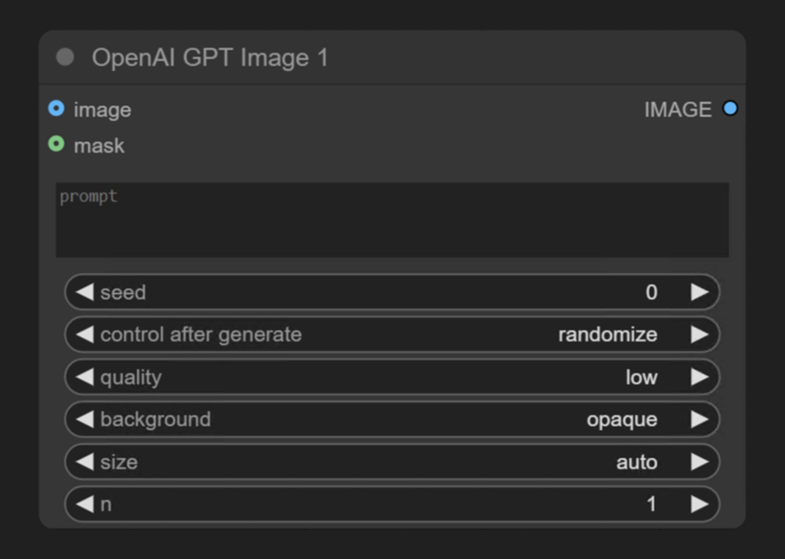
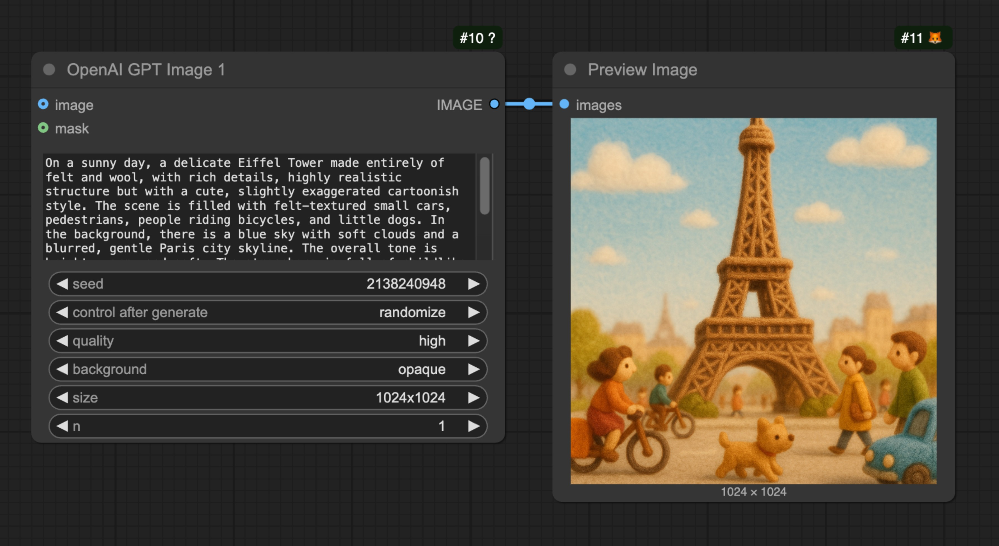
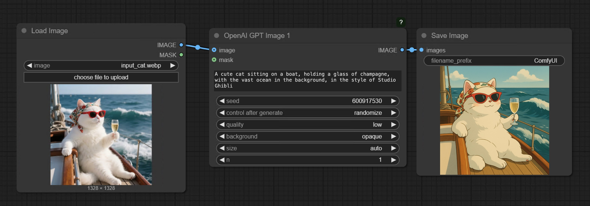
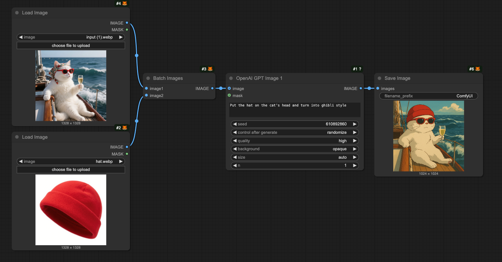
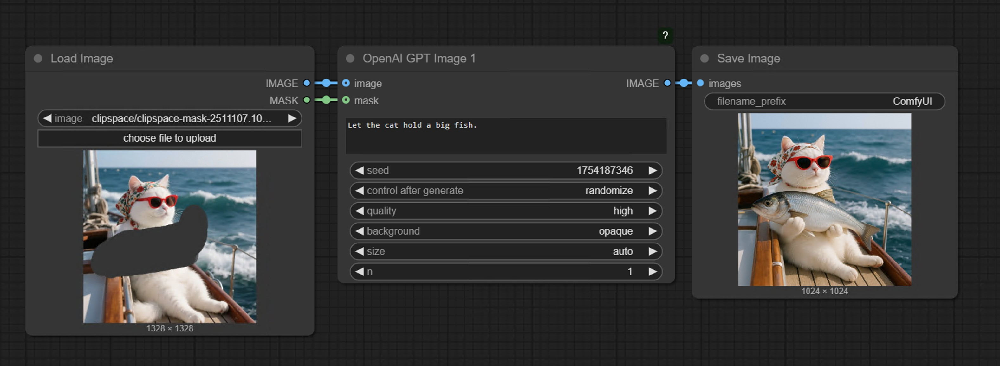

import Faq from "/snippets/ru/tutorials/partner-nodes/faq.mdx";
import ReqHint from "/snippets/ru/tutorials/partner-nodes/req-hint.mdx";
import UpdateReminder from "/snippets/ru/tutorials/update-reminder.mdx";

<Note>
Узел изображений OpenAI больше не предлагает `gpt-image-1`. Выберите `gpt-image-1.5` или более новую модель в поле `model` узла; шаги и параметры ниже по-прежнему применимы.
</Note>

На этой странице описан узел OpenAI GPT Image в ComfyUI: текст в изображение, одно референсное изображение, несколько референсных изображений и инпейтинг с маской, на моделях GPT Image, которые предлагает узел.

Узел **OpenAI GPT-Image-1** синхронно генерирует изображения через API генерации изображений OpenAI. Он принимает текстовые промпты и возвращает изображения, соответствующие описанию. Поле `model` узла выбирает модель GPT Image, начиная с `gpt-image-1.5`.

## Что GPT-Image-1 делает хорошо

- Генерация по принципу «текст в изображение»
- Редактирование изображений (инпейтинг с помощью масок)
- Генерация по принципу «изображение в изображение» на основе референсного изображения
- Ввод нескольких изображений: объединение нескольких референсных изображений в одну генерацию

## Примеры выходов

Генерация «текст в изображение» из одного текстового промпта:

Генерация «изображение в изображение» из исходного изображения:

Ввод нескольких изображений: объединение нескольких референсных изображений в одну генерацию:

Инпейтинг: замена области входного изображения, закрытой маской:

<ReqHint/>
<UpdateReminder/>

## Описание параметров

### Обязательные параметры

| Параметр | Тип | Описание                                                   |
|-----------|------|---------------------------------------------------------------|
| `prompt`  | Текст | Текстовый промпт, описывающий содержимое изображения, которое вы хотите сгенерировать |

### Параметры виджетов

| Параметр    | Тип     | Варианты                              | По умолчанию | Описание                                             |
|--------------|---------|---------------------------------------|---------|---------------------------------------------------------|
| `seed`       | Целое число | 0-2147483647                          | 0       | Случайный seed, используемый для управления результатами генерации |
| `quality`    | Вариант | low, medium, high                     | low     | Настройка качества изображения, влияет на стоимость и время генерации |
| `background` | Вариант | opaque, transparent                   | opaque  | Определяет, будет ли у возвращаемого изображения фон |
| `size`       | Вариант | auto, 1024x1024, 1024x1536, 1536x1024 | auto    | Размер сгенерированного изображения                 |
| `n`          | Целое число | 1-8                                   | 1       | Количество изображений для генерации                |

### Необязательные параметры

| Параметр | Тип  | Варианты         | По умолчанию | Описание                                                 |
|-----------|-------|-----------------|---------|-------------------------------------------------------------|
| `image`   | Изображение | Любой вход изображения | None    | Необязательное референсное изображение для редактирования |
| `mask`    | Маска  | Вход маски      | None    | Необязательная маска для инпейтинга (белые области будут заменены) |

## Примеры использования

### Пример: текст в изображение

На изображении ниже представлен простой рабочий процесс «текст в изображение». Скачайте изображение и перетащите его в ComfyUI, чтобы загрузить соответствующий рабочий процесс.

Соответствующий рабочий процесс очень прост:

Вам нужно только загрузить узел `OpenAI GPT-Image-1`, ввести описание изображения, которое вы хотите сгенерировать, в узле `prompt`, подключить узел `Save Image` и запустить рабочий процесс.

### Пример: изображение в изображение

На изображении ниже представлен простой рабочий процесс «изображение в изображение». Скачайте изображение и перетащите его в ComfyUI, чтобы загрузить соответствующий рабочий процесс.

В качестве входного изображения мы будем использовать изображение ниже:

В этом рабочем процессе мы используем узел `OpenAI GPT-Image-1` для генерации изображений и узел `Load Image` для загрузки входного изображения, а затем подключаем его ко входу `image` узла `OpenAI GPT-Image-1`.

### Пример с несколькими входными изображениями
Скачайте изображение ниже и перетащите его в ComfyUI, чтобы загрузить соответствующий рабочий процесс.

Используйте изображение шляпы ниже как дополнительное входное изображение.

Соответствующий рабочий процесс показан на изображении ниже:

Узел `Batch Images` используется для загрузки нескольких изображений в узел `OpenAI GPT-Image-1`.

### Рабочий процесс инпейтинга

GPT-Image-1 также поддерживает функцию редактирования изображений, позволяя указывать области для замены с помощью маски. Ниже приведен простой пример рабочего процесса инпейтинга:

Скачайте изображение ниже и перетащите его в ComfyUI, чтобы загрузить соответствующий рабочий процесс. Мы продолжим использовать входное изображение из раздела о рабочем процессе «изображение в изображение».

Соответствующий рабочий процесс показан на изображении

По сравнению с рабочим процессом «изображение в изображение» мы используем MaskEditor в узле `Load Image` через контекстное меню, чтобы нарисовать маску, а затем подключаем ее ко входу `mask` узла `OpenAI GPT-Image-1`, чтобы завершить рабочий процесс.

**Примечания**

- Маска и изображение должны быть одного размера.
- При вводе больших изображений узел автоматически изменит размер изображения до подходящего.

## Часто задаваемые вопросы

<Faq/>
