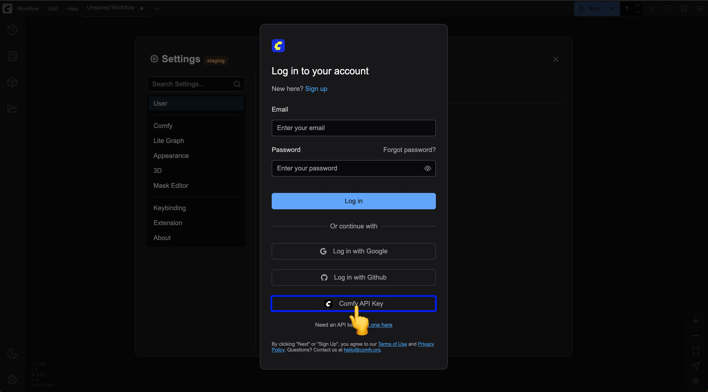

import Requirements from "/snippets/ru/tutorials/partner-nodes/requirements.mdx";
import Faq from "/snippets/ru/tutorials/partner-nodes/faq.mdx";

Партнёрские узлы: это новый способ вызова закрытых моделей в ComfyUI через API-запросы. Они дают пользователям ComfyUI доступ к внешним передовым AI-моделям без сложной настройки API-ключей.

<a id="api-nodes"></a>

## Что такое партнёрские узлы?

Партнёрские узлы представляют собой набор специальных узлов, которые подключаются к внешним API-сервисам, позволяя использовать модели ИИ с закрытым исходным кодом или размещённые у третьих сторон непосредственно в ваших рабочих процессах ComfyUI. Эти узлы созданы для того, чтобы бесшовно интегрировать возможности внешних моделей, сохраняя открытость ядра ComfyUI.

<Requirements/>

<a id="log-in-with-api-key-on-non-whitelisted-websites"></a>

## Войти с помощью API-ключа аккаунта ComfyUI на сайтах вне белого списка

Сейчас мы настроили белый список, который ограничивает сайты, где можно войти в аккаунт ComfyUI.
Если вам нужно войти в аккаунт ComfyUI на сайтах вне белого списка, обратитесь к разделу управления аккаунтом, чтобы узнать, как войти с помощью API-ключа.
В этом случае соответствующий сайт не обязательно должен быть в нашем белом списке.

<Card title="Управление аккаунтом" icon="book" href="/interface/user#logging-in-with-an-api-key">
Узнайте, как войти с помощью API-ключа аккаунта ComfyUI
</Card>



## Использовать интеграцию с API-ключом аккаунта ComfyUI для вызова платных Партнёрских узлов моделей {#use-comfyui-account-api-key-integration-to-call-paid-model-partner-nodes}

Сейчас мы поддерживаем доступ к нашим сервисам через интеграцию с API-ключом ComfyUI для вызова платных Партнёрских узлов моделей. Обратитесь к разделу «Интеграция с API-ключом», чтобы узнать, как использовать интеграцию с API-ключом для вызова платных Партнёрских узлов моделей.

<Note>
  **Важно:** API-ключ, о котором здесь идёт речь, это ваш **API-ключ аккаунта ComfyUI** (используется для доступа к платным Партнёрским узлам в рабочих процессах). Это **НЕ** то же самое, что **API-ключ для публикации в реестре**, который разработчики используют для публикации пользовательских узлов в реестре. Если вы хотите опубликовать пользовательские узлы, см. [Публикация узлов](/registry/publishing).
</Note>

<Card title="Интеграция с API-ключом" icon="link" href="/development/comfyui-server/api-key-integration">
Обратитесь к разделу «Интеграция с API-ключом», чтобы узнать, как использовать интеграцию с API-ключом для вызова платных Партнёрских узлов моделей
</Card>

## Преимущества партнёрских узлов

Партнёрские узлы дают пользователям ComfyUI несколько важных преимуществ:

- **Доступ к закрытым моделям**: используйте передовые ИИ-модели, не разворачивая их самостоятельно
- **Бесшовная интеграция**: партнёрские узлы полностью совместимы с другими узлами ComfyUI и могут комбинироваться для создания сложных рабочих процессов
- **Простота использования**: не нужно управлять ключами API или обрабатывать сложные запросы API
- **Контроль расходов**: предоплатная система обеспечивает полный контроль над расходами без неожиданных списаний

## Цены

<Card title="Цены партнёрских узлов" icon="coin" href="/tutorials/partner-nodes/pricing">
Обратитесь к странице с ценами, чтобы узнать стоимость для соответствующего партнёра.
</Card>

## Провайдеры моделей

<Card title="Провайдеры моделей" icon="badge-check" href="/tutorials/partner-nodes/model-providers">
Смотрите статус верификации, коммерческое лицензирование и размещение данных для провайдеров моделей, стоящих за Партнёрскими узлами
</Card>

## Об открытом исходном коде и opt-in

Важно отметить, что **партнёрские узлы полностью опциональны**. ComfyUI всегда будет оставаться проектом с полностью открытым исходным кодом и будет бесплатным для локальных пользователей. Партнёрские узлы задуманы как функция «opt-in», обеспечивающая удобство тем, кто хочет получить доступ к внешним передовым моделям (SOTA).

## Как полностью отключить партнёрские узлы

Вы можете добавить аргумент запуска `--disable-partner-nodes`, чтобы отключить все партнёрские узлы в ComfyUI. Используйте `--offline`, если также хотите запретить фронтенду обращаться к интернету.

**При ручной установке:**

```bash
python main.py --disable-partner-nodes
```

**Для пользователей портативной версии (Windows):**

Обновите файл `run_xxx.bat`:

```batch
.\python_embeded\python.exe -s ComfyUI\main.py --listen --windows-standalone-build --disable-partner-nodes
pause
```


## Сценарии использования

Одно из мощных применений партнёрских узлов: сочетание результатов работы внешних моделей с локальными узлами. Например:

- использование GPT-Image-1 для генерации базового изображения с последующим преобразованием его в видео с помощью локального узла `wan`
- объединение сгенерированных извне изображений с локальными узлами увеличения разрешения или переноса стиля
- создание гибридных рабочих процессов, использующих преимущества как закрытых, так и открытых моделей

Такая гибкость делает ComfyUI по-настоящему универсальным интерфейсом генеративного ИИ: он объединяет разные возможности ИИ в единый рабочий процесс и открывает ещё больше возможностей.

## Часто задаваемые вопросы

<Faq/>
