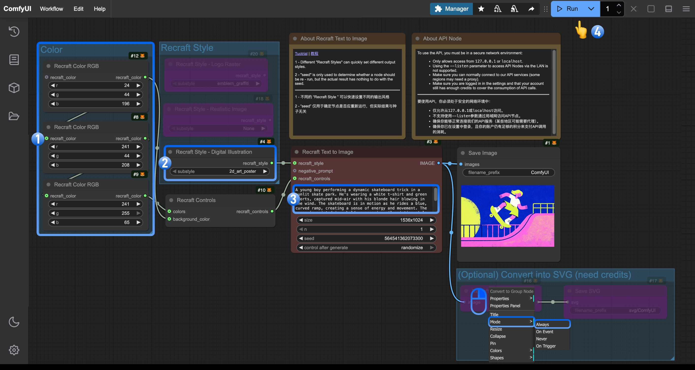

import ReqHint from "/snippets/ru/tutorials/partner-nodes/req-hint.mdx";
import UpdateReminder from "/snippets/ru/tutorials/update-reminder.mdx";

Узел Recraft Text to Image позволяет создавать высококачественные изображения в различных стилях с помощью технологии генерации изображений Recraft AI на основе текстовых описаний.

## Что умеет Recraft Text to Image

- **Высокое качество генерации**: создаёт изображения по текстовым описаниям с помощью технологии генерации изображений Recraft AI
- **Управление стилем**: готовые стили, такие как цифровое искусство, реалистичные фотографии и дизайн логотипов, через узел `Recraft Style`
- **Управление цветом**: задайте нужный цвет с помощью узла `Recraft Color RGB`
- **Настраиваемый размер вывода**: измените параметр `size`, чтобы управлять размерами результата
- **Преобразование в SVG**: опциональный узел `Recraft Vectorize Image` преобразует сгенерированное изображение в формат SVG

<ReqHint/>
<UpdateReminder/>

## Рабочий процесс с партнёрскими узлами Recraft Text to Image

### 1. Скачать файл рабочего процесса

Информация о рабочем процессе включена в метаданные изображения ниже. Скачайте его и перетащите в ComfyUI, чтобы загрузить рабочий процесс.

### 2. Выполнить шаги для запуска рабочего процесса

Выполните следующие шаги, чтобы запустить базовый рабочий процесс:
1. (Необязательно) Измените `Recraft Color RGB` в узле `Color` на нужный вам цвет
2. (Необязательно) Измените узел `Recraft Style`, чтобы управлять визуальным стилем, например цифровое искусство, реалистичное фото или дизайн логотипа. В эту группу входят другие узлы стилей, которые можно включить при необходимости
3. (Необязательно) Отредактируйте параметр `prompt` в узле `Recraft Text to Image`. Также можно изменить параметр `size`
4. Нажмите кнопку `Run` или используйте сочетание клавиш `Ctrl(cmd) + Enter`, чтобы сгенерировать изображение
5. После того как API вернёт результат, вы можете просмотреть сгенерированное изображение в узле `Save Image`. Изображение также сохранится в каталог `ComfyUI/output/`

> (Необязательно) В рабочий процесс включена группа **Convert to SVG**. Поскольку узел `Recraft Vectorize Image` в этой группе расходует дополнительные кредиты, включайте его только тогда, когда нужно преобразовать сгенерированное изображение в формат SVG

### 3. Дополнительные примечания

- **Recraft Style**: предлагает различные готовые стили, такие как реалистичные фотографии, цифровое искусство и дизайн логотипов
- **Параметр seed**: используется только для определения того, должен ли узел запуститься снова. На фактический результат генерации значение seed не влияет