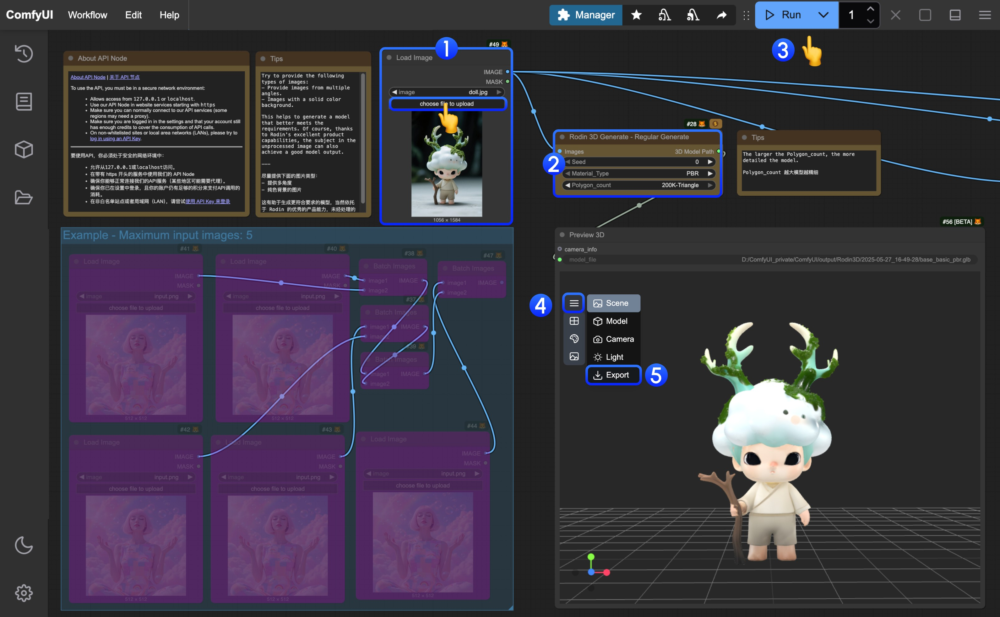
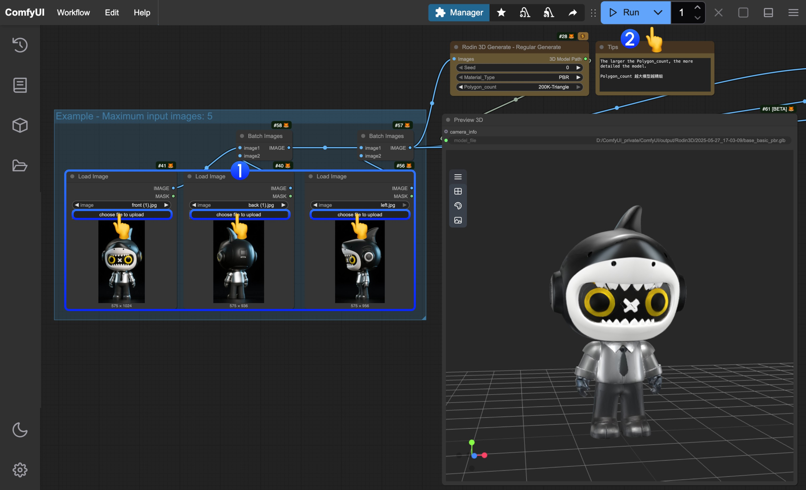
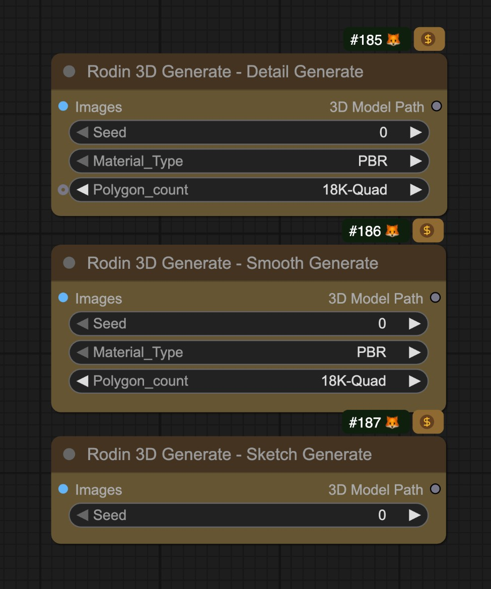

import ReqHint from "/snippets/ru/tutorials/partner-nodes/req-hint.mdx";
import UpdateReminder from "/snippets/ru/tutorials/update-reminder.mdx";

Hyper3D Rodin (hyper3d.ai) представляет собой платформу для быстрой генерации высококачественных 3D-моделей и материалов, готовых к производству, с помощью искусственного интеллекта.
ComfyUI теперь нативно интегрировал соответствующий API генерации моделей Rodin, что позволяет удобно использовать связанные узлы в ComfyUI для генерации моделей.

## Для чего хорошо подходит Rodin Model Generation

- **Генерация 3D-модели по одному изображению**: создаёт 3D-модель на основе одного входного изображения
- **Генерация 3D-модели по нескольким видам**: создаёт 3D-модель на основе до 5 входных изображений, например видов спереди, сзади и слева
- **Различные уровни детализации**: поддерживает генерацию моделей с настраиваемой детализацией, включая разное число полигонов для более гладких и детализированных моделей
- **Прямой экспорт**: сгенерированные модели сохраняются в каталог `ComfyUI/output/Rodin` и могут быть экспортированы из узла `Preview 3D`

<ReqHint/>
<UpdateReminder/>

## Рабочий процесс генерации модели по одному изображению {#single-view-model-generation-workflow}

Создайте 3D-модель по одному изображению с помощью Rodin.

<CardGroup cols={2}>
  <Card title="Скачать файл рабочего процесса" icon="download" href="https://raw.githubusercontent.com/Comfy-Org/example_workflows/refs/heads/main/api_nodes/rodin/rodin_image_to_model.json">
    Генерация модели по одному изображению (формат Json)
  </Card>
  <Card title="Запустить в Comfy Cloud" icon="cloud" href="https://cloud.comfy.org/?template=api_rodin_image_to_model&utm_source=docs&utm_medium=referral&utm_campaign=model-generation">
    Открыть в Comfy Cloud
  </Card>
</CardGroup>

Входные материалы

Скачайте этот пример входного изображения, чтобы попробовать рабочий процесс:

<CardGroup cols={1}>
  <Card title="Входное изображение" icon="image" href="https://raw.githubusercontent.com/Comfy-Org/workflow_templates/main/input/api_rodin_image_to_model_input_image.png">
    Скачать пример входного изображения
  </Card>
</CardGroup>

### 2. Выполните рабочий процесс шаг за шагом

Ориентируясь на номера на изображении, можно выполнить базовый рабочий процесс текст в изображение:
1. В узле `Load Image` загрузите предоставленное входное изображение.
2. (Необязательно) В `Rodin 3D Generate - Regular Generate` настройте соответствующие параметры.
   - polygon_count: можно задать разное количество полигонов; чем выше значение, тем более гладкой и детализированной будет модель.
3. Нажмите кнопку `Run` или используйте сочетание клавиш `Ctrl(cmd) + Enter`, чтобы выполнить генерацию модели. После завершения рабочего процесса соответствующая модель будет автоматически сохранена в каталог `ComfyUI/output/Rodin`.
4. В узле `Preview 3D` нажмите, чтобы развернуть меню.
5. Выберите `Export`, чтобы напрямую экспортировать соответствующую модель.

## Рабочий процесс генерации модели по нескольким видам

Соответствующий узел `Rodin 3D Generate - Regular Generate` поддерживает до 5 входных изображений.

### 1. Скачать файл рабочего процесса

Вы можете изменить рабочий процесс с одним видом на рабочий процесс с несколькими видами или сразу скачать файл рабочего процесса ниже.

<CardGroup cols={2}>
  <Card title="Скачать файл рабочего процесса" icon="download" href="https://raw.githubusercontent.com/Comfy-Org/example_workflows/refs/heads/main/api_nodes/rodin/multiview_to_model/api_rodin_multiview_to_model.json">
    Генерация модели по нескольким видам (формат JSON)
  </Card>
  <Card title="Запустить в Comfy Cloud" icon="cloud" href="https://cloud.comfy.org/?template=api_rodin_multiview_to_model&utm_source=docs&utm_medium=referral&utm_campaign=model-generation">
    Открыть в Comfy Cloud
  </Card>
</CardGroup>

Входные материалы

Скачайте эти примеры входных изображений, чтобы попробовать рабочий процесс:

<CardGroup cols={3}>
  <Card title="Вид спереди" icon="image" href="https://raw.githubusercontent.com/Comfy-Org/workflow_templates/main/input/api_rodin_multiview_to_model_front.jpg">
    Скачать вид спереди
  </Card>
  <Card title="Вид сзади" icon="image" href="https://raw.githubusercontent.com/Comfy-Org/workflow_templates/main/input/api_rodin_multiview_to_model_back.jpg">
    Скачать вид сзади
  </Card>
  <Card title="Вид слева" icon="image" href="https://raw.githubusercontent.com/Comfy-Org/workflow_templates/main/input/api_rodin_multiview_to_model_left.jpg">
    Скачать вид слева
  </Card>
</CardGroup>

### 2. Выполнить рабочий процесс шаг за шагом

Ориентируйтесь на номера на изображении, чтобы выполнить базовый рабочий процесс «текст в изображение»:  
1. В узле `Load Image` загрузите предоставленные входные изображения
2. Нажмите кнопку `Run` или используйте сочетание клавиш `Ctrl(cmd) + Enter`, чтобы выполнить генерацию модели. После завершения рабочего процесса соответствующая модель будет автоматически сохранена в каталог `ComfyUI/output/Rodin`
3. В узле `Preview 3D` нажмите, чтобы развернуть меню
4. Выберите `Export`, чтобы сразу экспортировать соответствующую модель

## Другие связанные узлы

В настоящее время Rodin предоставляет в ComfyUI различные типы узлов генерации моделей. Поскольку соответствующие входные условия совпадают с рабочим процессом, описанным в этой статье, вы можете включать их по мере необходимости. Кроме того, мы предусмотрели соответствующие узлы в соответствующих шаблонах: вы также можете изменить режим соответствующего узла при необходимости, чтобы включить их.

