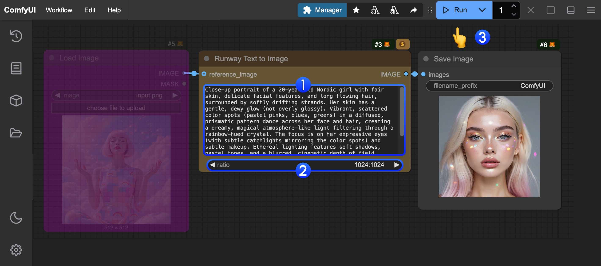
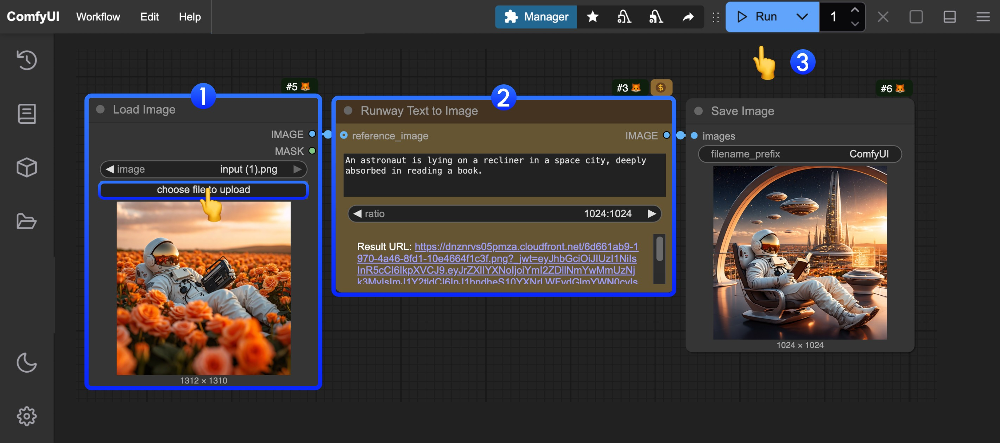

import ReqHint from "/snippets/ru/tutorials/partner-nodes/req-hint.mdx";
import UpdateReminder from "/snippets/ru/tutorials/update-reminder.mdx";

Runway это компания, специализирующаяся на генеративном ИИ и предоставляющая мощные возможности генерации изображений. Её модели поддерживают такие функции, как перенос стиля, расширение изображения и управление детализацией. Сейчас ComfyUI интегрировал API Runway, поэтому вы можете напрямую использовать соответствующие узлы в ComfyUI для генерации изображений.

## Для чего хорошо подходит Runway Image Generation

- **Генерация изображений из текста**: создаёт изображения по текстовому промпту с помощью узла `Runway Text to Image`, с настраиваемыми соотношениями сторон выходного изображения
- **Генерация по референсному изображению**: создаёт изображения на основе входного референсного изображения и текстового промпта
- **Перенос стиля, расширение изображения и управление деталями**: модели Runway поддерживают эти возможности для генерации изображений

<ReqHint/>
<UpdateReminder/>

## Рабочий процесс Runway: текст в изображение

### 1. Скачать файл рабочего процесса

Изображение ниже содержит информацию о рабочем процессе в `metadata`. Скачайте его и перетащите в ComfyUI, чтобы загрузить соответствующий рабочий процесс.

### 2. Выполнить рабочий процесс по шагам

Ориентируйтесь на номера на изображении, чтобы выполнить базовый рабочий процесс генерации изображения по тексту:
1. В узле `Runway Text to Image` введите промпт в поле `prompt`
2. (Необязательно) Настройте параметр `ratio`, чтобы задать другое соотношение сторон выходного изображения
3. Нажмите кнопку `Run` или используйте сочетание клавиш `Ctrl(cmd) + Enter`, чтобы выполнить генерацию изображения.
4. После того как API вернёт результаты, вы можете просмотреть сгенерированное изображение в узле `Save Image` (щелкните правой кнопкой мыши, чтобы сохранить). Соответствующее изображение также будет сохранено в каталог `ComfyUI/output/`.

## Рабочий процесс Runway: изображение по референсу

### 1. Скачивание рабочего процесса и входного изображения

Изображение ниже содержит информацию о рабочем процессе в `metadata`. Скачайте его и перетащите в ComfyUI, чтобы загрузить соответствующий рабочий процесс.

Скачайте изображение ниже для использования в качестве входного.

### 2. Пошаговое выполнение рабочего процесса

Чтобы выполнить базовый рабочий процесс генерации изображения по референсу, ориентируйтесь на номера на изображении:

1. В узле `Load Image` загрузите предоставленное входное изображение.
2. В узле `Runway Text to Image` введите промпт в поле `prompt` и настройте размеры.
3. Нажмите кнопку `Run` или используйте сочетание клавиш `Ctrl(cmd) + Enter`, чтобы запустить генерацию изображения.
4. После того как API вернёт результаты, сгенерированное изображение можно просмотреть в узле `Save Image` (щелкните правой кнопкой мыши, чтобы сохранить). Соответствующее изображение также будет сохранено в каталог `ComfyUI/output/`.
