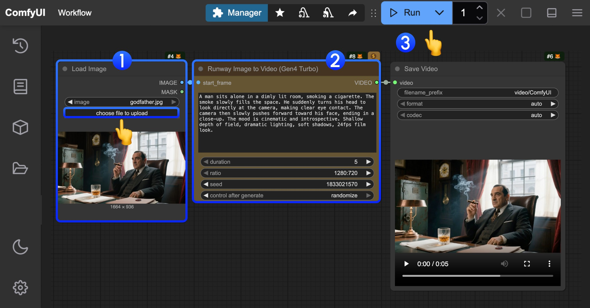

import ReqHint from "/snippets/ru/tutorials/partner-nodes/req-hint.mdx";
import UpdateReminder from "/snippets/ru/tutorials/update-reminder.mdx";

Runway: компания, специализирующаяся на генеративном ИИ и предоставляющая мощные возможности генерации видео. Сейчас ComfyUI интегрировал API Runway, поэтому вы можете напрямую использовать соответствующие узлы в ComfyUI для генерации видео.

Сейчас ComfyUI нативно поддерживает следующие модели генерации видео Runway:
- Runway Gen4 turbo

<Warning>
  **End of life (EOL)**: **Runway Gen3a Turbo** и **Runway First-Last-Frame to Video** достигли конца жизненного цикла **30 июля 2026 года**. В этот день Runway вывела Gen-3 Alpha Turbo из эксплуатации. Связанные Партнёрские узлы (`RunwayImageToVideoNodeGen3a`, `RunwayFirstLastFrameNode`) и шаблоны рабочих процессов устарели и больше не поддерживаются.
</Warning>

## В чём сильные стороны Runway Video Generation

- **Генерация видео из изображения**: узел `Runway Gen4 turbo` создаёт видео из входного изображения и текстового промпта, описывающего содержимое видео
- **Настраиваемая длительность видео**: измените параметр `duration`, чтобы задать длительность видео
- **Настраиваемое соотношение сторон**: измените параметр `ratio`, чтобы задать соотношение сторон видео

<Warning>
  **Прекращение поддержки (EOL)**: **Runway Gen3a Turbo** и **Runway First-Last-Frame to Video** были сняты с поддержки **30 июля 2026 года**. В этот день Runway прекратила поддержку Gen-3 Alpha Turbo. Соответствующие партнёрские узлы (`RunwayImageToVideoNodeGen3a`, `RunwayFirstLastFrameNode`) и шаблоны рабочих процессов устарели и больше не поддерживаются.
</Warning>

### Устаревшие рабочие процессы и замены

| Удалённый шаблон | Рекомендуемая замена |
| :--------------- | :-------------------- |
| `api_runway_gen3a_turbo_image_to_video` | [`api_runway_gen4_turbo_image_to_video`](https://github.com/Comfy-Org/workflow_templates/blob/main/templates/api_runway_gen4_turbo_image_to_video.json) (Gen4 Turbo) |
| `api_runway_first_last_frame` | [Kling 3.0 FLF2V](/ru/tutorials/partner-nodes/kling/kling-3-0) (`api_kling_v3_flf2v`) или другие шаблоны для генерации по первому и последнему кадру |

<ReqHint/>
<UpdateReminder/>

## Рабочий процесс Gen4 turbo Image-to-Video

### 1. Скачивание файла рабочего процесса

Видео ниже содержит информацию о рабочем процессе в своих `metadata`. Скачайте его и перетащите в ComfyUI, чтобы загрузить соответствующий рабочий процесс.

<video
  controls
  className="w-full aspect-video"
  src="https://raw.githubusercontent.com/Comfy-Org/example_workflows/refs/heads/main/api_nodes/runway/gen4_turbo_image_to_video/runway_gen4_turo_image_to_video.mp4"
></video>

<a className="prose"  target='_blank'  href="https://raw.githubusercontent.com/Comfy-Org/example_workflows/refs/heads/main/api_nodes/runway/gen4_turbo_image_to_video/runway_gen4_turo_image_to_video.json" style={{ display: 'inline-block', backgroundColor: '#0078D6', color: '#ffffff', padding: '10px 20px', borderRadius: '8px', borderColor: "transparent", textDecoration: 'none', fontWeight: 'bold'}}>
    
Скачать файл рабочего процесса в формате Json

</a>

Скачайте изображение ниже и используйте его как входное изображение

### 2. Выполните рабочий процесс шаг за шагом

Можете ориентироваться на номера на изображении, чтобы выполнить базовый рабочий процесс «изображение в видео»:

1. В узле `Load Image` загрузите предоставленное входное изображение
2. В узле `Runway Gen4 turbo` задайте `prompt` с описанием содержимого видео, измените параметр `duration`, чтобы задать длительность видео, и параметр `ratio`, чтобы задать соотношение сторон видео
3. Нажмите кнопку `Run` или используйте сочетание клавиш `Ctrl(cmd) + Enter`, чтобы выполнить генерацию видео.
4. После того как API вернёт результаты, вы сможете просмотреть сгенерированное видео в узле `Save Video` (правый клик для сохранения). Соответствующее видео также будет сохранено в каталог `ComfyUI/output/`.
