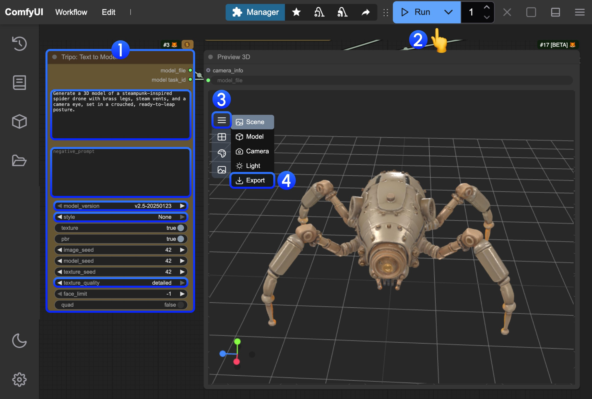
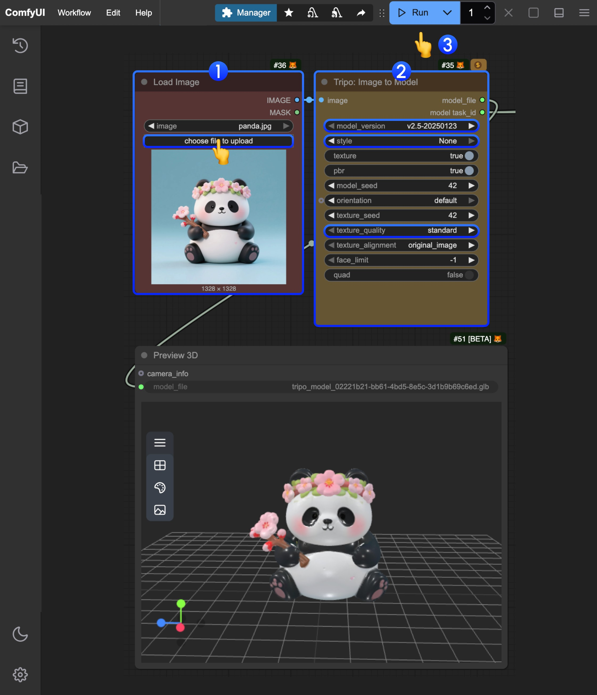
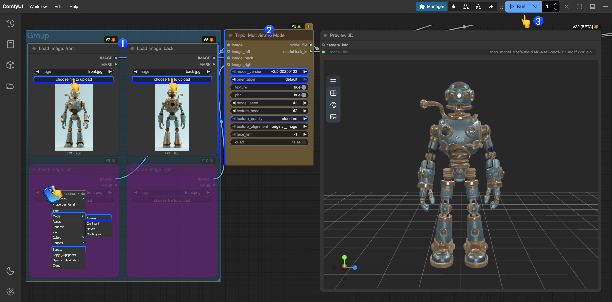
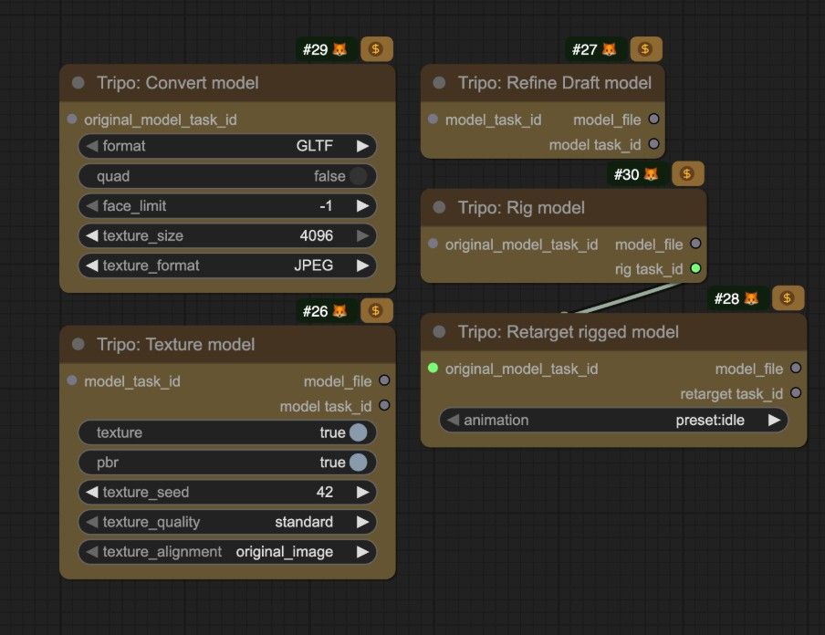

import ReqHint from "/snippets/ru/tutorials/partner-nodes/req-hint.mdx";
import UpdateReminder from "/snippets/ru/tutorials/update-reminder.mdx";

Tripo AI специализируется на генеративном 3D-моделировании с помощью ИИ. Компания предоставляет удобные платформы и сервисы API, которые позволяют быстро преобразовывать текстовые промпты или 2D-изображения (одно или несколько) в высококачественные 3D-модели.
В ComfyUI теперь нативно интегрирован соответствующий API Tripo, что позволяет удобно использовать связанные с ним узлы в ComfyUI для генерации моделей.

## Что умеет Tripo Model Generation

Сейчас партнёрские узлы ComfyUI поддерживают следующие возможности генерации моделей Tripo:
- Текст в модель
- Изображение в модель
- Генерация модели по нескольким ракурсам
- Создание риг-модели
- Ретаргетинг риг-модели

<ReqHint/>
<UpdateReminder/>

## Рабочий процесс Text-to-Model

Сгенерируйте 3D-модель по текстовому промпту с помощью возможностей Tripo «текст в модель».

<CardGroup cols={2}>
  <Card title="Запустить Text-to-Model в облаке" icon="cloud" href="https://cloud.comfy.org/?template=api_tripo_text_to_model&utm_source=docs&utm_medium=referral&utm_campaign=model-generation">
    Попробуйте рабочий процесс Text-to-Model сразу в Comfy Cloud.
  </Card>
  <Card title="Скачать рабочий процесс Text-to-Model" icon="download" href="https://raw.githubusercontent.com/Comfy-Org/example_workflows/refs/heads/main/api_nodes/tripo/api_tripo_text_to_model.json">
    Скачайте JSON, чтобы запустить его локально в ComfyUI.
  </Card>
</CardGroup>

### 2. Выполните рабочий процесс по шагам

Ориентируйтесь на номера на изображении, чтобы выполнить базовый рабочий процесс «текст в модель»:  
1. В узле `Tripo: Text to Model` введите промпт в поле `prompt`
   - model: можно выбрать разные модели
   - style: можно задать разные стили
   - texture_quality: можно задать разное качество текстуры
2. Нажмите кнопку `Run` или используйте сочетание клавиш `Ctrl(cmd) + Enter`, чтобы выполнить генерацию модели. После завершения рабочего процесса соответствующая модель автоматически сохранится в каталог `ComfyUI/output/`
3. В узле `Preview 3D` нажмите, чтобы развернуть меню
4. Выберите `Export`, чтобы сразу экспортировать соответствующую модель

## Рабочий процесс Image-to-Model

Генерируйте 3D-модель по одному входному изображению.

<CardGroup cols={2}>
  <Card title="Запустить Image-to-Model в облаке" icon="cloud" href="https://cloud.comfy.org/?template=api_tripo_image_to_model&utm_source=docs&utm_medium=referral&utm_campaign=model-generation">
    Попробуйте рабочий процесс Image-to-Model прямо сейчас в Comfy Cloud.
  </Card>
  <Card title="Скачать рабочий процесс Image-to-Model" icon="download" href="https://raw.githubusercontent.com/Comfy-Org/example_workflows/refs/heads/main/api_nodes/tripo/image_to_model/api_tripo_image_to_model.json">
    Скачайте JSON, чтобы запустить его локально в ComfyUI.
  </Card>
</CardGroup>

Входные материалы

Скачайте этот пример входного изображения, чтобы попробовать рабочий процесс:

<CardGroup cols={1}>
  <Card title="Входное изображение" icon="image" href="https://raw.githubusercontent.com/Comfy-Org/workflow_templates/main/input/api_tripo_image_to_model_input_image.jpg">
    Скачать пример входного изображения
  </Card>
</CardGroup>

### 2. Выполните рабочий процесс шаг за шагом

Ориентируйтесь на номера на изображении, чтобы выполнить базовый рабочий процесс image-to-model:  
1. В узле `Load Image` загрузите предоставленное входное изображение
2. В узле `Tripo: Image to Model` измените соответствующие настройки параметров
   - model: можно выбрать разные модели
   - style: можно задать разные стили
   - texture_quality: можно задать разное качество текстуры
3. Нажмите кнопку `Run` или используйте сочетание клавиш `Ctrl(cmd) + Enter`, чтобы выполнить генерацию модели. После завершения рабочего процесса соответствующая модель будет автоматически сохранена в каталог `ComfyUI/output/`
4. Инструкции по скачиванию модели см. в разделе text-to-model

## Рабочий процесс генерации модели по нескольким видам

Генерируйте 3D-модель по изображениям нескольких видов для повышенной точности.

<CardGroup cols={2}>
  <Card title="Запустить Multiview-to-Model в облаке" icon="cloud" href="https://cloud.comfy.org/?template=api_tripo_multiview_to_model&utm_source=docs&utm_medium=referral&utm_campaign=model-generation">
    Попробуйте рабочий процесс Multiview-to-Model сразу в Comfy Cloud.
  </Card>
  <Card title="Скачать рабочий процесс Multiview-to-Model" icon="download" href="https://raw.githubusercontent.com/Comfy-Org/example_workflows/refs/heads/main/api_nodes/tripo/multiview_to_image/api_tripo_multiview_to_model.json">
    Скачайте JSON, чтобы запустить его локально в ComfyUI.
  </Card>
</CardGroup>

Входные материалы

Скачайте эти примеры входных изображений, чтобы опробовать рабочий процесс:

<CardGroup cols={2}>
  <Card title="Вид спереди" icon="image" href="https://raw.githubusercontent.com/Comfy-Org/workflow_templates/main/input/api_tripo_multiview_to_model_front_image.jpg">
    Скачать входное изображение вида спереди
  </Card>
  <Card title="Вид сзади" icon="image" href="https://raw.githubusercontent.com/Comfy-Org/workflow_templates/main/input/api_tripo_multiview_to_model_back_image.jpg">
    Скачать входное изображение вида сзади
  </Card>
</CardGroup>

### 2. Выполните рабочий процесс по шагам

Можно ориентироваться на номера на изображении, чтобы выполнить базовый рабочий процесс генерации модели по нескольким видам:
1. В узлах `Load Image` загрузите предоставленные входные изображения соответственно
2. В узле `Tripo: Image to Model` измените соответствующие настройки параметров
   - model: можно выбрать разные модели
   - style: можно задать разные стили
   - texture_quality: можно задать разное качество текстуры
3. Нажмите кнопку `Run` или используйте сочетание клавиш `Ctrl(cmd) + Enter`, чтобы выполнить генерацию модели. После завершения рабочего процесса соответствующая модель будет автоматически сохранена в каталог `ComfyUI/output/`
4. Для других входных видов можно обратиться к схеме шагов и установить соответствующий режим узла в `Always`, чтобы включить его
5. О том, как скачать модель, см. инструкции в разделе генерации модели по тексту

## Последующая обработка той же задачи

Соответствующие узлы Tripo обеспечивают последующую обработку для одной и той же задачи. Вам достаточно указать соответствующий `model_task_id` в нужных узлах. Мы также предусмотрели соответствующие узлы в соответствующих шаблонах. Кроме того, при необходимости вы можете изменить режим соответствующего узла, чтобы включить его.

<Note>
  Сгенерированные модели скачиваются в ваш выходной каталог сразу после завершения задачи, поэтому файл модели сохраняется независимо от Tripo. А идентификаторы задач не сохраняются. Tripo хранит запись о задаче в течение 7 дней после её завершения (действует с 1 декабря 2026 года), поэтому повторный запуск сохранённого рабочего процесса более чем через 7 дней со старым `model_task_id` завершится ошибкой в узле последующей обработки. Чтобы продолжить, подключите `Tripo: Import Model` к файлу модели в вашем выходном каталоге и используйте его новый `model_task_id`.
</Note>
