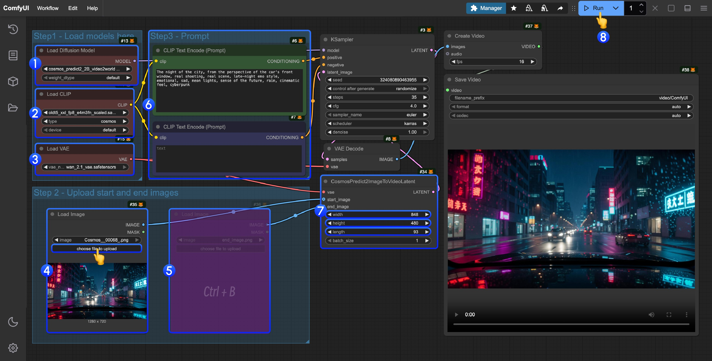

import UpdateReminder from "/snippets/ru/tutorials/update-reminder.mdx"

Cosmos-Predict2 это фундаментальная модель физического мира нового поколения от NVIDIA, специально разработанная для задач высококачественной визуальной генерации и предсказания в сценариях физического ИИ.
Модель обладает исключительной физической точностью, интерактивностью с окружающей средой и способностью воспроизводить детали, что позволяет реалистично симулировать сложные физические явления и динамичные сцены.

Cosmos-Predict2 поддерживает различные методы генерации, включая текст в изображение (Text2Image) и видео в мир (Video2World),
и широко используется в промышленном моделировании, автономном вождении, городском планировании, научных исследованиях и других областях.
Она служит важнейшим базовым инструментом для глубокой интеграции интеллектуального зрения и физического мира.

<CardGroup cols={2}>
  <Card title="GitHub" icon="github" href="https://github.com/nvidia-cosmos/cosmos-predict2">
    Исходный код и документация Cosmos-Predict2
  </Card>
  <Card title="Hugging Face" icon="cube" href="https://huggingface.co/collections/nvidia/cosmos-predict2-68028efc052239369a0f2959">
    Коллекция моделей Cosmos-Predict2
  </Card>
</CardGroup>

Это руководство поможет вам выполнить генерацию **Video2World** в ComfyUI.

Раздел о генерации изображений по тексту см. здесь:

<CardGroup cols={2}>
  <Card title="Cosmos Predict2: текст в изображение" icon="book" href="/ru/tutorials/image/cosmos/cosmos-predict2-t2i">
    Использование Cosmos-Predict2 для генерации изображений по тексту
  </Card>
  <Card title="Запустить в Comfy Cloud" icon="cloud" href="https://comfy.org/cloud">
    Запускайте рабочие процессы Cosmos-Predict2 в Comfy Cloud на мощных GPU
  </Card>
</CardGroup>

<UpdateReminder/>

## Рабочий процесс Cosmos Predict2 Video2World

При тестировании версии 2B требуется около 16 ГБ видеопамяти.

### 1. Файл рабочего процесса

Скачайте видео ниже и перетащите его в ComfyUI, чтобы загрузить рабочий процесс. В рабочий процесс уже встроены ссылки на скачивание моделей.

<video
  controls
  className="w-full aspect-video"
  src="https://raw.githubusercontent.com/Comfy-Org/example_workflows/refs/heads/main/video/cosmos/predict2/cosmos_predict2_2B_video2world_480p_16fps.mp4"
></video>

<CardGroup cols={2}>
  <Card title="Запустить в Comfy Cloud" icon="cloud" href="https://comfy.org/cloud">
    Запустите этот рабочий процесс в Comfy Cloud с предустановленными моделями
  </Card>
  <Card title="Скачать файл рабочего процесса" icon="download" href="https://raw.githubusercontent.com/Comfy-Org/example_workflows/refs/heads/main/video/cosmos/predict2/cosmos_predict2_2B_video2world_480p_16fps.json">
    Скачайте файл рабочего процесса в формате JSON
  </Card>
</CardGroup>

Скачайте следующее изображение для входа:


### 2. Ручная установка моделей

Если скачивание модели не удалось, в этом разделе вы можете попробовать скачать их вручную.

**Модель диффузии**

<Card title="Модель диффузии" icon="download" href="https://huggingface.co/Comfy-Org/Cosmos_Predict2_repackaged/blob/main/cosmos_predict2_2B_video2world_480p_16fps.safetensors">
  cosmos_predict2_2B_video2world_480p_16fps.safetensors
</Card>
Другие веса можно скачать на странице [Cosmos_Predict2_repackaged](https://huggingface.co/Comfy-Org/Cosmos_Predict2_repackaged).

**Текстовый энкодер**

<Card title="Текстовый энкодер" icon="download" href="https://huggingface.co/comfyanonymous/cosmos_1.0_text_encoder_and_VAE_ComfyUI/blob/main/text_encoders/oldt5_xxl_fp8_e4m3fn_scaled.safetensors">
  oldt5_xxl_fp8_e4m3fn_scaled.safetensors
</Card>
**VAE**

<Card title="VAE" icon="download" href="https://huggingface.co/Comfy-Org/Wan_2.1_ComfyUI_repackaged/blob/main/split_files/vae/wan_2.1_vae.safetensors">
  wan_2.1_vae.safetensors
</Card>
Расположение файлов
```
📂 ComfyUI/
├──📂 models/
│   ├── 📂 diffusion_models/
│   │   └─── cosmos_predict2_2B_video2world_480p_16fps.safetensors
│   ├── 📂 text_encoders/
│   │   └─── oldt5_xxl_fp8_e4m3fn_scaled.safetensors
│   └── 📂 vae/
│       └──  wan_2.1_vae.safetensors
```

### 3. Выполнить рабочий процесс по шагам



Выполните шаги на изображении, чтобы запустить рабочий процесс:
1. Убедитесь, что узел `Load Diffusion Model` загрузил `cosmos_predict2_2B_video2world_480p_16fps.safetensors`
2. Убедитесь, что узел `Load CLIP` загрузил `oldt5_xxl_fp8_e4m3fn_scaled.safetensors`
3. Убедитесь, что узел `Load VAE` загрузил `wan_2.1_vae.safetensors`
4. Загрузите предоставленное входное изображение в узле `Load Image`
5. (Необязательно) Если нужен контроль первого и последнего кадра, используйте сочетание `Ctrl(cmd) + B`, чтобы включить ввод последнего кадра
6. (Необязательно) Вы можете изменить промпты в узле `ClipTextEncode`
7. (Необязательно) Измените размер и количество кадров в узле `CosmosPredict2ImageToVideoLatent`
8. Нажмите кнопку `Run` или используйте сочетание `Ctrl(cmd) + Enter`, чтобы запустить рабочий процесс
9. После завершения генерации видео автоматически сохранится в каталог `ComfyUI/output/`, вы также можете просмотреть его в узле `save video`