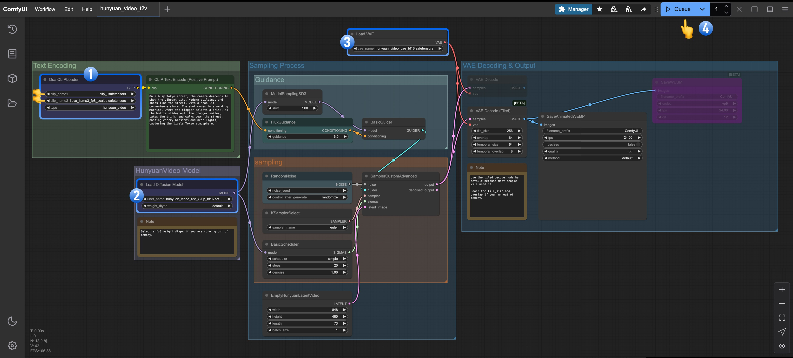
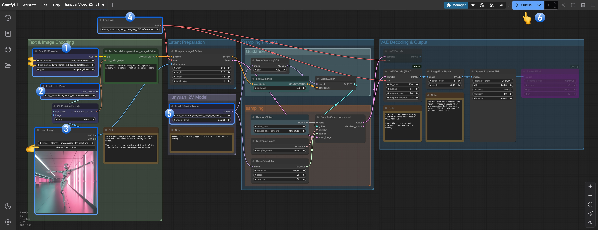
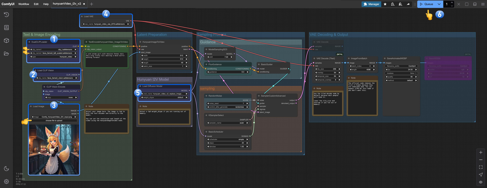

import UpdateReminder from "/snippets/ru/tutorials/update-reminder.mdx";

<video
  controls
  className="w-full aspect-video"
  src="https://github.com/user-attachments/assets/442afb73-3092-454f-bc46-02361c285930"
></video>

Серия Hunyuan Video разрабатывается и публикуется с открытым исходным кодом компанией [Tencent](https://huggingface.co/tencent). Она использует гибридную архитектуру с масштабом параметров 13B, которая поддерживает генерацию в режимах «текст в видео» и «изображение в видео».

Технические особенности:
- **Основная архитектура:** Использует архитектуру DiT (Diffusion Transformer), аналогичную Sora, которая эффективно объединяет текстовую информацию, изображения и данные о движении, чтобы повысить согласованность, качество и выравнивание между сгенерированными кадрами видео. Единый механизм полного внимания обеспечивает переходы камеры между несколькими ракурсами и при этом сохраняет согласованность объекта.
- **3D VAE:** Пользовательский 3D VAE сжимает видео в компактное латентное пространство, что делает генерацию «изображение в видео» более эффективной.
- **Превосходное выравнивание изображения, видео и текста:** Текстовые энкодеры MLLM отлично справляются как с генерацией изображений, так и с генерацией видео, лучше следуют текстовым инструкциям, улавливают детали и выполняют сложные рассуждения.

Узнать больше можно в официальных репозиториях: [Hunyuan Video](https://github.com/Tencent/HunyuanVideo) и [Hunyuan Video-I2V](https://github.com/Tencent/HunyuanVideo-I2V).

Это руководство поможет вам настроить в ComfyUI оба рабочих процесса: **текст в видео** и **изображение в видео**.

<Tip>
Изображения рабочих процессов в этом руководстве содержат метаданные с информацией о скачивании моделей.

Просто перетащите их в ComfyUI или используйте меню `Workflows` -> `Open (ctrl+o)`, чтобы загрузить соответствующий рабочий процесс. После этого появится запрос на скачивание необходимых моделей.

Если автоматическое скачивание не удастся или вы не используете настольную версию, в этом руководстве также приведены прямые ссылки на модели. Все модели доступны для скачивания [здесь](https://huggingface.co/Comfy-Org/HunyuanVideo_repackaged/tree/main/split_files).
</Tip>

<UpdateReminder/>

## Общие модели для всех рабочих процессов

Эти модели используются как в рабочих процессах «текст в видео», так и в рабочих процессах «изображение в видео». Скачайте их и сохраните в указанные каталоги:

<CardGroup cols={2}>
  <Card icon="cube" title="Текстовый энкодер: clip_l.safetensors" href="https://huggingface.co/Comfy-Org/HunyuanVideo_repackaged/blob/main/split_files/text_encoders/clip_l.safetensors?download=true">
    Сохранить в ComfyUI/models/text_encoders
  </Card>
  <Card icon="cube" title="Текстовый энкодер: llava_llama3_fp8_scaled.safetensors" href="https://huggingface.co/Comfy-Org/HunyuanVideo_repackaged/blob/main/split_files/text_encoders/llava_llama3_fp8_scaled.safetensors?download=true">
    Сохранить в ComfyUI/models/text_encoders
  </Card>
</CardGroup>

<Card icon="cube" title="VAE: hunyuan_video_vae_bf16.safetensors" href="https://huggingface.co/Comfy-Org/HunyuanVideo_repackaged/blob/main/split_files/vae/hunyuan_video_vae_bf16.safetensors?download=true">
  Сохранить в ComfyUI/models/vae
</Card>
Расположение файлов:

```
ComfyUI/
├── models/
│   ├── text_encoders/
│   │   ├── clip_l.safetensors
│   │   └── llava_llama3_fp8_scaled.safetensors
│   └── vae/
│       └── hunyuan_video_vae_bf16.safetensors
```
## Рабочий процесс Hunyuan текст в видео

Hunyuan Text-to-Video был открыт в декабре 2024 года и поддерживает генерацию коротких 5-секундных видео по описанию на естественном языке на китайском и английском.

### 1. Рабочий процесс

Скачайте изображение рабочего процесса ниже и перетащите его в ComfyUI, чтобы загрузить рабочий процесс:


<CardGroup cols={2}>
  <Card title="Запустить в Comfy Cloud" icon="cloud" href="https://cloud.comfy.org/?template=hunyuan_video_text_to_video&utm_source=docs&utm_medium=referral&utm_campaign=hunyuan-video">
    Открыть в Comfy Cloud
  </Card>
  <Card title="Скачать рабочий процесс" icon="download" href="https://github.com/Comfy-Org/workflow_templates/blob/main/templates/hunyuan_video_text_to_video.json">
    Скачайте JSON или найдите «Hunyuan Video» в библиотеке шаблонов
  </Card>
</CardGroup>

### 2. Ручная установка моделей

<Card icon="cube" title="Модель диффузии: hunyuan_video_t2v_720p_bf16.safetensors" href="https://huggingface.co/Comfy-Org/HunyuanVideo_repackaged/blob/main/split_files/diffusion_models/hunyuan_video_t2v_720p_bf16.safetensors?download=true">
  Сохраните в ComfyUI/models/diffusion_models
</Card>
Убедитесь, что все эти файлы моделей находятся в правильных местах:

```
ComfyUI/
├── models/
│   ├── text_encoders/
│   │   ├── clip_l.safetensors                       // Общая модель
│   │   └── llava_llama3_fp8_scaled.safetensors      // Общая модель
│   ├── vae/
│   │   └── hunyuan_video_vae_bf16.safetensors       // Общая модель
│   └── diffusion_models/
│       └── hunyuan_video_t2v_720p_bf16.safetensors  // Модель T2V
```

### 3. Как запустить рабочий процесс



1. Убедитесь, что узел `DualCLIPLoader` загрузил эти модели:
   - clip_name1: clip_l.safetensors
   - clip_name2: llava_llama3_fp8_scaled.safetensors
2. Убедитесь, что узел `Load Diffusion Model` загрузил `hunyuan_video_t2v_720p_bf16.safetensors`
3. Убедитесь, что узел `Load VAE` загрузил `hunyuan_video_vae_bf16.safetensors`
4. Нажмите кнопку `Queue` или используйте сочетание клавиш `Ctrl(cmd) + Enter`, чтобы запустить рабочий процесс

<Tip>
Если параметр `length` в узле `EmptyHunyuanLatentVideo` установлен в 1, модель может сгенерировать статичное изображение.
</Tip>

## Рабочий процесс Hunyuan Image-to-Video

Модель Hunyuan Image-to-Video была открыта 6 марта 2025 года на основе фреймворка HunyuanVideo. Она превращает статичные изображения в плавные видеоролики высокого качества, а также предоставляет код обучения LoRA для настройки особых видеоэффектов, таких как рост волос, трансформация объектов и других.

На данный момент у модели Hunyuan Image-to-Video есть две версии:
- v1 «concat»: лучшая плавность движения, но меньшее соответствие изображению-подсказке
- v2 «replace»: обновлена на следующий день после v1, лучше следует изображению, но выглядит менее динамичной по сравнению с v1

<div class="flex justify-between">
    <div class="text-center">
        <p>v1 «concat»</p>
        
    </div>
    <div class="text-center">
        <p>v2 «replace»</p>
        
    </div>
</div>

### Общая модель для версий v1 и v2

<Card icon="cube" title="CLIP Vision: llava_llama3_vision.safetensors" href="https://huggingface.co/Comfy-Org/HunyuanVideo_repackaged/blob/main/split_files/clip_vision/llava_llama3_vision.safetensors?download=true">
  Сохраните в ComfyUI/models/clip_vision
</Card>

### Рабочий процесс «изображение в видео» V1 "concat"

#### 1. Рабочий процесс и ресурсы

Скачайте изображение рабочего процесса ниже и перетащите его в ComfyUI, чтобы загрузить рабочий процесс:


<CardGroup cols={2}>
  <Card title="Скачать рабочий процесс" icon="download" href="https://raw.githubusercontent.com/Comfy-Org/example_workflows/main/hunyuan-video/i2v/v1_robot.webp">
    Скачайте изображение рабочего процесса и перетащите его в ComfyUI
  </Card>
</CardGroup>

Скачайте изображение ниже и используйте его как начальный кадр для генерации «изображение в видео»:

<Card icon="cube" title="Начальный кадр: robot-ballet.png" href="https://raw.githubusercontent.com/Comfy-Org/example_workflows/refs/heads/main/hunyuan-video/i2v/robot-ballet.png">
  Сохраните и используйте как входное изображение для генерации I2V
</Card>
#### 2. Ручная установка связанных моделей

<Card icon="cube" title="Модель диффузии: hunyuan_video_image_to_video_720p_bf16.safetensors" href="https://huggingface.co/Comfy-Org/HunyuanVideo_repackaged/blob/main/split_files/diffusion_models/hunyuan_video_image_to_video_720p_bf16.safetensors?download=true">
  Сохраните в ComfyUI/models/diffusion_models
</Card>
Убедитесь, что все эти файлы моделей находятся в правильных папках:

```
ComfyUI/
├── models/
│   ├── clip_vision/
│   │   └── llava_llama3_vision.safetensors                     // общая модель для I2V
│   ├── text_encoders/
│   │   ├── clip_l.safetensors                                  // общая модель
│   │   └── llava_llama3_fp8_scaled.safetensors                 // общая модель
│   ├── vae/
│   │   └── hunyuan_video_vae_bf16.safetensors                  // общая модель
│   └── diffusion_models/
│       └── hunyuan_video_image_to_video_720p_bf16.safetensors  // модель версии I2V v1 "concat"
```

#### 3. Шаги запуска рабочего процесса



1. Убедитесь, что в `DualCLIPLoader` загружены следующие модели:
   - clip_name1: clip_l.safetensors
   - clip_name2: llava_llama3_fp8_scaled.safetensors
2. Убедитесь, что `Load CLIP Vision` загрузил `llava_llama3_vision.safetensors`
3. Убедитесь, что `Load Image Model` загрузил `hunyuan_video_image_to_video_720p_bf16.safetensors`
4. Убедитесь, что `Load VAE` загрузил `vae_name: hunyuan_video_vae_bf16.safetensors`
5. Убедитесь, что `Load Diffusion Model` загрузил `hunyuan_video_image_to_video_720p_bf16.safetensors`
6. Нажмите кнопку `Queue` или используйте сочетание клавиш `Ctrl(cmd) + Enter`, чтобы запустить рабочий процесс

### Рабочий процесс v2 «replace» для генерации видео из изображения

Рабочий процесс v2 по сути такой же, как рабочий процесс v1. Вам нужно только скачать модель **replace** и использовать её в узле `Load Diffusion Model`.

#### 1. Рабочий процесс и ресурсы

Скачайте изображение рабочего процесса ниже и перетащите его в ComfyUI, чтобы загрузить рабочий процесс:


<CardGroup cols={2}>
  <Card title="Скачать рабочий процесс" icon="download" href="https://raw.githubusercontent.com/Comfy-Org/example_workflows/main/hunyuan-video/i2v/v2_fennec_gril.webp">
    Скачайте изображение рабочего процесса и перетащите его в ComfyUI
  </Card>
</CardGroup>

Скачайте изображение ниже и используйте его как начальный кадр для генерации видео из изображения:

<Card icon="cube" title="Начальный кадр: flux_dev_example.png" href="https://comfyanonymous.github.io/ComfyUI_examples/flux/flux_dev_example.png">
  Сохраните и используйте как входное изображение для генерации I2V
</Card>
#### 2. Установить связанные модели вручную

<Card icon="cube" title="Модель диффузии: hunyuan_video_v2_replace_image_to_video_720p_bf16.safetensors" href="https://huggingface.co/Comfy-Org/HunyuanVideo_repackaged/blob/main/split_files/diffusion_models/hunyuan_video_v2_replace_image_to_video_720p_bf16.safetensors?download=true">
  Сохраните в ComfyUI/models/diffusion_models
</Card>
Убедитесь, что все эти файлы моделей находятся в правильных местах:

```
ComfyUI/
├── models/
│   ├── clip_vision/
│   │   └── llava_llama3_vision.safetensors                                // общая модель I2V
│   ├── text_encoders/
│   │   ├── clip_l.safetensors                                             // общая модель
│   │   └── llava_llama3_fp8_scaled.safetensors                            // общая модель
│   ├── vae/
│   │   └── hunyuan_video_vae_bf16.safetensors                             // общая модель
│   └── diffusion_models/
│       └── hunyuan_video_v2_replace_image_to_video_720p_bf16.safetensors  // модель версии V2 «replace»
```

#### 3. Запустить рабочий процесс



1. Убедитесь, что в узле `DualCLIPLoader` загружены эти модели:
   - clip_name1: clip_l.safetensors
   - clip_name2: llava_llama3_fp8_scaled.safetensors
2. Убедитесь, что в узле `Load CLIP Vision` загружена модель `llava_llama3_vision.safetensors`
3. Убедитесь, что в узле `Load Image Model` загружена модель `hunyuan_video_image_to_video_720p_bf16.safetensors`
4. Убедитесь, что в узле `Load VAE` загружена модель `hunyuan_video_vae_bf16.safetensors`
5. Убедитесь, что в узле `Load Diffusion Model` загружена модель `hunyuan_video_v2_replace_image_to_video_720p_bf16.safetensors`
6. Нажмите кнопку `Queue` или используйте сочетание клавиш `Ctrl(cmd) + Enter`, чтобы запустить рабочий процесс

## Попробуйте сами

Вот несколько изображений и промптов, которые мы подготовили. Используйте их как есть или измените, чтобы создать собственное видео.


```
Futuristic robot dancing ballet, dynamic motion, fast motion, fast shot, moving scene
```

---


```
Samurai waving sword and hitting the camera. camera angle movement, zoom in, fast scene, super fast, dynamic
```

---


```
flying car fastly moving and flying through the city
```

---


```
cyberpunk car race in night city, dynamic, super fast, fast shot
```
