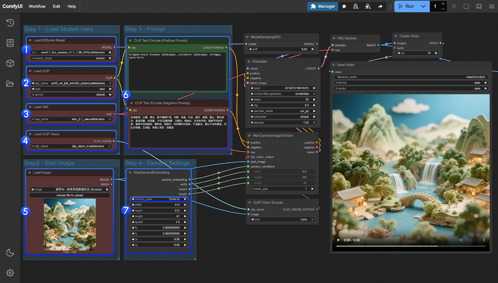

import UpdateReminder from "/snippets/ru/tutorials/update-reminder.mdx"

Wan2.1 Fun Camera представляет собой модель генерации видео с движением камеры из проекта VideoX-Fun от Alibaba, нативно поддерживаемую в ComfyUI. Она создаёт видео, в которых движение камеры следует заданным вами условиям управления, поэтому вы можете управлять тем, как камера движется в результате, вместо того чтобы описывать каждый кадр в промпте.

Модель входит в семейство Wan2.1-Fun и выпускается в двух размерах: версия 1.3B (около 19 ГБ) для лёгких локальных запусков и версия 14B (около 47 ГБ) для более качественного результата. Обе версии поддерживают предсказание видео в нескольких разрешениях (512, 768 и 1024 пикселя), обучены с частотой 16 кадров в секунду с длиной до 81 кадра (около 5 секунд) и принимают мультиязычные промпты. Веса опубликованы под лицензией Apache-2.0.

## О Wan2.1 Fun Camera

**Wan2.1 Fun Camera** представляет собой проект генерации видео, запущенный командой Alibaba и посвящённый управлению результатами генерации видео с помощью движения камеры.

**Скачать веса модели**:
- [Версия 14B](https://huggingface.co/alibaba-pai/Wan2.1-Fun-V1.1-14B-Control-Camera)
- [Версия 1.3B](https://huggingface.co/alibaba-pai/Wan2.1-Fun-V1.1-1.3B-Control-Camera)

**Репозиторий кода**: [VideoX-Fun](https://github.com/aigc-apps/VideoX-Fun)

**ComfyUI теперь нативно поддерживает модель Wan2.1 Fun Camera**.

<UpdateReminder/>

## Установка моделей

Эти модели нужно установить только один раз. Кроме того, информация для скачивания моделей включена в соответствующие изображения рабочих процессов, поэтому вы можете выбрать удобный для вас способ скачивания моделей.

Все перечисленные ниже модели можно найти в [Wan_2.1_ComfyUI_repackaged](https://huggingface.co/Comfy-Org/Wan_2.1_ComfyUI_repackaged)

### Диффузионные модели

Выберите один из вариантов: 1.3B или 14B:

<CardGroup cols={2}>
  <Card title="wan2.1_fun_camera_v1.1_1.3B_bf16.safetensors" icon="download" href="https://huggingface.co/Comfy-Org/Wan_2.1_ComfyUI_repackaged/blob/main/split_files/diffusion_models/wan2.1_fun_camera_v1.1_1.3B_bf16.safetensors?download=true">
    Диффузионная модель Wan2.1 Fun Camera 1.3B
  </Card>
  <Card title="wan2.1_fun_camera_v1.1_14B_bf16.safetensors" icon="download" href="https://huggingface.co/Comfy-Org/Wan_2.1_ComfyUI_repackaged/blob/main/split_files/diffusion_models/wan2.1_fun_camera_v1.1_14B_bf16.safetensors?download=true">
    Диффузионная модель Wan2.1 Fun Camera 14B
  </Card>
</CardGroup>

Если вы раньше использовали модели, связанные с Wan2.1, то следующие модели у вас уже должны быть. Если их нет, скачайте их:

### Текстовые энкодеры

Выберите один из следующих вариантов:

<CardGroup cols={2}>
  <Card title="umt5_xxl_fp16.safetensors" icon="download" href="https://huggingface.co/Comfy-Org/Wan_2.1_ComfyUI_repackaged/blob/main/split_files/text_encoders/umt5_xxl_fp16.safetensors?download=true">
    Текстовый энкодер полной точности
  </Card>
  <Card title="umt5_xxl_fp8_e4m3fn_scaled.safetensors" icon="download" href="https://huggingface.co/Comfy-Org/Wan_2.1_ComfyUI_repackaged/blob/main/split_files/text_encoders/umt5_xxl_fp8_e4m3fn_scaled.safetensors?download=true">
    Текстовый энкодер с квантованием FP8 (рекомендуется при небольшом объёме видеопамяти)
  </Card>
</CardGroup>

### VAE

<CardGroup cols={1}>
  <Card title="wan_2.1_vae.safetensors" icon="download" href="https://huggingface.co/Comfy-Org/Wan_2.1_ComfyUI_repackaged/blob/main/split_files/vae/wan_2.1_vae.safetensors?download=true">
    Модель VAE Wan2.1
  </Card>
</CardGroup>

### CLIP Vision

<CardGroup cols={1}>
  <Card title="clip_vision_h.safetensors" icon="download" href="https://huggingface.co/Comfy-Org/Wan_2.1_ComfyUI_repackaged/blob/main/split_files/clip_vision/clip_vision_h.safetensors?download=true">
    Энкодер CLIP vision
  </Card>
</CardGroup>

Расположение файлов:

```
📂 ComfyUI/
├── 📂 models/
│ ├── 📂 diffusion_models/
│ │   ├── wan2.1_fun_camera_v1.1_1.3B_bf16.safetensors # Версия 1.3B
│ │   └── wan2.1_fun_camera_v1.1_14B_bf16.safetensors # Версия 14B
│ ├── 📂 text_encoders/
│ │   └── umt5_xxl_fp8_e4m3fn_scaled.safetensors
│ ├── 📂 vae/
│ │   └── wan_2.1_vae.safetensors
│ └── 📂 clip_vision/
│     └── clip_vision_h.safetensors
```


## Рабочий процесс ComfyUI Wan2.1 Fun Camera 1.3B

### Wan 2.1 Fun Camera 1.3B {#video_wan2.1_fun_camera_v1.1_1.3B}

Генерируйте динамичные видео с кинематографичными движениями камеры с помощью модели Wan 2.1 Fun Camera 1.3B.


<CardGroup cols={2}>
  <Card title="Запустить в Comfy Cloud" icon="cloud" href="https://cloud.comfy.org/?template=video_wan2.1_fun_camera_v1.1_1.3B&utm_source=docs&utm_medium=referral&utm_campaign=fun-camera">
    Открыть в Comfy Cloud
  </Card>
  <Card title="Скачать рабочий процесс" icon="download" href="https://github.com/Comfy-Org/workflow_templates/blob/main/templates/video_wan2.1_fun_camera_v1.1_1.3B.json">
    Скачайте JSON или найдите «Wan 2.1 Fun Camera 1.3B» в Библиотеке шаблонов
  </Card>
</CardGroup>

Скачайте видео ниже и перетащите его в ComfyUI, чтобы загрузить соответствующий рабочий процесс:

<video
  controls
  className="w-full aspect-video"
  src="https://raw.githubusercontent.com/Comfy-Org/example_workflows/refs/heads/main/video/wan/fun-camera/v1.1/wan2.1_fun_camera_1.3B.mp4"
></video>

<Note>
Если вы хотите использовать версию 14B, просто замените файл модели на версию 14B, но учтите требования к VRAM.
</Note>

**Входные материалы**

Загрузите этот файл в соответствующий узел `LoadImage`:

<CardGroup cols={2}>
  <Card title="video_wan2.1_fun_camera_v1.1_1.3B_start_image.jpg" icon="image" href="https://raw.githubusercontent.com/Comfy-Org/workflow_templates/main/input/video_wan2.1_fun_camera_v1.1_1.3B_start_image.jpg">
    Узел `LoadImage` 52 · `video_wan2.1_fun_camera_v1.1_1.3B_start_image.jpg`
  </Card>
</CardGroup>

<div style={{display: 'grid', gridTemplateColumns: 'repeat(2, minmax(0, 1fr))', gap: '1rem', alignItems: 'start'}}>
  
</div>

### 3. Выполнить рабочий процесс шаг за шагом



1. Убедитесь, что загружена правильная версия файла модели:
   - Версия 1.3B: `wan2.1_fun_camera_v1.1_1.3B_bf16.safetensors`
   - Версия 14B: `wan2.1_fun_camera_v1.1_14B_bf16.safetensors`
2. Убедитесь, что узел `Load CLIP` загрузил `umt5_xxl_fp8_e4m3fn_scaled.safetensors`
3. Убедитесь, что узел `Load VAE` загрузил `wan_2.1_vae.safetensors`
4. Убедитесь, что узел `Load CLIP Vision` загрузил `clip_vision_h.safetensors`
5. Загрузите начальный кадр в узел `Load Image`
6. Измените промпт, если вы используете собственное входное изображение
7. Задайте движение камеры в узле `WanCameraEmbedding`
8. Нажмите кнопку `Run` или используйте сочетание клавиш `Ctrl(cmd) + Enter`, чтобы выполнить генерацию

## Рабочий процесс ComfyUI Wan2.1 Fun Camera 14B

### Wan 2.1 Fun Camera 14B {#video_wan2.1_fun_camera_v1.1_14B}

Генерируйте видео высокого качества с расширенным управлением камерой с помощью полной модели 14B.


<CardGroup cols={2}>
  <Card title="Запустить в Comfy Cloud" icon="cloud" href="https://cloud.comfy.org/?template=video_wan2.1_fun_camera_v1.1_14B&utm_source=docs&utm_medium=referral&utm_campaign=fun-camera">
    Открыть в Comfy Cloud
  </Card>
  <Card title="Скачать рабочий процесс" icon="download" href="https://github.com/Comfy-Org/workflow_templates/blob/main/templates/video_wan2.1_fun_camera_v1.1_14B.json">
    Скачайте JSON или найдите «Wan 2.1 Fun Camera 14B» в библиотеке шаблонов
  </Card>
</CardGroup>

<video
  controls
  className="w-full aspect-video"
  src="https://raw.githubusercontent.com/Comfy-Org/example_workflows/refs/heads/main/video/wan/fun-camera/v1.1/wan2.1_fun_camera_14B.mp4"
></video>

**Входные материалы**

Загрузите этот файл в соответствующий узел `LoadImage`:

<CardGroup cols={2}>
  <Card title="video_wan2.1_fun_camera_v1.1_14B_start_image.jpg" icon="image" href="https://raw.githubusercontent.com/Comfy-Org/workflow_templates/main/input/video_wan2.1_fun_camera_v1.1_14B_start_image.jpg">
    Узел `LoadImage` 52 · `video_wan2.1_fun_camera_v1.1_14B_start_image.jpg`
  </Card>
</CardGroup>

<div style={{display: 'grid', gridTemplateColumns: 'repeat(2, minmax(0, 1fr))', gap: '1rem', alignItems: 'start'}}>
  
</div>

## Справочник по производительности

**Версия 1.3B**:
- Генерация 81 кадра в разрешении 512x512 на RTX 4090 занимает около 72 секунд

**Версия 14B**:
- На RTX4090 с 24 ГБ видеопамяти может возникнуть нехватка памяти при генерации в разрешении 512x512, а проблемы с памятью также наблюдались на A100 при использовании более крупных размеров
