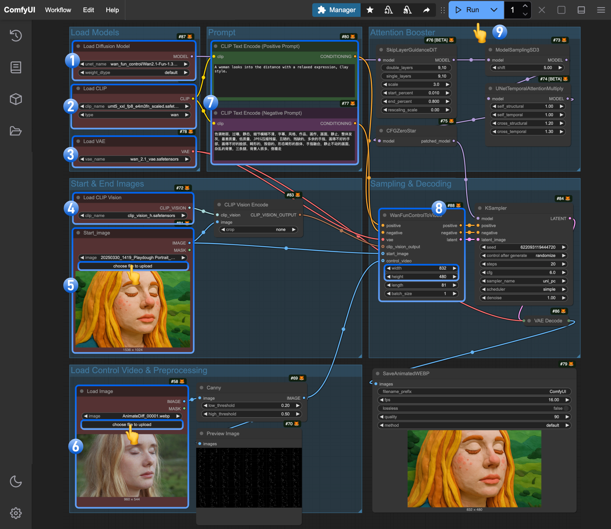
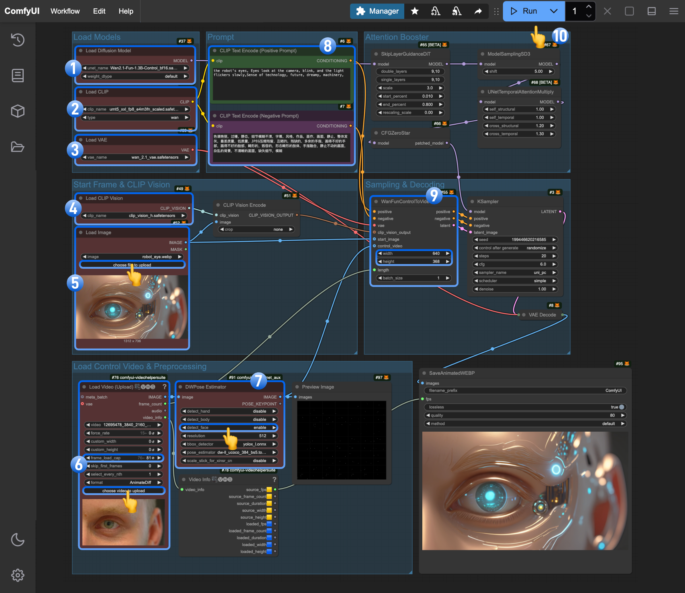
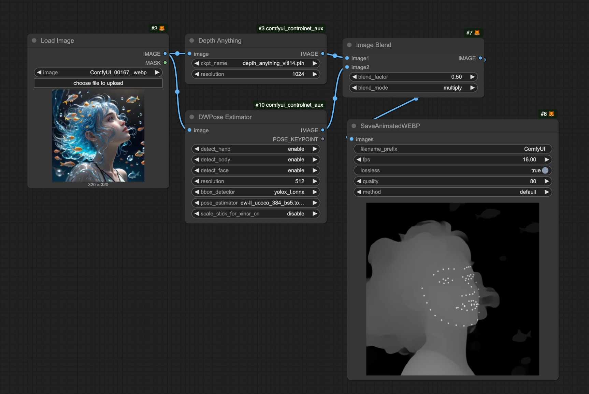

import UpdateReminder from "/snippets/ru/tutorials/update-reminder.mdx";

Wan2.1-Fun-Control: это открытая модель генерации видео из проекта VideoX-Fun от Alibaba, которая следует заданным условиям управления, а не полагается только на текст промпта. Вы можете направлять результат с помощью карт рёбер Canny, карт глубины, скелетов OpenPose, геометрических рёбер MLSD или точечных траекторий.

Модель доступна в двух размерах: версия 1.3B (около 19 ГБ) для лёгкого локального развёртывания с более низкими требованиями к видеопамяти и версия 14B (около 47 ГБ общего объёма моделей, из которых на диффузионные веса приходится около 32.8 ГБ) для более качественных результатов. Обе поддерживают генерацию видео в нескольких разрешениях: 512, 768 и 1024 пикселя, создают до 81 кадра (около 5 секунд) при 16 кадрах в секунду и принимают многоязычные промпты. ComfyUI нативно поддерживает Wan2.1-Fun-Control.

## О Wan2.1-Fun-Control

**Wan2.1-Fun-Control** представляет собой открытый проект генерации и управления видео, разработанный командой Alibaba.
В нём реализованы инновационные механизмы Control Codes, которые в сочетании с глубоким обучением и мультимодальными условными входами позволяют генерировать высококачественные видео, соответствующие заранее заданным условиям управления. Проект нацелен на точное управление содержимым сгенерированного видео с помощью мультимодальных условий управления.

Сейчас модель Fun Control поддерживает различные условия управления, включая **Canny (контурный рисунок), Depth, OpenPose (поза человека), MLSD (геометрические рёбра) и управление траекторией.**
Модель также поддерживает предсказание видео с несколькими разрешениями: доступны варианты 512, 768 и 1024 при 16 кадрах в секунду, что позволяет генерировать видео длиной до 81 кадра (примерно 5 секунд).

Версии модели:
- **1.3B** Лёгкая: подходит для локального развёртывания и быстрого вывода с **меньшими требованиями к VRAM**
- **14B** Высокопроизводительная: размер модели достигает 32GB+, результаты лучше, но **требуется больше VRAM**

**Скачать веса модели**:

<CardGroup cols={2}>
  <Card title="Wan2.1-Fun-1.3B-Control" icon="download" href="https://huggingface.co/alibaba-pai/Wan2.1-Fun-1.3B-Control">
    Лёгкая версия, меньшие требования к VRAM
  </Card>
  <Card title="Wan2.1-Fun-14B-Control" icon="download" href="https://huggingface.co/alibaba-pai/Wan2.1-Fun-14B-Control">
    Высокопроизводительная версия, размер файла 32GB+, более высокие требования к VRAM
  </Card>
</CardGroup>

**Репозиторий кода**: [VideoX-Fun](https://github.com/aigc-apps/VideoX-Fun)

ComfyUI теперь **нативно поддерживает** модель Wan2.1 Fun Control. Перед началом этого руководства обновите ComfyUI, чтобы использовалась версия после [этого коммита](https://github.com/Comfy-Org/ComfyUI/commit/3661c833bcc41b788a7c9f0e7bc48524f8ee5f82).

В этом руководстве мы приведём два рабочих процесса:
1. Рабочий процесс только с нативными узлами Comfy Core
2. Рабочий процесс с пользовательскими узлами

<Tip>
Из-за текущих ограничений нативных узлов в работе с видео рабочий процесс только на нативных узлах позволяет пользователям пройти весь путь без установки пользовательских узлов.
Однако мы обнаружили, что без пользовательских узлов обеспечить хороший пользовательский опыт при генерации видео сложно, поэтому в этом руководстве мы приводим обе версии рабочего процесса.
</Tip>

<UpdateReminder/>

## Установка моделей

Эти модели нужно установить только один раз. Изображения рабочих процессов также содержат информацию о загрузке моделей, поэтому вы можете выбрать удобный способ загрузки.

Указанные модели доступны в репозиториях [Wan_2.1_ComfyUI_repackaged](https://huggingface.co/Comfy-Org/Wan_2.1_ComfyUI_repackaged) и [Wan2.1-Fun](https://huggingface.co/collections/alibaba-pai/wan21-fun-67e4fb3b76ca01241eb7e334)

Нажмите на соответствующие ссылки, чтобы скачать файлы. Если вы уже работали с рабочими процессами Wan, достаточно скачать только **модели диффузии** (`Diffusion models`).

**Модели диффузии**: выберите 1.3B или 14B. Версия 14B занимает больше места (32 ГБ) и требует больше видеопамяти:

<CardGroup cols={2}>
  <Card title="wan2.1_fun_control_1.3B_bf16.safetensors" icon="download" href="https://huggingface.co/Comfy-Org/Wan_2.1_ComfyUI_repackaged/blob/main/split_files/diffusion_models/wan2.1_fun_control_1.3B_bf16.safetensors?download=true">
    Модель диффузии Wan2.1 Fun Control 1.3B: лёгкая, требует меньше видеопамяти
  </Card>
  <Card title="Wan2.1-Fun-14B-Control" icon="download" href="https://huggingface.co/alibaba-pai/Wan2.1-Fun-14B-Control/blob/main/diffusion_pytorch_model.safetensors">
    Модель диффузии Wan2.1 Fun Control 14B. После загрузки переименуйте файл в <code>Wan2.1-Fun-14B-Control.safetensors</code>. Размер более 32 ГБ, повышенные требования к видеопамяти
  </Card>
</CardGroup>

**Текстовые энкодеры**: выберите одну из следующих моделей (точность fp16 даёт больший размер файла и повышенные требования к производительности):

<CardGroup cols={2}>
  <Card title="umt5_xxl_fp16.safetensors" icon="download" href="https://huggingface.co/Comfy-Org/Wan_2.1_ComfyUI_repackaged/blob/main/split_files/text_encoders/umt5_xxl_fp16.safetensors?download=true">
    Текстовый энкодер UMT5 XXL: точность fp16, больший размер, повышенные требования к производительности
  </Card>
  <Card title="umt5_xxl_fp8_e4m3fn_scaled.safetensors" icon="download" href="https://huggingface.co/Comfy-Org/Wan_2.1_ComfyUI_repackaged/blob/main/split_files/text_encoders/umt5_xxl_fp8_e4m3fn_scaled.safetensors?download=true">
    Текстовый энкодер UMT5 XXL: точность fp8, меньший размер, пониженные требования к производительности
  </Card>
</CardGroup>

**VAE**

<Card title="wan_2.1_vae.safetensors" icon="download" href="https://huggingface.co/Comfy-Org/Wan_2.1_ComfyUI_repackaged/blob/main/split_files/vae/wan_2.1_vae.safetensors?download=true">
  Модель VAE Wan2.1
</Card>
**CLIP Vision**

<Card title="clip_vision_h.safetensors" icon="download" href="https://huggingface.co/Comfy-Org/Wan_2.1_ComfyUI_repackaged/blob/main/split_files/clip_vision/clip_vision_h.safetensors?download=true">
  Модель CLIP Vision для обработки референсных изображений
</Card>
Расположение файлов:
```
📂 ComfyUI/
├── 📂 models/
│   ├── 📂 diffusion_models/
│   │   ├── wan2.1_fun_control_1.3B_bf16.safetensors
│   │   └── Wan2.1-Fun-14B-Control.safetensors
│   ├── 📂 text_encoders/
│   │   └── umt5_xxl_fp8_e4m3fn_scaled.safetensors
│   ├── 📂 vae/
│   │   └── wan_2.1_vae.safetensors
│   └── 📂 clip_vision/
│       └── clip_vision_h.safetensors
```

## Нативный рабочий процесс ComfyUI

В этом рабочем процессе мы используем видео, преобразованные в **формат WebP**, поскольку узел `Load Image` сейчас не поддерживает формат mp4. Мы также используем **Canny Edge** для предварительной обработки исходного видео.
Поскольку многие пользователи сталкиваются со сбоями установки и проблемами окружения при установке пользовательских узлов, эта версия рабочего процесса использует только нативные узлы, чтобы обеспечить более плавную работу.

Спасибо нашим замечательным авторам ComfyUI, которые создают узлы с богатым функционалом. Если вы хотите сразу посмотреть соответствующую версию, см. [Рабочий процесс с пользовательскими узлами](#рабочий-процесс-с-использованием-пользовательских-узлов).

### 1. Скачивание файла рабочего процесса


<CardGroup cols={2}>
  <Card title="Запустить в Comfy Cloud" icon="cloud" href="https://cloud.comfy.org/?template=wan2.1_fun_control&utm_source=docs&utm_medium=referral&utm_campaign=fun-control">
    Открыть в Comfy Cloud
  </Card>
  <Card title="Скачать рабочий процесс" icon="download" href="https://raw.githubusercontent.com/Comfy-Org/example_workflows/main/wan2.1_fun_control/wan2.1_fun_control_native.webp">
    Скачайте изображение рабочего процесса и перетащите его в ComfyUI, чтобы загрузить рабочий процесс
  </Card>
</CardGroup>

**Входные материалы**

<CardGroup cols={2}>
  <Card title="Начальное изображение: wan2.1_fun_control_start_frame.png" icon="image" href="https://raw.githubusercontent.com/Comfy-Org/workflow_templates/main/input/wan2.1_fun_control_start_frame.png">
    Входной начальный кадр для нативного рабочего процесса. Скачайте и используйте это изображение или замените его своим.
  </Card>
  <Card title="Управляющее видео: 01-portrait_video.webp" icon="video" href="https://raw.githubusercontent.com/Comfy-Org/example_workflows/main/wan2.1_fun_control/input/01-portrait_video.webp">
    Входное управляющее видео в формате WebP для нативного рабочего процесса. Нативному рабочему процессу требуется формат WebP, поскольку Load Image не поддерживает mp4.
  </Card>
</CardGroup>

### 2. Выполнение рабочего процесса шаг за шагом



1. Убедитесь, что в узле `Load Diffusion Model` загружена модель `wan2.1_fun_control_1.3B_bf16.safetensors`
2. Убедитесь, что в узле `Load CLIP` загружен файл `umt5_xxl_fp8_e4m3fn_scaled.safetensors`
3. Убедитесь, что в узле `Load VAE` загружен файл `wan_2.1_vae.safetensors`
4. Убедитесь, что в узле `Load CLIP Vision` загружен файл `clip_vision_h.safetensors`
5. Загрузите начальный кадр в узел `Load Image` (переименован в `Start_image`)
6. Загрузите управляющее видео во второй узел `Load Image`. Примечание: этот узел сейчас не поддерживает mp4, только видео в формате WebP
7. (Необязательно) Измените промпт (поддерживаются как английский, так и китайский язык)
8. (Необязательно) Настройте размеры видео в `WanFunControlToVideo`, избегая слишком больших значений
9. Нажмите кнопку `Run` или используйте сочетание клавиш `Ctrl(cmd) + Enter`, чтобы выполнить генерацию видео

### 3. Примечания по использованию

- Поскольку в узел `WanFunControlToVideo` нужно подать столько же кадров, сколько их в управляющем видео, при указании количества кадров, превышающего фактическое число кадров управляющего видео, лишние кадры могут показывать сцены, не соответствующие условиям управления. Мы решим эту проблему в разделе [Рабочий процесс с пользовательскими узлами](#рабочий-процесс-с-использованием-пользовательских-узлов)
- Избегайте слишком больших размеров, так как это может сделать процесс выборки очень долгим. Попробуйте сначала сгенерировать изображения меньшего размера, а затем выполнить upscale
- Проявите воображение и расширьте этот рабочий процесс, добавив рабочие процессы текст в изображение или других типов, чтобы получить прямую генерацию видео из текста или перенос стиля
- Используйте инструменты вроде [ComfyUI-comfyui_controlnet_aux](https://github.com/Fannovel16/comfyui_controlnet_aux) для более богатых возможностей управления

## Рабочий процесс с использованием пользовательских узлов

Потребуется установить следующие два пользовательских узла:

- [ComfyUI-VideoHelperSuite](https://github.com/Kosinkadink/ComfyUI-VideoHelperSuite)
- [ComfyUI-comfyui_controlnet_aux](https://github.com/Fannovel16/comfyui_controlnet_aux)

Вы можете использовать [ComfyUI Manager](https://github.com/Comfy-Org/ComfyUI-Manager), чтобы установить отсутствующие узлы, или следовать инструкциям по установке для каждого пакета пользовательских узлов.

### 1. Скачивание файла рабочего процесса


<CardGroup cols={2}>
  <Card title="Запустить в Comfy Cloud" icon="cloud" href="https://cloud.comfy.org/?template=wan2.1_fun_control&utm_source=docs&utm_medium=referral&utm_campaign=fun-control">
    Открыть в Comfy Cloud
  </Card>
  <Card title="Скачать рабочий процесс" icon="download" href="https://github.com/Comfy-Org/workflow_templates/blob/main/templates/wan2.1_fun_control.json">
    Скачайте JSON или найдите «Wan 2.1 ControlNet» в библиотеке шаблонов
  </Card>
</CardGroup>

**Входные материалы**

<CardGroup cols={2}>
  <Card title="Начальный кадр: wan2.1_fun_control_start_frame.png" icon="image" href="https://raw.githubusercontent.com/Comfy-Org/workflow_templates/main/input/wan2.1_fun_control_start_frame.png">
    Начальный кадр для рабочего процесса с пользовательскими узлами. Скачайте и используйте это изображение или замените его своим.
  </Card>
  <Card title="Управляющее видео: wan2.1_fun_control_control_video.mp4" icon="video" href="https://raw.githubusercontent.com/Comfy-Org/workflow_templates/main/input/wan2.1_fun_control_control_video.mp4">
    Управляющее видео в формате MP4 для рабочего процесса с пользовательскими узлами. Пользовательский узел Load Video поддерживает формат mp4.
  </Card>
</CardGroup>

### 2. Пошаговое выполнение рабочего процесса



> Часть с моделью по сути такая же. Если вы уже работали с нативным рабочим процессом, можете сразу загрузить соответствующие изображения и запустить его.

1. Убедитесь, что узел `Load Diffusion Model` загрузил `wan2.1_fun_control_1.3B_bf16.safetensors`
2. Убедитесь, что узел `Load CLIP` загрузил `umt5_xxl_fp8_e4m3fn_scaled.safetensors`
3. Убедитесь, что узел `Load VAE` загрузил `wan_2.1_vae.safetensors`
4. Убедитесь, что узел `Load CLIP Vision` загрузил `clip_vision_h.safetensors`
5. Загрузите начальный кадр в узел `Load Image`
6. Загрузите видео в формате mp4 в пользовательский узел `Load Video(Upload)`. Обратите внимание, что в рабочем процессе изменено значение `frame_load_cap` по умолчанию.
7. Для текущего изображения `DWPose Estimator` использует только параметр `detect_face`
8. (Необязательно) Измените промпт (поддерживаются как английский, так и китайский)
9. (Необязательно) Отрегулируйте размеры видео в `WanFunControlToVideo`, избегая слишком больших значений
10. Нажмите кнопку `Run` или используйте сочетание клавиш `Ctrl(cmd) + Enter`, чтобы выполнить генерацию видео

### 3. Примечания по использованию

Спасибо авторам из сообщества ComfyUI за их пакеты пользовательских узлов:
- В этом примере `Load Video(Upload)` используется для поддержки видео в формате mp4
- `video_info`, полученный от `Load Video(Upload)`, позволяет сохранить одинаковый `fps` у выходного видео
- Вы можете заменить `DWPose Estimator` другими предобработчиками из пакета узлов `ComfyUI-comfyui_controlnet_aux`
- Промпты поддерживают несколько языков

## Советы по использованию



- Полезный совет: можно объединить несколько методов предварительной обработки изображений, а затем использовать узел `Image Blend`, чтобы одновременно применять несколько способов управления.
- Вы можете использовать узел `Video Combine` из `ComfyUI-VideoHelperSuite`, чтобы сохранять видео в формате mp4.
- Мы используем `SaveAnimatedWEBP`, так как сейчас не поддерживаем встраивание рабочего процесса в **mp4**, и некоторые другие пользовательские узлы тоже могут не поддерживать встраивание рабочего процесса. Чтобы сохранить рабочий процесс в видео, мы выбираем узел `SaveAnimatedWEBP`.
- В узле `WanFunControlToVideo` параметр `control_video` не является обязательным, поэтому иногда можно пропустить использование управляющего видео: сначала сгенерировать видео очень маленького размера, например 320x320, а затем использовать его как входное управляющее видео, чтобы добиться согласованных результатов.

- [ComfyUI-WanVideoWrapper](https://github.com/kijai/ComfyUI-WanVideoWrapper)
- [ComfyUI-KJNodes](https://github.com/kijai/ComfyUI-KJNodes)
