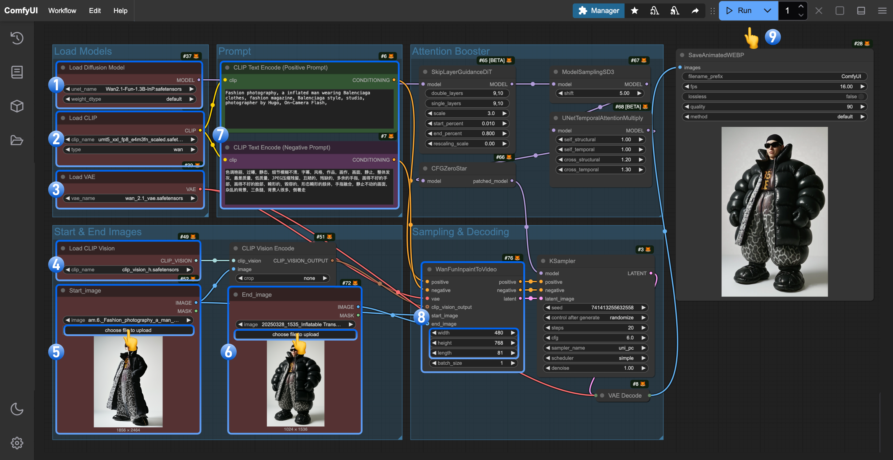

import UpdateReminder from "/snippets/ru/tutorials/update-reminder.mdx";

**Wan2.1 Fun InP** представляет собой модель генерации видео с открытым исходным кодом из серии Wan2.1-Fun от Alibaba. Вы предоставляете изображения первого и последнего кадра, и модель генерирует видео перехода между ними со стабильным и связным движением.

В этом руководстве описан официальный рабочий процесс ComfyUI для Wan2.1 Fun InP. Доступны облегчённая версия 1.3B и высокопроизводительная версия 14B; также приведены загрузки моделей и пошаговые инструкции по генерации.

## О Wan2.1-Fun-InP

**Wan-Fun InP**: это  открытая модель генерации видео, выпущенная Alibaba в составе серии Wan2.1-Fun. Она предназначена для генерации видео из изображений с управлением первым и последним кадром.

**Ключевые особенности**:
- **Управление первым и последним кадром**: поддерживается ввод изображений первого и последнего кадра для генерации переходного видео между ними, что повышает связность видео и свободу творчества. По сравнению с более ранними версиями от сообщества официальная модель Alibaba дает более стабильные и значительно более качественные результаты.
- **Поддержка нескольких разрешений**: поддерживается генерация видео в разрешениях 512x512, 768x768, 1024x1024 и других, что позволяет учитывать требования разных сценариев.

**Версии модели**:
- **1.3B** облегченная: подходит для локального развертывания и быстрого вывода с **более низкими требованиями к видеопамяти**
- **14B** высокопроизводительная: размер модели достигает 32 ГБ и более, результаты лучше, но требуются **более высокие требования к видеопамяти**

Ниже приведены соответствующие веса моделей и репозитории с кодом:

- [Wan2.1-Fun-1.3B-Input](https://huggingface.co/alibaba-pai/Wan2.1-Fun-1.3B-Input)
- [Wan2.1-Fun-14B-Input](https://huggingface.co/alibaba-pai/Wan2.1-Fun-14B-Input)
- Репозиторий с кодом: [VideoX-Fun](https://github.com/aigc-apps/VideoX-Fun)

<Tip>
Сейчас ComfyUI нативно поддерживает модель Wan2.1 Fun InP. Перед началом работы с этим руководством обновите ComfyUI, чтобы ваша версия была ПОСЛЕ [этого коммита](https://github.com/Comfy-Org/ComfyUI/commit/0a1f8869c9998bbfcfeb2e97aa96a6d3e0a2b5df).
</Tip>

<UpdateReminder/>

## Рабочий процесс Wan2.1 Fun InP

### 1. Скачать рабочий процесс

Скачайте изображение ниже и перетащите его в ComfyUI, чтобы загрузить рабочий процесс:


<CardGroup cols={2}>
  <Card title="Запустить в Comfy Cloud" icon="cloud" href="https://cloud.comfy.org/?template=wan2.1_fun_inp&utm_source=docs&utm_medium=referral&utm_campaign=fun-inp">
    Открыть в Comfy Cloud
  </Card>
  <Card title="Скачать рабочий процесс" icon="download" href="https://github.com/Comfy-Org/workflow_templates/blob/main/templates/wan2.1_fun_inp.json">
    Скачайте JSON или найдите «Wan 2.1 Inpainting» в библиотеке шаблонов
  </Card>
</CardGroup>

<CardGroup cols={2}>
  <Card title="Начальное изображение" icon="image" href="https://raw.githubusercontent.com/Comfy-Org/workflow_templates/main/input/wan2.1_fun_inp_start_image.png">
    Первый кадр для генерации видео. Скачайте и используйте это изображение или замените его своим.
  </Card>
  <Card title="Конечное изображение" icon="image" href="https://raw.githubusercontent.com/Comfy-Org/workflow_templates/main/input/wan2.1_fun_inp_end_image.png">
    Последний кадр для генерации видео. Скачайте и используйте это изображение или замените его своим.
  </Card>
</CardGroup>

### 2. Ручная установка моделей

Если автоматическая загрузка моделей не работает, скачайте модели вручную и сохраните их в соответствующие папки.

Все модели, упомянутые в этом руководстве, можно найти в [Wan_2.1_ComfyUI_repackaged](https://huggingface.co/Comfy-Org/Wan_2.1_ComfyUI_repackaged) и [Wan2.1-Fun](https://huggingface.co/collections/alibaba-pai/wan21-fun-67e4fb3b76ca01241eb7e334).

**Модели диффузии** : выберите 1.3B или 14B. Версия 14B имеет больший размер файла (32GB) и более высокие требования к видеопамяти:

<CardGroup cols={2}>
  <Card title="Модель диффузии: Wan2.1 Fun InP 1.3B" icon="download" href="https://huggingface.co/Comfy-Org/Wan_2.1_ComfyUI_repackaged/blob/main/split_files/diffusion_models/wan2.1_fun_inp_1.3B_bf16.safetensors">
    `models/diffusion_models/wan2.1_fun_inp_1.3B_bf16.safetensors`
  </Card>
  <Card title="Модель диффузии: Wan2.1 Fun InP 14B" icon="download" href="https://huggingface.co/alibaba-pai/Wan2.1-Fun-14B-InP/blob/main/diffusion_pytorch_model.safetensors">
    `models/diffusion_models/Wan2.1-Fun-14B-InP.safetensors` (переименуйте после скачивания)
  </Card>
</CardGroup>

**Текстовые энкодеры** : выберите одну из следующих моделей (точность fp16 занимает больше места и предъявляет более высокие требования к производительности):

<CardGroup cols={2}>
  <Card title="Текстовый энкодер: umt5_xxl_fp16" icon="download" href="https://huggingface.co/Comfy-Org/Wan_2.1_ComfyUI_repackaged/blob/main/split_files/text_encoders/umt5_xxl_fp16.safetensors">
    `models/text_encoders/umt5_xxl_fp16.safetensors`
  </Card>
  <Card title="Текстовый энкодер: umt5_xxl_fp8" icon="download" href="https://huggingface.co/Comfy-Org/Wan_2.1_ComfyUI_repackaged/blob/main/split_files/text_encoders/umt5_xxl_fp8_e4m3fn_scaled.safetensors">
    `models/text_encoders/umt5_xxl_fp8_e4m3fn_scaled.safetensors`
  </Card>
</CardGroup>

**VAE**

<Card title="VAE: wan_2.1_vae" icon="download" href="https://huggingface.co/Comfy-Org/Wan_2.1_ComfyUI_repackaged/blob/main/split_files/vae/wan_2.1_vae.safetensors">
  `models/vae/wan_2.1_vae.safetensors`
</Card>
**CLIP Vision**

<Card title="CLIP Vision: clip_vision_h" icon="download" href="https://huggingface.co/Comfy-Org/Wan_2.1_ComfyUI_repackaged/blob/main/split_files/clip_vision/clip_vision_h.safetensors">
  `models/clip_vision/clip_vision_h.safetensors`
</Card>
Расположение файлов:
```
📂 ComfyUI/
├── 📂 models/
│   ├── 📂 diffusion_models/
│   │   ├── wan2.1_fun_inp_1.3B_bf16.safetensors
│   │   └── Wan2.1-Fun-14B-InP.safetensors
│   ├── 📂 text_encoders/
│   │   ├── umt5_xxl_fp16.safetensors
│   │   └── umt5_xxl_fp8_e4m3fn_scaled.safetensors
│   ├── 📂 vae/
│   │   └── wan_2.1_vae.safetensors
│   └── 📂 clip_vision/
│       └── clip_vision_h.safetensors
```

### 3. Выполнить рабочий процесс по шагам



1. Убедитесь, что в узле `Load Diffusion Model` загружена модель `wan2.1_fun_inp_1.3B_bf16.safetensors`
2. Убедитесь, что в узле `Load CLIP` загружена модель `umt5_xxl_fp8_e4m3fn_scaled.safetensors`
3. Убедитесь, что в узле `Load VAE` загружена модель `wan_2.1_vae.safetensors`
4. Убедитесь, что в узле `Load CLIP Vision` загружена модель `clip_vision_h.safetensors`
5. Загрузите начальный кадр в узел `Load Image` (переименованный в `Start_image`)
6. Загрузите конечный кадр во второй узел `Load Image`
7. (Необязательно) Измените промпт (поддерживаются английский и китайский языки)
8. (Необязательно) Настройте размер видео в `WanFunInpaintToVideo`, избегая слишком больших размеров
9. Нажмите кнопку `Run` или используйте сочетание клавиш `Ctrl(cmd) + Enter`, чтобы выполнить генерацию видео

### 4. Примечания к рабочему процессу

<Tip>
Обязательно используйте правильную модель: `wan2.1_fun_inp_1.3B_bf16.safetensors` и `wan2.1_fun_control_1.3B_bf16.safetensors` хранятся в одной папке и имеют очень похожие названия. Убедитесь, что вы используете нужную модель.
</Tip>

- При использовании Wan Fun InP может потребоваться часто изменять промпты, чтобы обеспечить точность соответствующих переходов между сценами.

## Другие пользовательские узлы для Wan2.1 Fun InP и видео

- [ComfyUI-VideoHelperSuite](https://github.com/Kosinkadink/ComfyUI-VideoHelperSuite)
- [ComfyUI-WanVideoWrapper](https://github.com/kijai/ComfyUI-WanVideoWrapper)
- [ComfyUI-KJNodes](https://github.com/kijai/ComfyUI-KJNodes)
