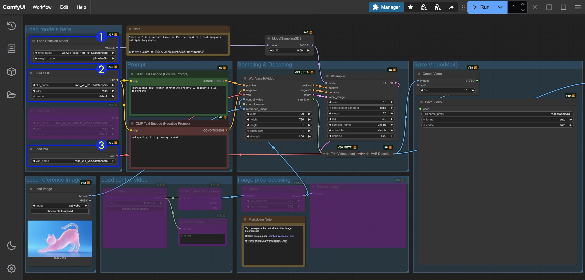
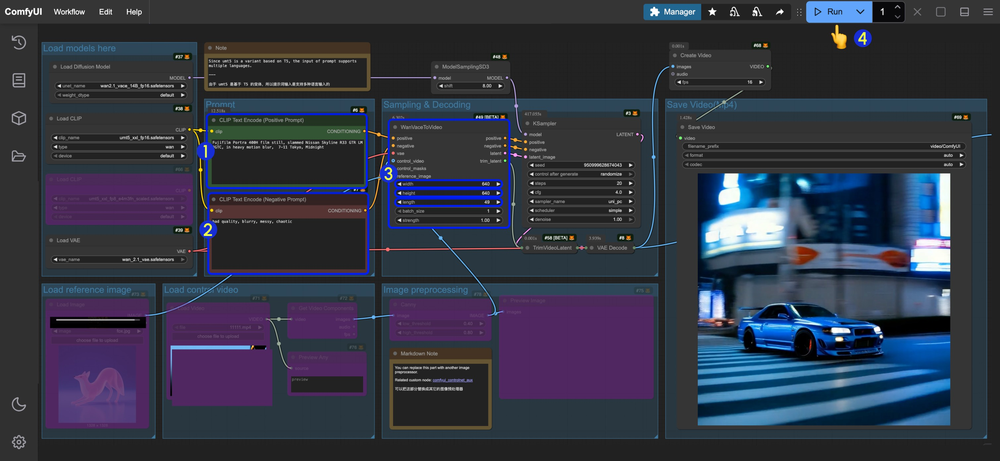
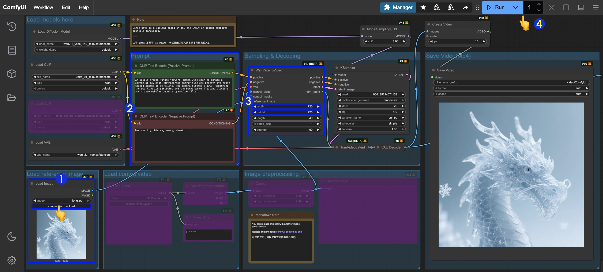
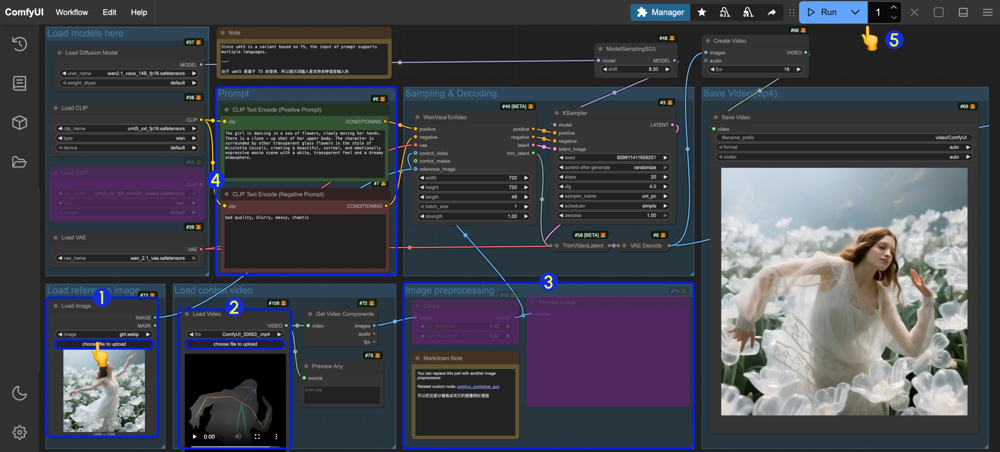

import CancelBypass from "/snippets/ru/interface/cancel-bypass.mdx"
import UpdateReminder from "/snippets/ru/tutorials/update-reminder.mdx";

<Warning>
Мы внесли корректировки в шаблон и добавили соответствующие инструкции и сведения по использованию CausVid LoRA, поэтому этот документ необходимо обновить, что потребует некоторого времени на подготовку. А пока руководствуйтесь примечаниями в шаблоне по использованию.
</Warning>

## О VACE

VACE 14B представляет собой открытую унифицированную модель редактирования видео, выпущенную командой Alibaba Tongyi Wanxiang. Благодаря объединению возможностей решения нескольких задач, поддержке обработки в высоком разрешении и гибким механизмам мультимодального ввода эта модель значительно повышает эффективность и качество создания видео.

Модель распространяется с открытым исходным кодом по лицензии [Apache-2.0](https://github.com/ali-vilab/VACE?tab=Apache-2.0-1-ov-file) и может использоваться в личных или коммерческих целях.

Ниже подробно разобраны её ключевые возможности и технические особенности:

- Мультимодальный ввод: поддерживает несколько форм ввода, включая текст, изображения, видео, маски и управляющие сигналы
- Единая архитектура: одна модель поддерживает несколько задач со свободно комбинируемыми функциями
- Перенос движения: генерирует согласованные действия на основе референсных видео
- Локальная замена: заменяет отдельные области в видео с помощью масок
- Расширение видео: достраивает действия или расширяет фон
- Замена фона: сохраняет объекты, меняя окружающий фон

Сейчас выпущены две версии VACE: 1.3B и 14B. По сравнению с версией 1.3B версия 14B поддерживает вывод в разрешении 720P с более высоким качеством деталей изображения и стабильностью.

| Модель                                                      | 480P | 720P |
| ----------------------------------------------------------- | ---- | ---- |
| [VACE-1.3B](https://huggingface.co/Wan-AI/Wan2.1-VACE-1.3B) | ✅   | ❌   |
| [VACE-14B](https://huggingface.co/Wan-AI/Wan2.1-VACE-14B)   | ✅   | ✅   |

Связанные веса моделей и репозитории с кодом:

<CardGroup cols={2}>
  <Card title="VACE-1.3B" icon="download" href="https://huggingface.co/Wan-AI/Wan2.1-VACE-1.3B">
    Веса модели 1.3B на Hugging Face
  </Card>
  <Card title="VACE-14B" icon="download" href="https://huggingface.co/Wan-AI/Wan2.1-VACE-14B">
    Веса модели 14B на Hugging Face
  </Card>
  <Card title="Репозиторий GitHub" icon="github" href="https://github.com/ali-vilab/VACE">
    Исходный код и документация VACE
  </Card>
  <Card title="Страница проекта VACE" icon="globe" href="https://ali-vilab.github.io/VACE-Page/">
    Официальная домашняя страница проекта с примерами
  </Card>
</CardGroup>

<UpdateReminder/>

## Скачивание и загрузка моделей в рабочих процессах

Поскольку все рабочие процессы в этом документе используют один и тот же шаблон, сначала опишем скачивание и загрузку моделей, а затем будем включать или отключать разные входы, обходя те или иные узлы, чтобы получать разные рабочие процессы.
Информация о скачивании моделей уже встроена в сведения о рабочем процессе в конкретных примерах, поэтому скачать модели можно и вместе со скачиванием конкретных примеров рабочих процессов.

### Скачивание моделей

**Модели диффузии**

<CardGroup cols={2}>
  <Card title="wan2.1_vace_14B_fp16.safetensors" icon="download" href="https://huggingface.co/Comfy-Org/Wan_2.1_ComfyUI_repackaged/blob/main/split_files/diffusion_models/wan2.1_vace_14B_fp16.safetensors">
    Модель диффузии VACE 14B (рекомендуется, ~32GB). Поместите файл в <code>ComfyUI/models/diffusion_models/</code>
  </Card>
  <Card title="wan2.1_vace_1.3B_fp16.safetensors" icon="download" href="https://huggingface.co/Comfy-Org/Wan_2.1_ComfyUI_repackaged/blob/main/split_files/diffusion_models/wan2.1_vace_1.3B_fp16.safetensors">
    Модель диффузии VACE 1.3B (легче, ~7GB). Поместите файл в <code>ComfyUI/models/diffusion_models/</code>
  </Card>
</CardGroup>

<Tip>
Если вы уже работали с рабочими процессами для Wan Video, следующие файлы моделей у вас уже скачаны.
</Tip>

**VAE**

<CardGroup cols={2}>
  <Card title="wan_2.1_vae.safetensors" icon="download" href="https://huggingface.co/Comfy-Org/Wan_2.1_ComfyUI_repackaged/blob/main/split_files/vae/wan_2.1_vae.safetensors">
    Модель VAE для Wan. Поместите файл в <code>ComfyUI/models/vae/</code>
  </Card>
</CardGroup>

**Текстовые энкодеры** (выберите одну версию)

<CardGroup cols={2}>
  <Card title="umt5_xxl_fp16.safetensors" icon="download" href="https://huggingface.co/Comfy-Org/Wan_2.1_ComfyUI_repackaged/blob/main/split_files/text_encoders/umt5_xxl_fp16.safetensors">
    Текстовый энкодер полной точности (выше качество, больше размер). Поместите файл в <code>ComfyUI/models/text_encoders/</code>
  </Card>
  <Card title="umt5_xxl_fp8_e4m3fn_scaled.safetensors" icon="download" href="https://huggingface.co/Comfy-Org/Wan_2.1_ComfyUI_repackaged/blob/main/split_files/text_encoders/umt5_xxl_fp8_e4m3fn_scaled.safetensors">
    Текстовый энкодер FP8 (меньше расход видеопамяти). Поместите файл в <code>ComfyUI/models/text_encoders/</code>
  </Card>
</CardGroup>

Куда сохранять файлы:

```
📂 ComfyUI/
├── 📂 models/
│   ├── 📂 diffusion_models/
│   │   └─── wan2.1_vace_14B_fp16.safetensors
│   ├── 📂 text_encoders/
│   │   └─── umt5_xxl_fp8_e4m3fn_scaled.safetensors # или umt5_xxl_fp16.safetensors
│   └── 📂 vae/
│       └──  wan_2.1_vae.safetensors
```

### Загрузка моделей

Поскольку в рабочих процессах из этого документа используются одни и те же модели, сами рабочие процессы тоже одинаковы: разные входы включаются и отключаются только обходом узлов. Ориентируйтесь на изображение ниже, чтобы убедиться, что в разных рабочих процессах правильно загружены нужные модели.



1. Убедитесь, что в узле `Load Diffusion Model` загружена модель `wan2.1_vace_14B_fp16.safetensors`
2. Убедитесь, что в узле `Load CLIP` загружена модель `umt5_xxl_fp8_e4m3fn_scaled.safetensors` или `umt5_xxl_fp16.safetensors`
3. Убедитесь, что в узле `Load VAE` загружена модель `wan_2.1_vae.safetensors`

<CancelBypass/>

---

## 1. VACE: текст в видео

**Что делает:** преобразует текстовые описания в высококачественные видео с помощью модели Wan2.1 VACE 14B. Поддерживается разрешение 480p и 720p.

### Wan2.1 VACE Text to Video {#video_wan_vace_14B_t2v}

Преобразование текстовых описаний в высококачественные видео. Поддерживаются разрешения 480p и 720p с моделью VACE-14B.


<CardGroup cols={2}>
  <Card title="Запустить в Comfy Cloud" icon="cloud" href="https://cloud.comfy.org/?template=video_wan_vace_14B_t2v&utm_source=docs&utm_medium=referral&utm_campaign=vace">
    Открыть в Comfy Cloud
  </Card>
  <Card title="Скачать рабочий процесс" icon="download" href="https://github.com/Comfy-Org/workflow_templates/blob/main/templates/video_wan_vace_14B_t2v.json">
    Скачайте JSON или найдите «Wan2.1 VACE Text to Video» в библиотеке шаблонов
  </Card>
</CardGroup>

<video
  controls
  className="w-full aspect-video"
  src="https://github.com/Comfy-Org/example_workflows/raw/refs/heads/main/video/wan/vace/vace-t2v.mp4"
></video>

<Tip>
Если не удаётся загрузить рабочий процесс из mp4-файла, убедитесь, что версия фронтенда ComfyUI соответствует актуальной версии в [requirements.txt](https://github.com/Comfy-Org/ComfyUI/blob/master/requirements.txt), и проверьте, что загрузка рабочего процесса из mp4-файла работает.

Сейчас последняя версия фронтенда ComfyUI в файле requirements.txt: 1.19.9.
</Tip>

### Шаги запуска



Следуйте пронумерованным шагам на изображении, чтобы обеспечить плавное выполнение рабочего процесса:

1. Введите положительные промпты в узле `CLIP Text Encode (Positive Prompt)`
2. Введите негативные промпты в узле `CLIP Text Encode (Negative Prompt)`
3. Задайте размеры изображения (для первого запуска рекомендуется разрешение 640x640) и количество кадров (длительность видео) в узле `WanVaceToVideo`
4. Нажмите кнопку `Run` или используйте сочетание клавиш `Ctrl(cmd) + Enter`, чтобы выполнить генерацию видео
5. После генерации видео автоматически сохранится в каталог `ComfyUI/output/video` (расположение подпапки зависит от настроек узла `save video`)

<Tip>
При тестировании на GPU 4090:
- разрешение 720x1280, генерация 81 кадра занимает около 40 минут
- разрешение 640x640, генерация 49 кадров занимает около 7 минут

При этом качество видео 720P выше.
</Tip>

---

## 2. VACE: изображение в видео

**Что делает:** генерирует видео, соответствующие стилю и содержимому референсного изображения. Идеально подходит для генерации видео в едином стиле.

Вы можете продолжить использовать рабочий процесс выше: просто снимите обход с узла `Load image` в группе **Load reference image** и укажите своё изображение. Также можно использовать изображение ниже. В этом файле соответствующие параметры уже настроены.

### Wan2.1 VACE Reference to Video {#video_wan_vace_14B_ref2v}

Создавайте видео, соответствующие стилю и содержимому референсного изображения. Идеально для генерации видео в едином стиле.


<CardGroup cols={2}>
  <Card title="Запустить в Comfy Cloud" icon="cloud" href="https://cloud.comfy.org/?template=video_wan_vace_14B_ref2v&utm_source=docs&utm_medium=referral&utm_campaign=vace">
    Открыть в Comfy Cloud
  </Card>
  <Card title="Скачать рабочий процесс" icon="download" href="https://github.com/Comfy-Org/workflow_templates/blob/main/templates/video_wan_vace_14B_ref2v.json">
    Скачайте JSON или найдите «Wan2.1 VACE Reference to Video» в библиотеке шаблонов
  </Card>
</CardGroup>

<video
  controls
  className="w-full aspect-video"
  src="https://raw.githubusercontent.com/Comfy-Org/example_workflows/refs/heads/main/video/wan/vace/i2v/vace_i2v.mp4"
></video>

**Входные материалы**

Загрузите этот файл в соответствующий узел `LoadImage`:

<CardGroup cols={2}>
  <Card title="video_wan_vace_14B_ref2v_reference_image.jpg" icon="image" href="https://raw.githubusercontent.com/Comfy-Org/workflow_templates/main/input/video_wan_vace_14B_ref2v_reference_image.jpg">
    узел `LoadImage` 73 · `video_wan_vace_14B_ref2v_reference_image.jpg`
  </Card>
</CardGroup>

<div style={{display: 'grid', gridTemplateColumns: 'repeat(2, minmax(0, 1fr))', gap: '1rem', alignItems: 'start'}}>
  
</div>

### Шаги выполнения



Следуйте пронумерованным шагам на изображении, чтобы рабочий процесс выполнялся без сбоев:

1. Укажите соответствующее изображение в узле `Load image`
2. Вы можете изменять и редактировать промпты так же, как в рабочем процессе текст в видео
3. Задайте размеры изображения (при первом запуске рекомендуется разрешение 640x640) и количество кадров (длительность видео) в `WanVaceToVideo`
4. Нажмите кнопку `Run` или используйте сочетание клавиш `Ctrl(cmd) + Enter`, чтобы запустить генерацию видео
5. После генерации видео автоматически сохраняется в каталог `ComfyUI/output/video` (расположение подпапки зависит от настроек узла `save video`)

<Tip>
Возможно, вы захотите использовать узлы вроде получения размеров изображения, чтобы задать разрешение, но из-за требований к шагу ширины и высоты у соответствующих узлов при размерах изображения, не кратных 16, могут появляться сообщения об ошибках.
</Tip>

### Дополнительные примечания

VACE также поддерживает ввод нескольких референсных изображений в одном изображении для генерации соответствующих видео. Связанные примеры можно посмотреть на [странице](https://ali-vilab.github.io/VACE-Page/) проекта VACE.

---

## 3. VACE видео-в-видео

**Что делает:** Генерирует видео, управляя входными видео и референсными изображениями с помощью Wan VACE. Управляйте стилем и движением видео с помощью референсных материалов.

### Wan2.1 VACE Control Video {#video_wan_vace_14B_v2v}

Генерируйте видео, управляя входными видео и референсными изображениями с помощью Wan VACE.


<CardGroup cols={2}>
  <Card title="Запустить в Comfy Cloud" icon="cloud" href="https://cloud.comfy.org/?template=video_wan_vace_14B_v2v&utm_source=docs&utm_medium=referral&utm_campaign=vace">
    Открыть в Comfy Cloud
  </Card>
  <Card title="Скачать рабочий процесс" icon="download" href="https://github.com/Comfy-Org/workflow_templates/blob/main/templates/video_wan_vace_14B_v2v.json">
    Скачать JSON или найти «Wan2.1 VACE Control Video» в библиотеке шаблонов
  </Card>
</CardGroup>

<video
  controls
  className="w-full aspect-video"
  src="https://raw.githubusercontent.com/Comfy-Org/example_workflows/refs/heads/main/video/wan/vace/v2v/vace_v2v.mp4"
></video>

В качестве входных данных будут использоваться следующие материалы:

<CardGroup cols={2}>
  <Card title="Референсное изображение" icon="image" href="https://raw.githubusercontent.com/Comfy-Org/workflow_templates/refs/heads/main/input/video_wan_vace_14B_v2v_reference_image.jpg">
    Входное референсное изображение для стиля и содержимого.
  </Card>
  <Card title="Управляющее видео (предварительно обработано)" icon="video" href="https://raw.githubusercontent.com/Comfy-Org/workflow_templates/refs/heads/main/input/video_wan_vace_14B_v2v_reference_image_control_video.mp4">
    Предварительно обработанное управляющее видео (глубина). Используйте напрямую в <code>Load Video</code> в группе <strong>Load control video</strong>.
  </Card>
</CardGroup>

1. Входное изображение для референса:


2. Видео ниже было предварительно обработано и будет использоваться для управления генерацией видео:

<video
  controls
  className="w-full aspect-video"
  src="https://raw.githubusercontent.com/Comfy-Org/example_workflows/refs/heads/main/video/wan/vace/v2v/post+depth.mp4"
></video>

3. Ниже представлено оригинальное видео. Вы можете скачать эти материалы и использовать узлы предварительной обработки, такие как [comfyui_controlnet_aux](https://github.com/Fannovel16/comfyui_controlnet_aux), чтобы предварительно обработать изображения:

<video
  controls
  className="w-full aspect-video"
  src="https://raw.githubusercontent.com/Comfy-Org/example_workflows/refs/heads/main/video/wan/vace/v2v/original.mp4"
></video>

### Шаги выполнения



Следуйте пронумерованным шагам на изображении, чтобы обеспечить плавное выполнение рабочего процесса:

1. Загрузите референсное изображение в узел `Load Image` в группе **Load reference image**
2. Загрузите управляющее видео в узел `Load Video` в группе **Load control video**. Поскольку предоставленное видео предварительно обработано, дополнительная обработка не требуется
3. Если вам нужно самостоятельно предварительно обработать оригинальное видео, вы можете изменить группу **Image preprocessing** или использовать узлы `comfyui_controlnet_aux` для выполнения предварительной обработки
4. Измените промпты
5. Задайте размеры изображения (для первого запуска рекомендуется разрешение 640x640) и количество кадров (длительность видео) в `WanVaceToVideo`
6. Нажмите кнопку `Run` или используйте сочетание клавиш `Ctrl(cmd) + Enter`, чтобы выполнить генерацию видео
7. После генерации видео автоматически сохранится в каталог `ComfyUI/output/video` (расположение подпапки зависит от настроек узла `save video`)

---

## 4. Инпейтинг VACE

**Что делает:** редактирует отдельные области видео, сохраняя окружающее содержимое. Отлично подходит для удаления или замены объектов.

### Wan2.1 VACE Inpainting {#video_wan_vace_inpainting}

Редактирует отдельные области видео, сохраняя окружающее содержимое. Отлично подходит для удаления или замены объектов.


<CardGroup cols={2}>
  <Card title="Запустить в Comfy Cloud" icon="cloud" href="https://cloud.comfy.org/?template=video_wan_vace_inpainting&utm_source=docs&utm_medium=referral&utm_campaign=vace">
    Открыть в Comfy Cloud
  </Card>
  <Card title="Скачать рабочий процесс" icon="download" href="https://github.com/Comfy-Org/workflow_templates/blob/main/templates/video_wan_vace_inpainting.json">
    Скачать JSON или найти «Wan2.1 VACE Inpainting» в Библиотеке шаблонов
  </Card>
</CardGroup>

**Входные материалы**

<CardGroup cols={2}>
  <Card title="Входное видео" icon="video" href="https://raw.githubusercontent.com/Comfy-Org/workflow_templates/refs/heads/main/input/video_wan_vace_inpainting_input_video.mp4">
    Входное видео для инпейтинга. Загружается в узле <code>Load Video</code>.
  </Card>
  <Card title="Первый кадр и маска" icon="image" href="https://raw.githubusercontent.com/Comfy-Org/workflow_templates/refs/heads/main/input/video_wan_vace_inpainting_1st_frame_and_mask.png">
    Первый кадр с наложенной маской для области инпейтинга.
  </Card>
  <Card title="Референсное изображение" icon="image" href="https://raw.githubusercontent.com/Comfy-Org/workflow_templates/refs/heads/main/input/video_wan_vace_inpainting_reference_image.jpg">
    Референсное изображение для содержимого инпейтинга.
  </Card>
</CardGroup>

[Будет обновлено]

---

## 5. Outpainting видео с VACE

**Что делает:** генерирует расширенные видео, увеличивая размер видео с помощью outpainting в Wan VACE.

### Wan2.1 VACE Outpainting {#video_wan_vace_outpainting}

Генерирует расширенные видео, увеличивая размер видео с помощью outpainting в Wan VACE.


<CardGroup cols={2}>
  <Card title="Запустить в Comfy Cloud" icon="cloud" href="https://cloud.comfy.org/?template=video_wan_vace_outpainting&utm_source=docs&utm_medium=referral&utm_campaign=vace">
    Открыть в Comfy Cloud
  </Card>
  <Card title="Скачать рабочий процесс" icon="download" href="https://github.com/Comfy-Org/workflow_templates/blob/main/templates/video_wan_vace_outpainting.json">
    Скачать JSON или найдите «Wan2.1 VACE Outpainting» в Библиотеке шаблонов
  </Card>
</CardGroup>

**Входные материалы**

<CardGroup cols={2}>
  <Card title="Входное видео" icon="video" href="https://raw.githubusercontent.com/Comfy-Org/workflow_templates/refs/heads/main/input/video_wan_vace_outpainting_input_video.mp4">
    Входное видео для outpainting. Загрузите его в узле <code>Load Video</code>.
  </Card>
</CardGroup>

[Будет обновлено]

## 6. Генерация видео VACE по первому и последнему кадру

**Что делает:** генерирует плавные переходы в видео, задавая начальный и конечный кадры. Поддерживает пользовательские последовательности ключевых кадров.

### Wan2.1 VACE First-Last Frame {#video_wan_vace_flf2v}

Генерируйте плавные переходы в видео, задавая начальный и конечный кадры. Поддерживаются пользовательские последовательности ключевых кадров.


<CardGroup cols={2}>
  <Card title="Запустить в Comfy Cloud" icon="cloud" href="https://cloud.comfy.org/?template=video_wan_vace_flf2v&utm_source=docs&utm_medium=referral&utm_campaign=vace">
    Открыть в Comfy Cloud
  </Card>
  <Card title="Скачать рабочий процесс" icon="download" href="https://github.com/Comfy-Org/workflow_templates/blob/main/templates/video_wan_vace_flf2v.json">
    Скачайте JSON или найдите «Wan2.1 VACE First-Last Frame» в библиотеке шаблонов
  </Card>
</CardGroup>

**Входные материалы**

<CardGroup cols={2}>
  <Card title="Начальный кадр" icon="image" href="https://raw.githubusercontent.com/Comfy-Org/workflow_templates/refs/heads/main/input/video_wan_vace_flf2v_start_image.png">
    Изображение начального кадра. Загрузите его в узле <code>Load Image</code>.
  </Card>
  <Card title="Конечный кадр" icon="image" href="https://raw.githubusercontent.com/Comfy-Org/workflow_templates/refs/heads/main/input/video_wan_vace_flf2v_end_image.png">
    Изображение конечного кадра. Загрузите его в узле <code>Load Image</code>.
  </Card>
</CardGroup>

Чтобы первый и последний кадры учитывались, значение `length` для видео должно удовлетворять условию: `length-1` делится на 4.

Соответствующее значение `Batch_size` должно удовлетворять условию `Batch_size = length - 2`.

[Будет обновлено]
