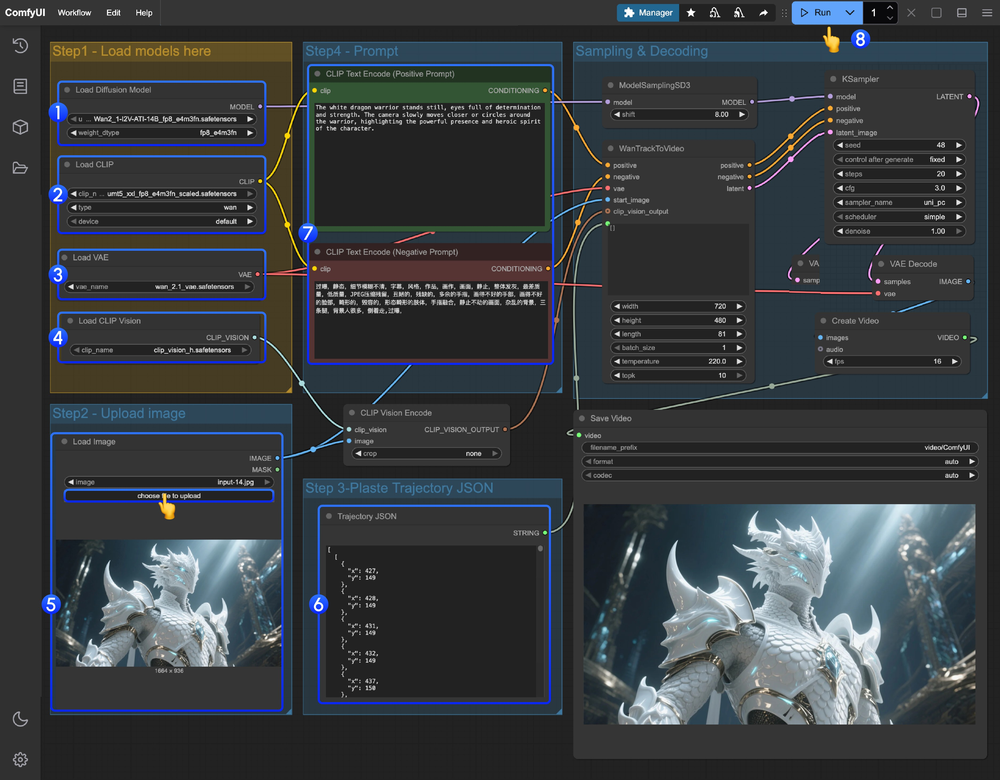

import UpdateReminder from "/snippets/ru/tutorials/update-reminder.mdx"

**ATI (Any Trajectory Instruction)** представляет собой управляемый фреймворк генерации видео, предложенный командой ByteDance. ATI реализован на основе Wan2.1 и поддерживает единое управление объектами, локальными областями и движением камеры в видео с помощью произвольных инструкций траекторий.

<CardGroup cols={2}>
  <Card title="Репозиторий проекта" icon="github" href="https://github.com/bytedance/ATI">
    Исходный код и документация ATI на GitHub
  </Card>
  <Card title="Онлайн-инструмент редактирования траекторий" icon="pencil" href="https://comfyui-wiki.github.io/Trajectory-Annotation-Tool/">
    Визуальный инструмент для рисования и редактирования траекторий движения на изображениях
  </Card>
</CardGroup>

## Ключевые возможности

- **Единое управление движением**: Поддерживает управление траекториями для нескольких типов движения, включая объекты, локальные области и движения камеры.
- **Интерактивный редактор траекторий**: Визуальный инструмент, который позволяет пользователям свободно рисовать и редактировать траектории движения на изображениях.
- **Совместимость с Wan2.1**: Основан на официальной реализации Wan2.1 и совместим с окружениями и структурами моделей.
- **Богатый набор инструментов визуализации**: Поддерживает визуализацию входных траекторий, выходных видео и наложений траекторий.

## Пример рабочего процесса с управлением траекторией WAN ATI

<UpdateReminder />

### 1. Скачать рабочий процесс

Обновите ComfyUI до последней версии, затем скачайте файл рабочего процесса и перетащите его в ComfyUI или найдите "Wan2.1 ATI" в Библиотеке шаблонов по пути `Workflow` → `Browse Templates` → `Video`.


<CardGroup cols={2}>
  <Card title="Запустить в Comfy Cloud" icon="cloud" href="https://cloud.comfy.org/?template=video_wan_ati&utm_source=docs&utm_medium=referral&utm_campaign=wan-ati">
    Открыть в Comfy Cloud
  </Card>
  <Card title="Скачать рабочий процесс" icon="download" href="https://github.com/Comfy-Org/workflow_templates/blob/main/templates/video_wan_ati.json">
    Скачать JSON или найдите "Wan2.1 ATI" в Библиотеке шаблонов
  </Card>
</CardGroup>

<video
  controls
  className="w-full aspect-video"
  src="https://raw.githubusercontent.com/Comfy-Org/example_workflows/refs/heads/main/video/wan/ati/wan_ati.mp4"
></video>

В качестве входных данных мы будем использовать следующее изображение:

<CardGroup cols={1}>
  <Card title="Входное изображение: video_wan_ati_input_image.jpg" icon="image" href="https://raw.githubusercontent.com/Comfy-Org/workflow_templates/main/input/video_wan_ati_input_image.jpg">
    Скачайте входное изображение по умолчанию или используйте собственное изображение в качестве начального кадра.
  </Card>
</CardGroup>

<video
  controls
  className="w-full aspect-video"
  src="https://raw.githubusercontent.com/Comfy-Org/workflow_templates/main/output/template-Animation_Trajectory_Control_Wan_ATI.mp4"
></video>

### 2. Установить модели вручную

Все модели, используемые в этом руководстве, можно найти [здесь](https://huggingface.co/Comfy-Org/Wan_2.1_ComfyUI_repackaged/tree/main/split_files).

**Модель диффузии**: выберите одну версию:

<CardGroup cols={1}>
  <Card title="Модель диффузии: Wan2_1-I2V-ATI-14B_fp8_e4m3fn.safetensors" icon="download" href="https://huggingface.co/Kijai/WanVideo_comfy/blob/main/Wan2_1-I2V-ATI-14B_fp8_e4m3fn.safetensors">
    Модель диффузии Wan2.1 I2V ATI 14B (точность fp8). Поместите в <code>ComfyUI/models/diffusion_models/</code>
  </Card>
</CardGroup>

**Текстовые энкодеры**: выберите одну версию:

<CardGroup cols={2}>
  <Card title="Текстовый энкодер: umt5_xxl_fp16.safetensors" icon="download" href="https://huggingface.co/Comfy-Org/Wan_2.1_ComfyUI_repackaged/blob/main/split_files/text_encoders/umt5_xxl_fp16.safetensors">
    Текстовый энкодер полной точности (выше качество, больше размер). Поместите в <code>ComfyUI/models/text_encoders/</code>
  </Card>
  <Card title="Текстовый энкодер: umt5_xxl_fp8_e4m3fn_scaled.safetensors" icon="download" href="https://huggingface.co/Comfy-Org/Wan_2.1_ComfyUI_repackaged/blob/main/split_files/text_encoders/umt5_xxl_fp8_e4m3fn_scaled.safetensors">
    Текстовый энкодер FP8 (меньше потребление видеопамяти). Поместите в <code>ComfyUI/models/text_encoders/</code>
  </Card>
</CardGroup>

**VAE**

<Card title="VAE: wan_2.1_vae.safetensors" icon="download" href="https://huggingface.co/Comfy-Org/Wan_2.1_ComfyUI_repackaged/blob/main/split_files/vae/wan_2.1_vae.safetensors">
  Модель VAE Wan2.1. Поместите в <code>ComfyUI/models/vae/</code>
</Card>
**CLIP Vision**

<Card title="CLIP Vision: clip_vision_h.safetensors" icon="download" href="https://huggingface.co/Comfy-Org/Wan_2.1_ComfyUI_repackaged/blob/main/split_files/clip_vision/clip_vision_h.safetensors">
  Модель CLIP Vision для обработки референсных изображений. Поместите в <code>ComfyUI/models/clip_vision/</code>
</Card>
**Расположение файлов**

```
📂 ComfyUI/
├── 📂 models/
│   ├── 📂 diffusion_models/
│   │   └── Wan2_1-I2V-ATI-14B_fp8_e4m3fn.safetensors
│   ├── 📂 text_encoders/
│   │   └── umt5_xxl_fp8_e4m3fn_scaled.safetensors  # или выбранная вами версия
│   ├── 📂 clip_vision/
│   │   └── clip_vision_h.safetensors
│   └── 📂 vae/
│       └── wan_2.1_vae.safetensors
```

### 3. Выполнить рабочий процесс по шагам



Следуйте пронумерованным шагам на изображении, чтобы соответствующий рабочий процесс выполнялся без ошибок.

1. Убедитесь, что узел `Load Diffusion Model` загрузил модель `Wan2_1-I2V-ATI-14B_fp8_e4m3fn.safetensors`
2. Убедитесь, что узел `Load CLIP` загрузил модель `umt5_xxl_fp8_e4m3fn_scaled.safetensors`
3. Убедитесь, что узел `Load VAE` загрузил модель `wan_2.1_vae.safetensors`
4. Убедитесь, что узел `Load CLIP Vision` загрузил модель `clip_vision_h.safetensors`
5. Загрузите предложенное входное изображение в узле `Load Image`
6. Редактирование траектории: на данный момент в ComfyUI ещё нет соответствующего редактора траекторий. Вы можете воспользоваться следующей ссылкой, чтобы выполнить редактирование траектории.
    - [Онлайн-инструмент для редактирования траектории](https://comfyui-wiki.github.io/Trajectory-Annotation-Tool/)
7. Если вам нужно изменить промпты (позитивный и негативный), внесите изменения в узле `CLIP Text Encoder` под номером `5`
8. Нажмите кнопку `Run` или используйте сочетание клавиш `Ctrl(cmd) + Enter`, чтобы запустить генерацию видео
