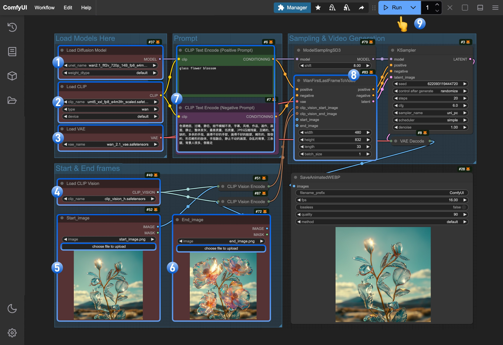

import UpdateReminder from "/snippets/ru/tutorials/update-reminder.mdx";

Wan FLF2V (First-Last Frame Video Generation) это открытая модель генерации видео, разработанная командой Alibaba Tongyi Wanxiang. Лицензия с открытым исходным кодом: [Apache 2.0](https://github.com/Wan-Video/Wan2.1?tab=Apache-2.0-1-ov-file).
Пользователю достаточно указать два изображения в качестве начального и конечного кадров, и модель автоматически сгенерирует промежуточные переходные кадры, создавая логически связное и естественно плавное видео высокого разрешения 720p.

**Ключевые технические особенности**

1. **Точный контроль первого и последнего кадра**: совпадение первого и последнего кадров достигает 98%, границы видео задаются начальной и конечной сценами, а промежуточные динамические изменения интеллектуально заполняются для создания переходов между сценами и морфинга объектов.
2. **Стабильная и плавная генерация видео**: благодаря семантическим признакам CLIP и механизмам cross-attention дрожание видео снижено на 37% по сравнению с аналогичными моделями, что обеспечивает естественные и плавные переходы.
3. **Многофункциональные творческие возможности**: поддерживает динамическое добавление китайских и английских субтитров, генерацию в стилях аниме, реализм, фэнтези и других, подстраиваясь под разные творческие задачи.
4. **HD-вывод 720p**: напрямую генерирует видео с разрешением 1280x720 без постобработки, подходящее для социальных сетей и коммерческого использования.
5. **Поддержка экосистемы открытого кода**: веса модели, код и фреймворк обучения полностью открыты, что позволяет развёртывать модель на популярных ИИ-платформах.

**Технические принципы и архитектура**

1. **Архитектура DiT**: на основе диффузионных моделей и архитектуры Diffusion Transformer в сочетании с механизмом Full Attention для оптимизации моделирования пространственно-временных зависимостей, что обеспечивает связность видео.
2. **3D-причинный вариационный энкодер**: технология Wan-VAE сжимает HD-кадры до 1/128 размера, сохраняя тонкие динамические детали и существенно снижая требования к памяти.
3. **Трёхэтапная стратегия обучения**: начиная с предобучения на разрешении 480P и постепенно переходя к 720P, балансируя качество генерации и вычислительную эффективность за счёт поэтапной оптимизации.

**Полезные ссылки**

- **Репозиторий GitHub**: [GitHub](https://github.com/Wan-Video/Wan2.1)
- **Страница модели на Hugging Face**: [Hugging Face](https://huggingface.co/Wan-AI/Wan2.1-FLF2V-14B-720P)
- **Сообщество ModelScope**: [ModelScope](https://www.modelscope.cn/models/Wan-AI/Wan2.1-FLF2V-14B-720P)

<UpdateReminder/>

## Пример нативного рабочего процесса Wan2.1 FLF2V 720P в ComfyUI

### 1. Скачать файлы рабочего процесса и входные файлы
<Tip>
Поскольку модель обучена на изображениях высокого разрешения, использование меньших размеров может не дать хороших результатов. В примере используется размер 720 * 1280, из-за чего пользователям с небольшим объёмом видеопамяти будет сложно запустить процесс, а генерация займёт много времени.
При необходимости измените размер генерируемого видео для тестирования. Обратите внимание: при небольшом размере генерации эта модель может выдавать некачественный результат.
</Tip>

Обновите ComfyUI до последней версии, затем скачайте файл рабочего процесса и перетащите его в ComfyUI или найдите «Wan2.1 FLF2V 720P» в библиотеке шаблонов через `Workflow` → `Browse Templates` → `Video`.


<CardGroup cols={2}>
  <Card title="Запустить в Comfy Cloud" icon="cloud" href="https://cloud.comfy.org/?template=wan2.1_flf2v_720_f16&utm_source=docs&utm_medium=referral&utm_campaign=wan-flf">
    Открыть в Comfy Cloud
  </Card>
  <Card title="Скачать рабочий процесс" icon="download" href="https://github.com/Comfy-Org/workflow_templates/blob/main/templates/wan2.1_flf2v_720_f16.json">
    Скачать JSON или найти «Wan2.1 FLF2V» в библиотеке шаблонов
  </Card>
</CardGroup>

<CardGroup cols={2}>
  <Card title="Начальное изображение: wan2.1_flf2v_720_f16_start_image.png" icon="image" href="https://raw.githubusercontent.com/Comfy-Org/workflow_templates/main/input/wan2.1_flf2v_720_f16_start_image.png">
    Начальный кадр для генерации видео (узел LoadImage 52). Скачайте и используйте это изображение или замените его своим.
  </Card>
  <Card title="Конечное изображение: wan2.1_flf2v_720_f16_end_image.png" icon="image" href="https://raw.githubusercontent.com/Comfy-Org/workflow_templates/main/input/wan2.1_flf2v_720_f16_end_image.png">
    Конечный кадр для генерации видео (узел LoadImage 72). Скачайте и используйте это изображение или замените его своим.
  </Card>
</CardGroup>

### 2. Ручная установка моделей

Все модели, упомянутые в этом руководстве, можно найти [здесь](https://huggingface.co/Comfy-Org/Wan_2.1_ComfyUI_repackaged/tree/main/split_files).

**Модели диффузии**: выберите одну версию в зависимости от вашего оборудования

<CardGroup cols={2}>
  <Card title="Модель диффузии: Wan2.1 FLF2V 14B FP16" icon="download" href="https://huggingface.co/Comfy-Org/Wan_2.1_ComfyUI_repackaged/blob/main/split_files/diffusion_models/wan2.1_flf2v_720p_14B_fp16.safetensors">
    wan2.1_flf2v_720p_14B_fp16.safetensors : полная точность, требует больше видеопамяти. Поместите в <code>ComfyUI/models/diffusion_models/</code>
  </Card>
  <Card title="Модель диффузии: Wan2.1 FLF2V 14B FP8" icon="download" href="https://huggingface.co/Comfy-Org/Wan_2.1_ComfyUI_repackaged/blob/main/split_files/diffusion_models/wan2.1_flf2v_720p_14B_fp8_e4m3fn.safetensors">
    wan2.1_flf2v_720p_14B_fp8_e4m3fn.safetensors : квантованная версия, меньшее потребление видеопамяти. Поместите в <code>ComfyUI/models/diffusion_models/</code>
  </Card>
</CardGroup>

<Tip>
Если вы ранее пробовали рабочие процессы, связанные с Wan Video, следующие файлы у вас уже могут быть.
</Tip>

**Текстовые энкодеры**: выберите одну версию

<CardGroup cols={2}>
  <Card title="Текстовый энкодер: UMT5 XXL FP16" icon="download" href="https://huggingface.co/Comfy-Org/Wan_2.1_ComfyUI_repackaged/blob/main/split_files/text_encoders/umt5_xxl_fp16.safetensors">
    umt5_xxl_fp16.safetensors : текстовый энкодер полной точности. Поместите в <code>ComfyUI/models/text_encoders/</code>
  </Card>
  <Card title="Текстовый энкодер: UMT5 XXL FP8" icon="download" href="https://huggingface.co/Comfy-Org/Wan_2.1_ComfyUI_repackaged/blob/main/split_files/text_encoders/umt5_xxl_fp8_e4m3fn_scaled.safetensors">
    umt5_xxl_fp8_e4m3fn_scaled.safetensors : квантованный текстовый энкодер. Поместите в <code>ComfyUI/models/text_encoders/</code>
  </Card>
</CardGroup>

**VAE**

<Card title="VAE: Wan2.1 VAE" icon="download" href="https://huggingface.co/Comfy-Org/Wan_2.1_ComfyUI_repackaged/blob/main/split_files/vae/wan_2.1_vae.safetensors">
  wan_2.1_vae.safetensors : VAE Wan2.1 для кодирования и декодирования. Поместите в <code>ComfyUI/models/vae/</code>
</Card>
**CLIP Vision**

<Card title="CLIP Vision: CLIP Vision H" icon="download" href="https://huggingface.co/Comfy-Org/Wan_2.1_ComfyUI_repackaged/blob/main/split_files/clip_vision/clip_vision_h.safetensors">
  clip_vision_h.safetensors : энкодер CLIP Vision. Поместите в <code>ComfyUI/models/clip_vision/</code>
</Card>
Расположение файлов
```
ComfyUI/
├───📂 models/
│   ├───📂 diffusion_models/
│   │   └─── wan2.1_flf2v_720p_14B_fp16.safetensors           # или версия FP8
│   ├───📂 text_encoders/
│   │   └─── umt5_xxl_fp8_e4m3fn_scaled.safetensors           # или выбранная вами версия
│   ├───📂 vae/
│   │   └─── wan_2.1_vae.safetensors
│   └───📂 clip_vision/
│       └─── clip_vision_h.safetensors   
```

### 3. Пошаговое выполнение рабочего процесса



1. Убедитесь, что узел `Load Diffusion Model` загрузил `wan2.1_flf2v_720p_14B_fp16.safetensors` или `wan2.1_flf2v_720p_14B_fp8_e4m3fn.safetensors`
2. Убедитесь, что узел `Load CLIP` загрузил `umt5_xxl_fp8_e4m3fn_scaled.safetensors`
3. Убедитесь, что узел `Load VAE` загрузил `wan_2.1_vae.safetensors`
4. Убедитесь, что узел `Load CLIP Vision` загрузил `clip_vision_h.safetensors`
5. Загрузите начальный кадр в узел `Start_image`
6. Загрузите конечный кадр в узел `End_image`
7. (Необязательно) Измените позитивный и негативный промпты, поддерживаются как китайский, так и английский
8. (**Важно**) В `WanFirstLastFrameToVideo` по умолчанию используется размер 720*1280, поскольку это модель 720P, поэтому небольшой размер не даст хорошего результата. Для хорошей генерации используйте размер около 720*1280.
9. Нажмите кнопку `Run` или используйте сочетание клавиш `Ctrl(cmd) + Enter`, чтобы выполнить генерацию видео