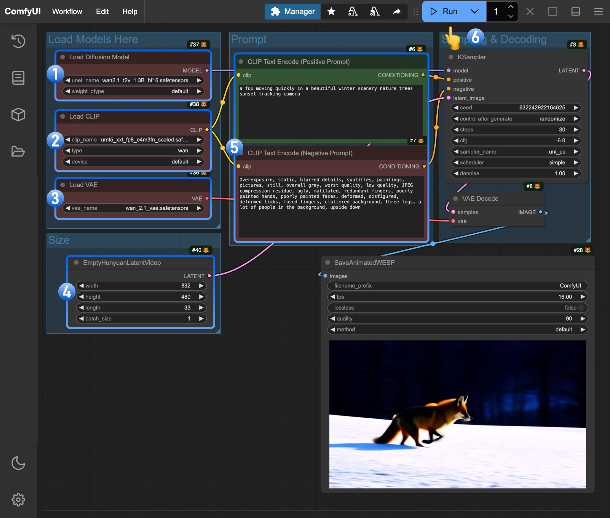
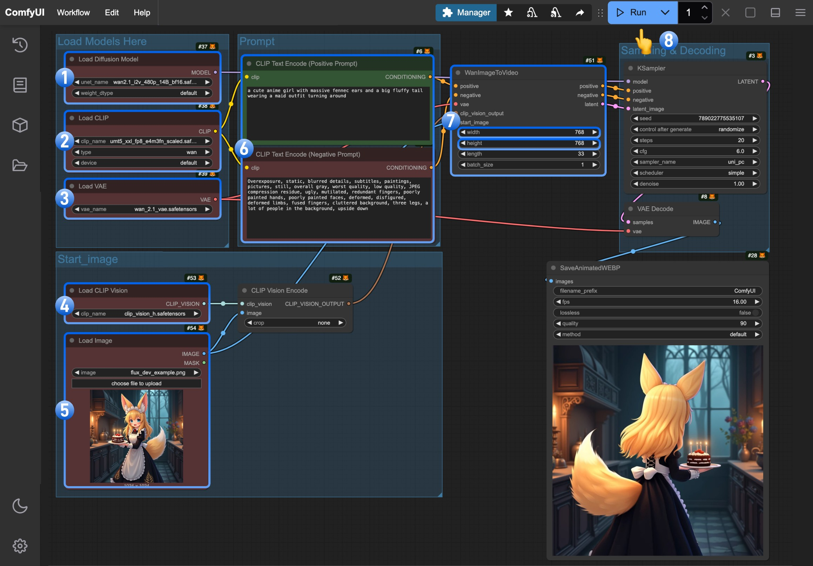
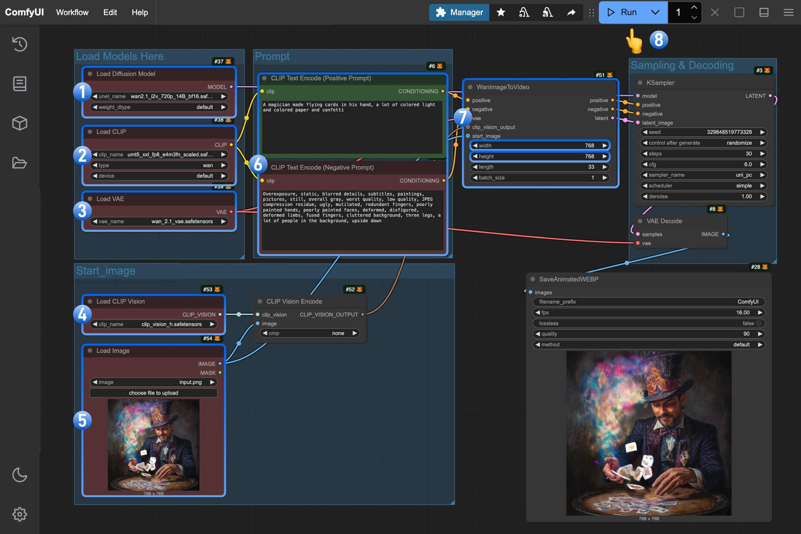

import UpdateReminder from "/snippets/ru/tutorials/update-reminder.mdx";

Wan2.1 Video представляет собой серию моделей генерации видео, открытую Alibaba в феврале 2025 года под [лицензией Apache 2.0](https://github.com/Wan-Video/Wan2.1?tab=Apache-2.0-1-ov-file).
Доступны две версии:
- 14B (14 млрд параметров)
- 1.3B (1.3 млрд параметров)
Серия охватывает несколько задач, включая текст в видео (T2V) и изображение в видео (I2V).
Модель не только превосходит существующие открытые модели по качеству работы, но и, что важнее, её облегчённая версия требует для запуска всего 8 ГБ видеопамяти, что значительно снижает порог входа.

<video controls>
  <source src="https://github.com/user-attachments/assets/4aca6063-60bf-4953-bfb7-e265053f49ef" type="video/mp4"/>
</video>

- [Репозиторий кода Wan2.1](https://github.com/Wan-Video/Wan2.1)
- [Репозиторий моделей Wan2.1](https://huggingface.co/Wan-AI)

<UpdateReminder/>

## Примеры нативных рабочих процессов Wan2.1 в ComfyUI

<Tip>
Пожалуйста, перед запуском примеров обновите ComfyUI до последней версии, чтобы убедиться, что у вас есть нативная поддержка Wan Video.
</Tip>

## Установка моделей

Все модели, упомянутые в этом руководстве, можно найти [здесь](https://huggingface.co/Comfy-Org/Wan_2.1_ComfyUI_repackaged/tree/main/split_files). Ниже приведены основные модели, которые понадобятся для примеров из этого руководства: их можно скачать заранее.

Выберите одну версию из **Text encoders** для скачивания:

<CardGroup cols={2}>
  <Card title="umt5_xxl_fp16.safetensors" icon="download" href="https://huggingface.co/Comfy-Org/Wan_2.1_ComfyUI_repackaged/blob/main/split_files/text_encoders/umt5_xxl_fp16.safetensors?download=true">
    Текстовый энкодер точности FP16. Поместите в <code>ComfyUI/models/text_encoders/</code>
  </Card>
  <Card title="umt5_xxl_fp8_e4m3fn_scaled.safetensors" icon="download" href="https://huggingface.co/Comfy-Org/Wan_2.1_ComfyUI_repackaged/blob/main/split_files/text_encoders/umt5_xxl_fp8_e4m3fn_scaled.safetensors?download=true">
    Текстовый энкодер с масштабированием FP8. Поместите в <code>ComfyUI/models/text_encoders/</code>
  </Card>
</CardGroup>

**VAE**

<Card title="wan_2.1_vae.safetensors" icon="download" href="https://huggingface.co/Comfy-Org/Wan_2.1_ComfyUI_repackaged/blob/main/split_files/vae/wan_2.1_vae.safetensors?download=true">
    Модель VAE Wan2.1. Поместите в <code>ComfyUI/models/vae/</code>
</Card>
**CLIP Vision**

<Card title="clip_vision_h.safetensors" icon="download" href="https://huggingface.co/Comfy-Org/Wan_2.1_ComfyUI_repackaged/blob/main/split_files/clip_vision/clip_vision_h.safetensors?download=true">
    Модель CLIP Vision для формирования условия по изображению. Поместите в <code>ComfyUI/models/clip_vision/</code>
</Card>
Расположение файлов на диске:
```
ComfyUI/
├── models/
│   ├── diffusion_models/
│   │   └── ... (download per workflow below)
│   ├── text_encoders/
│   │   └── umt5_xxl_fp8_e4m3fn_scaled.safetensors
│   ├── vae/
│   │   └── wan_2.1_vae.safetensors
│   └── clip_vision/
│       └── clip_vision_h.safetensors
```

<Note>
Для diffusion-моделей в этом руководстве мы используем модели точности fp16, поскольку они, как мы обнаружили, работают лучше версий bf16. Если вам нужны другие версии точности, перейдите [сюда](https://huggingface.co/Comfy-Org/Wan_2.1_ComfyUI_repackaged/tree/main/split_files/diffusion_models), чтобы скачать их.
</Note>

## Рабочий процесс Wan2.1 текст в видео (1.3B)

### Wan 2.1 текст в видео {#text_to_video_wan}

Генерируйте видео из текстовых промптов с помощью Wan 2.1.


<CardGroup cols={2}>
  <Card title="Запустить в Comfy Cloud" icon="cloud" href="https://cloud.comfy.org/?template=text_to_video_wan&utm_source=docs&utm_medium=referral&utm_campaign=wan-video">
    Открыть в Comfy Cloud
  </Card>
  <Card title="Скачать рабочий процесс" icon="download" href="https://github.com/Comfy-Org/workflow_templates/blob/main/templates/text_to_video_wan.json">
    Скачайте JSON или найдите «Wan 2.1 Text to Video» в Библиотеке шаблонов
  </Card>
</CardGroup>

### Загрузки моделей

<Card title="wan2.1_t2v_1.3B_fp16.safetensors" icon="download" href="https://huggingface.co/Comfy-Org/Wan_2.1_ComfyUI_repackaged/blob/main/split_files/diffusion_models/wan2.1_t2v_1.3B_fp16.safetensors?download=true">
    Модель диффузии для Wan2.1 текст в видео. Поместите в <code>ComfyUI/models/diffusion_models/</code>
</Card>
> Если вам нужны другие версии t2v с иной точностью, скачайте их [здесь](https://huggingface.co/Comfy-Org/Wan_2.1_ComfyUI_repackaged/tree/main/split_files/diffusion_models).

### Шаги запуска



1. Убедитесь, что в узле `Load Diffusion Model` загружена модель `wan2.1_t2v_1.3B_fp16.safetensors`
2. Убедитесь, что в узле `Load CLIP` загружена модель `umt5_xxl_fp8_e4m3fn_scaled.safetensors`
3. Убедитесь, что в узле `Load VAE` загружена модель `wan_2.1_vae.safetensors`
4. (Необязательно) При необходимости можно изменить размеры видео в узле `EmptyHunyuanLatentVideo`
5. (Необязательно) Если нужно изменить промпты (позитивный и негативный), сделайте это в узле `CLIP Text Encoder` под номером `5`
6. Нажмите кнопку `Run` или используйте сочетание клавиш `Ctrl(cmd) + Enter`, чтобы выполнить генерацию видео

## Рабочий процесс Wan2.1 «изображение в видео» (14B)

**Поскольку Wan Video разделяет модели 480P и 720P**, в этом руководстве мы приведём примеры для обоих разрешений. Помимо использования разных моделей, у них есть небольшие различия в параметрах.

### Версия 480P

### Wan 2.1 «изображение в видео» {#image_to_video_wan}

Генерируйте видео из изображений с помощью Wan 2.1.


<CardGroup cols={2}>
  <Card title="Запустить в Comfy Cloud" icon="cloud" href="https://cloud.comfy.org/?template=image_to_video_wan&utm_source=docs&utm_medium=referral&utm_campaign=wan-video">
    Открыть в Comfy Cloud
  </Card>
  <Card title="Скачать рабочий процесс" icon="download" href="https://github.com/Comfy-Org/workflow_templates/blob/main/templates/image_to_video_wan.json">
    Скачайте JSON или найдите «Wan 2.1 Image to Video» в Библиотеке шаблонов
  </Card>
</CardGroup>

**Входные материалы**

Загрузите этот файл в соответствующий узел `LoadImage`:

<CardGroup cols={2}>
  <Card title="image_to_video_wan_start_image.png" icon="image" href="https://raw.githubusercontent.com/Comfy-Org/workflow_templates/main/input/image_to_video_wan_start_image.png">
    узел `LoadImage` 52 · `image_to_video_wan_start_image.png`
  </Card>
</CardGroup>

<div style={{display: 'grid', gridTemplateColumns: 'repeat(2, minmax(0, 1fr))', gap: '1rem', alignItems: 'start'}}>
  
</div>
#### Загрузки моделей

<Card title="wan2.1_i2v_480p_14B_fp16.safetensors" icon="download" href="https://huggingface.co/Comfy-Org/Wan_2.1_ComfyUI_repackaged/blob/main/split_files/diffusion_models/wan2.1_i2v_480p_14B_fp16.safetensors?download=true">
    Модель диффузии для Wan2.1 I2V 480P. Поместите в <code>ComfyUI/models/diffusion_models/</code>
</Card>
#### Шаги запуска



1. Убедитесь, что в узле `Load Diffusion Model` загружена модель `wan2.1_i2v_480p_14B_fp16.safetensors`
2. Убедитесь, что в узле `Load CLIP` загружена модель `umt5_xxl_fp8_e4m3fn_scaled.safetensors`
3. Убедитесь, что в узле `Load VAE` загружена модель `wan_2.1_vae.safetensors`
4. Убедитесь, что в узле `Load CLIP Vision` загружена модель `clip_vision_h.safetensors`
5. Загрузите предложенное входное изображение в узле `Load Image`
6. (Необязательно) Введите в узле `CLIP Text Encoder` описание видео, которое хотите сгенерировать
7. (Необязательно) При необходимости можно изменить размеры видео в узле `WanImageToVideo`
8. Нажмите кнопку `Run` или используйте сочетание клавиш `Ctrl(cmd) + Enter`, чтобы запустить генерацию видео

### Версия 720P


<CardGroup cols={2}>
  <Card title="Запустить в Comfy Cloud" icon="cloud" href="https://cloud.comfy.org/?template=image_to_video_wan&utm_source=docs&utm_medium=referral&utm_campaign=wan-video">
    Открыть в Comfy Cloud
  </Card>
  <Card title="Скачать рабочий процесс" icon="download" href="https://raw.githubusercontent.com/Comfy-Org/example_workflows/refs/heads/main/wan2.1/wan2.1_i2v_14b_720P.webp">
    Скачайте изображение рабочего процесса и перетащите его в ComfyUI, чтобы загрузить рабочий процесс
  </Card>
</CardGroup>

<Card title="Входное изображение" icon="image" href="https://raw.githubusercontent.com/Comfy-Org/example_workflows/refs/heads/main/wan2.1/input/magician.png">
    Скачайте входное изображение по умолчанию или используйте своё изображение.
</Card>
#### Загрузки моделей

<Card title="wan2.1_i2v_720p_14B_fp16.safetensors" icon="download" href="https://huggingface.co/Comfy-Org/Wan_2.1_ComfyUI_repackaged/blob/main/split_files/diffusion_models/wan2.1_i2v_720p_14B_fp16.safetensors?download=true">
    Модель диффузии для Wan2.1 I2V 720P. Поместите в <code>ComfyUI/models/diffusion_models/</code>
</Card>
#### Шаги запуска



1. Убедитесь, что в узле `Load Diffusion Model` загружена модель `wan2.1_i2v_720p_14B_fp16.safetensors`
2. Убедитесь, что в узле `Load CLIP` загружена модель `umt5_xxl_fp8_e4m3fn_scaled.safetensors`
3. Убедитесь, что в узле `Load VAE` загружена модель `wan_2.1_vae.safetensors`
4. Убедитесь, что в узле `Load CLIP Vision` загружена модель `clip_vision_h.safetensors`
5. Загрузите предложенное входное изображение в узле `Load Image`
6. (Необязательно) Введите в узле `CLIP Text Encoder` описание видео, которое хотите сгенерировать
7. (Необязательно) При необходимости можно изменить размеры видео в узле `WanImageToVideo`
8. Нажмите кнопку `Run` или используйте сочетание клавиш `Ctrl(cmd) + Enter`, чтобы запустить генерацию видео
