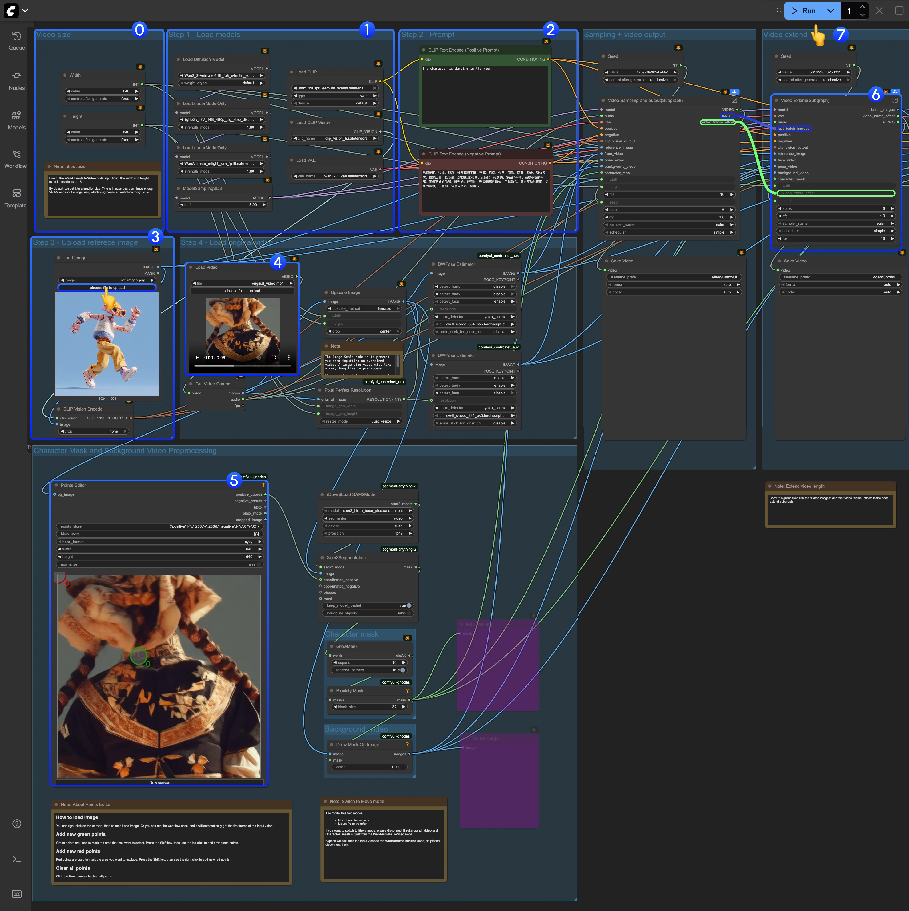
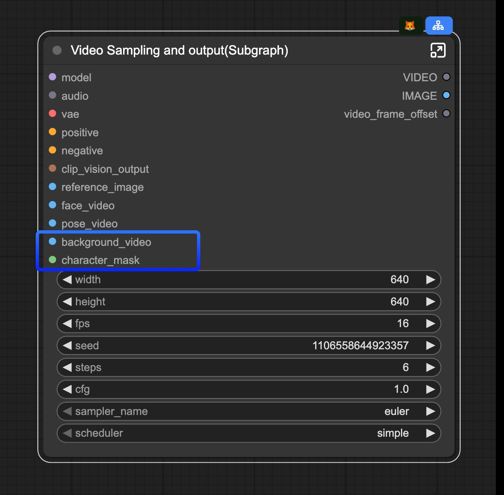

import UpdateReminder from "/snippets/ru/tutorials/update-reminder.mdx"

Wan-Animate представляет собой единый фреймворк для анимации и замены персонажей, разработанный командой WAN.

Модель позволяет анимировать любого персонажа на основе видео исполнителя, точно воспроизводя его мимику и движения для создания реалистичных видео с персонажем.

Она также позволяет заменять персонажей в видео на анимированных, сохраняя их мимику и движения и воспроизводя оригинальное освещение и цветовой тон для бесшовной интеграции в окружение.

## Ключевые особенности модели

- Работа в двух режимах: единая архитектура поддерживает как анимацию, так и замену, что позволяет легко переключать режимы.
- Расширенный контроль движений тела: использует пространственно выровненные сигналы скелета для точного воспроизведения движений тела.
- Точные движения и мимика: точно воспроизводит движения и мимику из референсного видео.
- Естественная интеграция с окружением: бесшовно вписывает заменённого персонажа в оригинальное окружение видео.
- Плавная генерация длинного видео: итеративная генерация обеспечивает согласованность движений и визуального потока в длинных видео.

## Запись трансляции ComfyOrg Wan2.2 Animate

<iframe
  className="w-full aspect-video rounded-xl"
 src="https://www.youtube.com/embed/5kb-rP0m5BA?si=lbIYkCP5akkG2N6D" 
 title="Wan 2.2 Animate in ComfyUI with Flipping Sigmas / September 19th, 2025" frameborder="0" 
 allow="accelerometer; clipboard-write; encrypted-media; gyroscope; picture-in-picture; web-share" 
 referrerpolicy="strict-origin-when-cross-origin" 
 allowfullscreen>
 </iframe>

<UpdateReminder/>

## О рабочем процессе Wan2.2 Animate

Этот рабочий процесс поддерживает два режима: Mix (заменить персонажа в видео персонажем с референсного изображения) и Move (анимировать персонажа, используя движение из входного видео).

### Wan2.2 Animate: анимация и замена персонажа {#video_wan2_2_14B_animate}

Единый фреймворк для анимации и замены персонажа с точной передачей движения и мимики.


<CardGroup cols={2}>
  <Card title="Запустить в Comfy Cloud" icon="cloud" href="https://cloud.comfy.org/?template=video_wan2_2_14B_animate&utm_source=docs&utm_medium=referral&utm_campaign=wan2-2-animate">
    Открыть в Comfy Cloud
  </Card>
  <Card title="Скачать рабочий процесс" icon="download" href="https://github.com/Comfy-Org/workflow_templates/blob/main/templates/video_wan2_2_14B_animate.json">
    Скачайте JSON или найдите «Wan2.2 Animate» в библиотеке шаблонов
  </Card>
</CardGroup>

**Входные материалы**

Загрузите эти файлы в соответствующие узлы:

<CardGroup cols={2}>
  <Card title="video_wan2_2_14B_animate_reference_image.png" icon="image" href="https://raw.githubusercontent.com/Comfy-Org/workflow_templates/main/input/video_wan2_2_14B_animate_reference_image.png">
    `LoadImage`, узел 10 · `video_wan2_2_14B_animate_reference_image.png`
  </Card>
  <Card title="video_wan2_2_14B_animate_original_video.mp4" icon="video" href="https://raw.githubusercontent.com/Comfy-Org/workflow_templates/main/input/video_wan2_2_14B_animate_original_video.mp4">
    `LoadVideo`, узел 145 · `video_wan2_2_14B_animate_original_video.mp4`
  </Card>
</CardGroup>

<div style={{display: 'grid', gridTemplateColumns: 'repeat(2, minmax(0, 1fr))', gap: '1rem', alignItems: 'start'}}>
  
</div>

### 2. Ссылки на модели

Все модели, используемые в этом руководстве, можно найти [здесь](https://huggingface.co/Comfy-Org/Wan_2.2_ComfyUI_Repackaged/tree/main/split_files).

**Diffusion Models**

<CardGroup cols={2}>
  <Card title="Wan2.2 Animate 14B FP8 (Kijai)" icon="download" href="https://huggingface.co/Kijai/WanVideo_comfy_fp8_scaled/blob/main/Wan22Animate/Wan2_2-Animate-14B_fp8_e4m3fn_scaled_KJ.safetensors">
    Wan2_2-Animate-14B_fp8_e4m3fn_scaled_KJ.safetensors: масштабированная FP8-версия из репозитория Kijai
  </Card>
  <Card title="Wan2.2 Animate 14B BF16" icon="download" href="https://huggingface.co/Comfy-Org/Wan_2.2_ComfyUI_Repackaged/blob/main/split_files/diffusion_models/wan2.2_animate_14B_bf16.safetensors">
    wan2.2_animate_14B_bf16.safetensors: оригинальные веса модели в bf16
  </Card>
</CardGroup>

**CLIP Vision**

<Card title="CLIP Vision H" icon="download" href="https://huggingface.co/Comfy-Org/Wan_2.1_ComfyUI_repackaged/blob/main/split_files/clip_vision/clip_vision_h.safetensors">
  clip_vision_h.safetensors: кодировщик CLIP Vision
</Card>
**LoRAs**

<Card title="LightX2V I2V 14B 4-Step LoRA" icon="download" href="https://huggingface.co/Kijai/WanVideo_comfy/blob/main/Lightx2v/lightx2v_I2V_14B_480p_cfg_step_distill_rank64_bf16.safetensors">
  lightx2v_I2V_14B_480p_cfg_step_distill_rank64_bf16.safetensors: LoRA для ускорения за 4 шага
</Card>
**VAE**

<Card title="Wan2.1 VAE" icon="download" href="https://huggingface.co/Comfy-Org/Wan_2.2_ComfyUI_Repackaged/blob/main/split_files/vae/wan_2.1_vae.safetensors">
  wan_2.1_vae.safetensors: Wan2.1 VAE для кодирования и декодирования
</Card>
**Text Encoders**

<Card title="UMT5 XXL FP8 Scaled" icon="download" href="https://huggingface.co/Comfy-Org/Wan_2.1_ComfyUI_repackaged/blob/main/split_files/text_encoders/umt5_xxl_fp8_e4m3fn_scaled.safetensors">
  umt5_xxl_fp8_e4m3fn_scaled.safetensors: масштабированный текстовый кодировщик FP8
</Card>
```
ComfyUI/
├───📂 models/
│   ├───📂 diffusion_models/
│   │   ├─── Wan2_2-Animate-14B_fp8_e4m3fn_scaled_KJ.safetensors
│   │   └─── wan2.2_animate_14B_bf16.safetensors
│   ├───📂 loras/
│   │   └─── lightx2v_I2V_14B_480p_cfg_step_distill_rank64_bf16.safetensors
│   ├───📂 text_encoders/
│   │   └─── umt5_xxl_fp8_e4m3fn_scaled.safetensors 
│   ├───📂 clip_visions/ 
│   │   └─── clip_vision_h.safetensors
│   └───📂 vae/
│       └── wan_2.1_vae.safetensors
```

### 3. Установить пользовательские узлы

Скачайте следующий файл рабочего процесса и перетащите его в ComfyUI, чтобы загрузить рабочий процесс. Если у вас установлен [ComfyUI-Manager](https://github.com/Comfy-Org/ComfyUI-Manager), вы можете просто нажать кнопку `Install missing nodes`, чтобы установить отсутствующие узлы.

Нам нужно установить следующие пользовательские узлы:

- [ComfyUI-KJNodes](https://github.com/kijai/ComfyUI-KJNodes)
- [ComfyUI-comfyui_controlnet_aux](https://github.com/Fannovel16/comfyui_controlnet_aux)

Если вы не знаете, как устанавливать пользовательские узлы, обратитесь к разделу [Как установить пользовательские узлы](/ru/installation/install_custom_node)

### 4. Инструкции по рабочему процессу

Wan2.2 animate имеет два режима: Mix и Move
- Mix: использовать референсное изображение, чтобы заменить персонажа в видео
- Move: использовать движение персонажа из входного видео, чтобы анимировать персонажа на референсном изображении (как в Wan2.2 Fun Control)

#### 4.1 Режим Mix


0. Если вы запускаете этот рабочий процесс впервые, используйте небольшой размер для генерации видео: может не хватить VRAM, а из-за ограничения `WanAnimateToVideo` ширина или высота видео должна быть кратна 16.
1. Убедитесь, что все модели загружены правильно
2. Обновите промпт при необходимости
3. Загрузите референсное изображение: персонаж на этом изображении станет целевым персонажем
4. В первый раз можно использовать предоставленные нами видео как входные: узел **DWPose Estimator** из [comfyui_controlnet_aux](https://github.com/Fannovel16/comfyui_controlnet_aux) предварительно обработает входное видео в видео управления позой и лицом
5. `Points Editor` взят из [KJNodes](https://github.com/kijai/ComfyUI-KJNodes/); по умолчанию этот узел не загружает первый кадр из входного видео, поэтому нужно один раз запустить рабочий процесс или вручную загрузить первый кадр
    - Под узлом `Points Editor` мы добавили примечание о том, как работает этот узел и как его редактировать. Обратитесь к нему
6. Группа «Video Extend» нужна, чтобы продлить выходное видео
    - Каждый `Video Extend` добавляет ещё 77 кадров (около 4.8125 секунды)
    - Если входное видео короче 5 с, он может вам не понадобиться
    - Если нужно продлить сильнее, скопируйте и вставьте группу несколько раз: соедините `batch_images` от предыдущего Video Extend со следующим, а также `video_frame_offset` от предыдущего Video Extend со следующим
7. Нажмите кнопку `Run` или используйте сочетание клавиш `Ctrl(cmd) + Enter`, чтобы выполнить генерацию видео

#### 4.2 Режим Move

В рабочем процессе Wan2.2 animate мы использовали [подграф](/interface/features/subgraph); вот как переключиться в режим Move:



Чтобы переключиться в режим Move, отключите входы `background_video` и `character_mask` от узла `Video Sampling and output(Subgraph)`.

