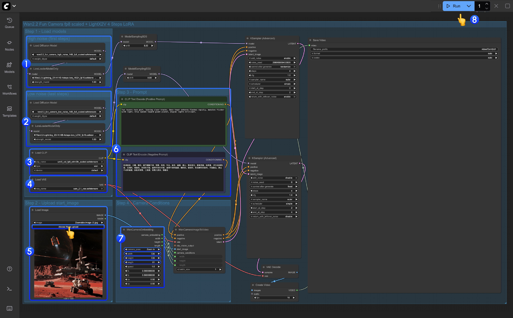

import UpdateReminder from "/snippets/ru/tutorials/update-reminder.mdx"

**Wan2.2-Fun-Camera-Control** представляет собой модель нового поколения для генерации видео и управления камерой, разработанную Alibaba PAI. Благодаря инновационным кодам управления камерой (Camera Control Codes) и объединению глубокого обучения с мультимодальными условными входами она генерирует высококачественные видео, соответствующие заранее заданным условиям движения камеры. Модель распространяется под **лицензией Apache 2.0**, что допускает коммерческое использование.

**Ключевые возможности**:
- **Управление движением камеры**: поддерживает различные режимы движения камеры, включая **Pan Up**, **Pan Down**, **Pan Left**, **Pan Right**, **Zoom In**, **Zoom Out** и их комбинации.
- **Генерация видео высокого качества**: на основе архитектуры Wan2.2 выдаёт видео кинематографического качества.

Ссылки на веса модели и репозиторий кода:

- [🤗Wan2.2-Fun-A14B-Control-Camera](https://huggingface.co/alibaba-pai/Wan2.2-Fun-A14B-Control-Camera)
- Репозиторий кода: [VideoX-Fun](https://github.com/aigc-apps/VideoX-Fun)

## Пример рабочего процесса генерации видео с Wan2.2 Fun Camera Control

<UpdateReminder/>

Предлагаемый рабочий процесс включает две версии:
1. Использование 4-шагового LoRA [Wan2.2-Lightning](https://huggingface.co/lightx2v/Wan2.2-Lightning) через lightx2v: это может снизить динамику видео, но ускоряет генерацию.
2. Версия fp8_scaled без ускоряющего LoRA.

Ниже приведены результаты замеров на GPU RTX4090D 24GB при разрешении 640*640 и длине 81 кадр:

| Тип модели                  | Разрешение | Использование VRAM | Время первой генерации | Время второй генерации |
| --------------------------- | ---------- | ------------------ | ---------------------- | ---------------------- |
| fp8_scaled                  | 640×640    | 84%                | ≈ 536 секунд           | ≈ 513 секунд           |
| fp8_scaled + 4-step LoRA    | 640×640    | 89%                | ≈ 108 секунд           | ≈ 71 секунда           |

4-шаговый LoRA улучшает первое впечатление пользователя, но может снижать динамику видео. По умолчанию включена версия с ускоряющим LoRA. Чтобы переключить рабочие процессы, выберите узлы и нажмите **Ctrl+B**.

### 1. Скачать рабочий процесс и материалы

Скачайте видео или JSON-файл ниже и перетащите его в ComfyUI, чтобы загрузить соответствующий рабочий процесс. Рабочий процесс предложит скачать модели.

<video
  controls
  className="w-full aspect-video"
  src="https://raw.githubusercontent.com/Comfy-Org/example_workflows/refs/heads/main/video/wan/wan2.2_fun_camera/wan2.2_14B_fun_camera.mp4"
></video>


<CardGroup cols={2}>
  <Card title="Запустить в Comfy Cloud" icon="cloud" href="https://cloud.comfy.org/?template=video_wan2_2_14B_fun_camera&utm_source=docs&utm_medium=referral&utm_campaign=wan2-2-fun-camera">
    Открыть в Comfy Cloud
  </Card>
  <Card title="Скачать рабочий процесс" icon="download" href="https://github.com/Comfy-Org/workflow_templates/blob/main/templates/video_wan2_2_14B_fun_camera.json">
    Скачайте JSON или найдите «Wan2.2 Fun Camera» в библиотеке шаблонов
  </Card>
</CardGroup>

Скачайте изображение ниже, оно будет использоваться как вход.

**Входные материалы**

<CardGroup cols={2}>
  <Card title="video_wan2_2_14B_fun_camera_start_image.jpg" icon="image" href="https://raw.githubusercontent.com/Comfy-Org/workflow_templates/main/input/video_wan2_2_14B_fun_camera_start_image.jpg">
    Начальный кадр для генерации видео. Скачайте и используйте это изображение или замените его своим.
  </Card>
</CardGroup>

### 2. Ссылки на модели

Следующие модели можно найти в [Wan_2.2_ComfyUI_Repackaged](https://huggingface.co/Comfy-Org/Wan_2.2_ComfyUI_Repackaged):

**Модели диффузии**

<CardGroup cols={2}>
  <Card title="wan2.2_fun_camera_high_noise_14B_fp8_scaled.safetensors" icon="download" href="https://huggingface.co/Comfy-Org/Wan_2.2_ComfyUI_Repackaged/blob/main/split_files/diffusion_models/wan2.2_fun_camera_high_noise_14B_fp8_scaled.safetensors">
    Модель диффузии с высоким шумом для Wan2.2 Fun Camera
  </Card>
  <Card title="wan2.2_fun_camera_low_noise_14B_fp8_scaled.safetensors" icon="download" href="https://huggingface.co/Comfy-Org/Wan_2.2_ComfyUI_Repackaged/blob/main/split_files/diffusion_models/wan2.2_fun_camera_low_noise_14B_fp8_scaled.safetensors">
    Модель диффузии с низким шумом для Wan2.2 Fun Camera
  </Card>
</CardGroup>

**Wan2.2-Lightning LoRA (необязательно, для ускорения)**

<CardGroup cols={2}>
  <Card title="wan2.2_i2v_lightx2v_4steps_lora_v1_high_noise.safetensors" icon="download" href="https://huggingface.co/Comfy-Org/Wan_2.2_ComfyUI_Repackaged/blob/main/split_files/loras/wan2.2_i2v_lightx2v_4steps_lora_v1_high_noise.safetensors">
    4-шаговый ускоряющий LoRA для модели с высоким шумом
  </Card>
  <Card title="wan2.2_i2v_lightx2v_4steps_lora_v1_low_noise.safetensors" icon="download" href="https://huggingface.co/Comfy-Org/Wan_2.2_ComfyUI_Repackaged/blob/main/split_files/loras/wan2.2_i2v_lightx2v_4steps_lora_v1_low_noise.safetensors">
    4-шаговый ускоряющий LoRA для модели с низким шумом
  </Card>
</CardGroup>

**VAE**

<Card title="wan_2.1_vae.safetensors" icon="download" href="https://huggingface.co/Comfy-Org/Wan_2.2_ComfyUI_Repackaged/blob/main/split_files/vae/wan_2.1_vae.safetensors">
  VAE Wan2.1 для кодирования и декодирования
</Card>
**Текстовый энкодер**

<Card title="umt5_xxl_fp8_e4m3fn_scaled.safetensors" icon="download" href="https://huggingface.co/Comfy-Org/Wan_2.1_ComfyUI_repackaged/blob/main/split_files/text_encoders/umt5_xxl_fp8_e4m3fn_scaled.safetensors">
  Текстовый энкодер FP8 scaled
</Card>
Куда сохранять файлы

```
ComfyUI/
├───📂 models/
│   ├───📂 diffusion_models/
│   │   ├─── wan2.2_fun_camera_low_noise_14B_fp8_scaled.safetensors
│   │   └─── wan2.2_fun_camera_high_noise_14B_fp8_scaled.safetensors
│   ├───📂 loras/
│   │   ├─── wan2.2_i2v_lightx2v_4steps_lora_v1_high_noise.safetensors
│   │   └─── wan2.2_i2v_lightx2v_4steps_lora_v1_low_noise.safetensors
│   ├───📂 text_encoders/
│   │   └─── umt5_xxl_fp8_e4m3fn_scaled.safetensors
│   └───📂 vae/
│       └── wan_2.1_vae.safetensors
```

### 3. Выполнить рабочий процесс по шагам



<Note>
  В этом рабочем процессе используется LoRA. Убедитесь, что модель диффузии и LoRA соответствуют друг другу: модели с высоким и низким шумом и LoRA должны быть подобраны попарно.
</Note>

1. Загрузка модели с **высоким шумом** и **LoRA**
  - Убедитесь, что узел `Load Diffusion Model` загружает `wan2.2_fun_camera_high_noise_14B_fp8_scaled.safetensors`
  - Убедитесь, что узел `LoraLoaderModelOnly` загружает `wan2.2_i2v_lightx2v_4steps_lora_v1_high_noise.safetensors`
2. Загрузка модели с **низким шумом** и **LoRA**
  - Убедитесь, что узел `Load Diffusion Model` загружает `wan2.2_fun_camera_low_noise_14B_fp8_scaled.safetensors`
  - Убедитесь, что узел `LoraLoaderModelOnly` загружает `wan2.2_i2v_lightx2v_4steps_lora_v1_low_noise.safetensors`
3. Убедитесь, что узел `Load CLIP` загружает `umt5_xxl_fp8_e4m3fn_scaled.safetensors`
4. Убедитесь, что узел `Load VAE` загружает `wan_2.1_vae.safetensors`
5. Загрузите начальный кадр в узле `Load Image`
6. Измените промпт (можно на китайском или английском)
7. Задайте параметры управления камерой в узле `WanCameraEmbedding`:
   - **Camera Motion**: выберите тип движения камеры (Zoom In, Zoom Out, Pan Up, Pan Down, Pan Left, Pan Right, Static и т. д.)
   - **Width/Height**: задайте разрешение видео
   - **Length**: задайте количество кадров видео (по умолчанию 81 кадр)
   - **Speed**: задайте скорость видео (по умолчанию 1.0)
8. Нажмите кнопку `Run` или используйте сочетание клавиш `Ctrl(cmd) + Enter`, чтобы выполнить генерацию видео