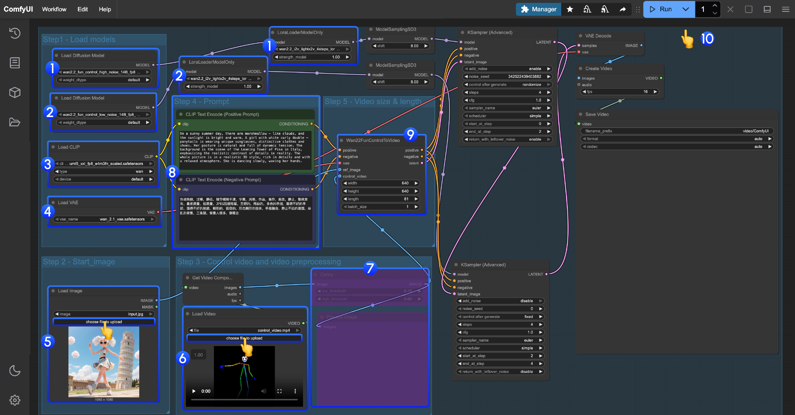

import UpdateReminder from '/snippets/ru/tutorials/update-reminder.mdx'

**Wan2.2-Fun-Control** представляет собой модель генерации и управления видео нового поколения от команды Alibaba PAI. Благодаря инновационному механизму Control Codes в сочетании с глубоким обучением и мультимодальными условными входами она генерирует высококачественное видео, соответствующее заданным условиям управления. Модель распространяется по **лицензии Apache 2.0** и поддерживает коммерческое использование.

**Ключевые возможности**:
- **Мультимодальное управление**: поддерживает несколько условий управления, включая **Canny (контурный рисунок)**, **Depth**, **OpenPose (поза человека)**, **MLSD (геометрические рёбра)** и **управление траекторией**
- **Генерация видео высокого качества**: на основе архитектуры Wan2.2 выдаёт видео кинематографического качества
- **Поддержка нескольких языков**: поддерживает промпты на нескольких языках, включая китайский и английский

Ниже приведены соответствующие веса моделей и репозитории с кодом:

- [🤗Wan2.2-Fun-A14B-Control](https://huggingface.co/alibaba-pai/Wan2.2-Fun-A14B-Control)
- Репозиторий с кодом: [VideoX-Fun](https://github.com/aigc-apps/VideoX-Fun)

## Запись прямой трансляции ComfyOrg Wan2.2 Fun InP & Control на YouTube

<iframe
  className="w-full aspect-video rounded-xl"
  src="https://www.youtube.com/embed/YcAerNYIvho?si=Zh8tzRwI_OTAFx3m"
  title="ComfyUI Selection Toolbox New Features"
  allow="accelerometer; clipboard-write; encrypted-media; gyroscope; picture-in-picture"
  allowFullScreen
></iframe>

## Пример рабочего процесса генерации видео Wan2.2 Fun Control

<UpdateReminder/>

Рабочий процесс доступен в двух версиях:
1. Версия с 4-шаговой LoRA [Wan2.2-Lightning](https://huggingface.co/lightx2v/Wan2.2-Lightning) от lightx2v: может немного снизить динамику видео, но работает быстрее
2. Версия fp8_scaled без ускоряющей LoRA

Ниже приведены результаты тестирования на GPU RTX4090D с 24 ГБ видеопамяти при разрешении 640×640 и 81 кадре

| Тип модели               | Использование видеопамяти | Время первой генерации | Время второй генерации |
| ------------------------ | ---------- | -------------------- | --------------------- |
| fp8_scaled               | 83%        | ≈ 524 с               | ≈ 520 с                |
| fp8_scaled + 4-step LoRA | 89%        | ≈ 138 с               | ≈ 79 с                 |

Поскольку 4-шаговая LoRA удобнее для тех, кто впервые работает с этим рабочим процессом, но может немного снизить динамику видео, ускоренная версия с LoRA включена по умолчанию. Чтобы включить другой рабочий процесс, выделите его и нажмите **Ctrl+B**.

### 1. Загрузка рабочего процесса и материалов

Обновите ComfyUI до последней версии, затем скачайте файл рабочего процесса и перетащите его в ComfyUI или найдите «Wan2.2 Fun Control» в библиотеке шаблонов: `Workflow` → `Browse Templates` → `Video`.


<CardGroup cols={2}>
  <Card title="Запустить в Comfy Cloud" icon="cloud" href="https://cloud.comfy.org/?template=video_wan2_2_14B_fun_control&utm_source=docs&utm_medium=referral&utm_campaign=wan2-2-fun-control">
    Открыть в Comfy Cloud
  </Card>
  <Card title="Скачать рабочий процесс" icon="download" href="https://github.com/Comfy-Org/workflow_templates/blob/main/templates/video_wan2_2_14B_fun_control.json">
    Скачайте JSON или найдите «Wan2.2 Fun Control» в библиотеке шаблонов
  </Card>
</CardGroup>

Скачайте следующие изображение и видео как входные материалы.

**Входные материалы**

<CardGroup cols={2}>
  <Card title="video_wan2_2_14B_fun_control_start_image.jpg" icon="image" href="https://raw.githubusercontent.com/Comfy-Org/workflow_templates/main/input/video_wan2_2_14B_fun_control_start_image.jpg">
    Стартовый кадр для генерации видео. Скачайте и используйте это изображение или замените его своим.
  </Card>
  <Card title="video_wan2_2_14B_fun_control_start_image_control_video.mp4" icon="video" href="https://raw.githubusercontent.com/Comfy-Org/workflow_templates/main/input/video_wan2_2_14B_fun_control_start_image_control_video.mp4">
    Предобработанное видео управления позой. Скачайте и используйте это видео или замените его своим.
  </Card>
</CardGroup>

> Здесь используется предобработанное видео.

### 2. Модели

Все модели из этого руководства доступны [здесь](https://huggingface.co/Comfy-Org/Wan_2.2_ComfyUI_Repackaged/tree/main/split_files).

**Модели диффузии**

<CardGroup cols={2}>
  <Card title="Wan2.2 Fun Control High Noise 14B FP8" icon="download" href="https://huggingface.co/Comfy-Org/Wan_2.2_ComfyUI_Repackaged/blob/main/split_files/diffusion_models/wan2.2_fun_control_high_noise_14B_fp8_scaled.safetensors">
    wan2.2_fun_control_high_noise_14B_fp8_scaled.safetensors: модель диффузии с высоким уровнем шума
  </Card>
  <Card title="Wan2.2 Fun Control Low Noise 14B FP8" icon="download" href="https://huggingface.co/Comfy-Org/Wan_2.2_ComfyUI_Repackaged/blob/main/split_files/diffusion_models/wan2.2_fun_control_low_noise_14B_fp8_scaled.safetensors">
    wan2.2_fun_control_low_noise_14B_fp8_scaled.safetensors: модель диффузии с низким уровнем шума
  </Card>
</CardGroup>

**LoRA Wan2.2-Lightning (необязательно, для ускорения)**

<CardGroup cols={2}>
  <Card title="4-шаговая LoRA для высокого шума" icon="download" href="https://huggingface.co/Comfy-Org/Wan_2.2_ComfyUI_Repackaged/blob/main/split_files/loras/wan2.2_i2v_lightx2v_4steps_lora_v1_high_noise.safetensors">
    wan2.2_i2v_lightx2v_4steps_lora_v1_high_noise.safetensors: 4-шаговая ускоряющая LoRA для высокого шума
  </Card>
  <Card title="4-шаговая LoRA для низкого шума" icon="download" href="https://huggingface.co/Comfy-Org/Wan_2.2_ComfyUI_Repackaged/blob/main/split_files/loras/wan2.2_i2v_lightx2v_4steps_lora_v1_low_noise.safetensors">
    wan2.2_i2v_lightx2v_4steps_lora_v1_low_noise.safetensors: 4-шаговая ускоряющая LoRA для низкого шума
  </Card>
</CardGroup>

**VAE**

<Card title="Wan2.1 VAE" icon="download" href="https://huggingface.co/Comfy-Org/Wan_2.2_ComfyUI_Repackaged/blob/main/split_files/vae/wan_2.1_vae.safetensors">
  wan_2.1_vae.safetensors: VAE Wan2.1 для кодирования и декодирования
</Card>
**Текстовый энкодер**

<Card title="UMT5 XXL FP8 Scaled" icon="download" href="https://huggingface.co/Comfy-Org/Wan_2.1_ComfyUI_repackaged/blob/main/split_files/text_encoders/umt5_xxl_fp8_e4m3fn_scaled.safetensors">
  umt5_xxl_fp8_e4m3fn_scaled.safetensors: текстовый энкодер FP8 scaled
</Card>
```
ComfyUI/
├───📂 models/
│   ├───📂 diffusion_models/
│   │   ├─── wan2.2_fun_control_low_noise_14B_fp8_scaled.safetensors
│   │   └─── wan2.2_fun_control_high_noise_14B_fp8_scaled.safetensors
│   ├───📂 loras/
│   │   ├─── wan2.2_i2v_lightx2v_4steps_lora_v1_high_noise.safetensors
│   │   └─── wan2.2_i2v_lightx2v_4steps_lora_v1_low_noise.safetensors
│   ├───📂 text_encoders/
│   │   └─── umt5_xxl_fp8_e4m3fn_scaled.safetensors 
│   └───📂 vae/
│       └── wan_2.1_vae.safetensors
```

### 3. Руководство по рабочему процессу



<Note>
  В этом рабочем процессе используется LoRA. Убедитесь, что модель диффузии и LoRA соответствуют друг другу: модели и LoRA с высоким и низким уровнем шума нужно применять вместе.
</Note>

1. Загрузка модели и **LoRA** для **высокого шума**
   - Убедитесь, что узел `Load Diffusion Model` загружает модель `wan2.2_fun_control_high_noise_14B_fp8_scaled.safetensors`
   - Убедитесь, что узел `LoraLoaderModelOnly` загружает `wan2.2_i2v_lightx2v_4steps_lora_v1_high_noise.safetensors`
2. Загрузка модели и **LoRA** для **низкого шума**
   - Убедитесь, что узел `Load Diffusion Model` загружает модель `wan2.2_fun_control_low_noise_14B_fp8_scaled.safetensors`
   - Убедитесь, что узел `LoraLoaderModelOnly` загружает `wan2.2_i2v_lightx2v_4steps_lora_v1_low_noise.safetensors`
3. Убедитесь, что узел `Load CLIP` загружает модель `umt5_xxl_fp8_e4m3fn_scaled.safetensors`
4. Убедитесь, что узел `Load VAE` загружает модель `wan_2.1_vae.safetensors`
5. Загрузите стартовый кадр в узле `Load Image`
6. Во втором узле `Load video` загрузите видео управления позой. Предоставленное видео уже предобработано, его можно использовать напрямую
7. Поскольку мы предоставляем предобработанное видео позы, соответствующий узел предобработки видеоизображения нужно отключить. Выделите его и нажмите `Ctrl + B`
8. Измените промпт: можно использовать и китайский, и английский язык
9. В узле `Wan22FunControlToVideo` измените размеры видео. По умолчанию задано разрешение 640×640, чтобы обработка не занимала слишком много времени на слабых GPU
10. Нажмите кнопку `Run` или сочетание клавиш `Ctrl(cmd) + Enter`, чтобы запустить генерацию видео

### Дополнительные примечания

Поскольку встроенные узлы ComfyUI включают только препроцессор Canny, для других типов предобработки изображений можно использовать инструменты вроде [ComfyUI-comfyui_controlnet_aux](https://github.com/Fannovel16/comfyui_controlnet_aux)
