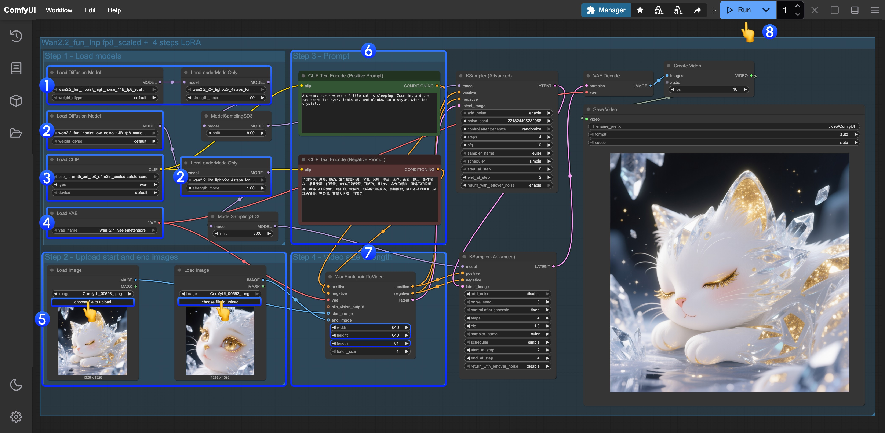

import UpdateReminder from "/snippets/ru/tutorials/update-reminder.mdx"

**Wan2.2-Fun-Inp** представляет собой модель генерации видео с управлением начальным и конечным кадром, выпущенную командой Alibaba PAI. Она поддерживает подачу **изображений начального и конечного кадра** для генерации промежуточного переходного видео, что даёт авторам больше контроля над творческим процессом. Модель распространяется по **лицензии Apache 2.0** и допускает коммерческое использование.

**Ключевые особенности**:
- **Управление начальным и конечным кадром**: поддерживается подача изображений начального и конечного кадра для генерации промежуточного переходного видео, что повышает связность видео и свободу творчества
- **Генерация видео высокого качества**: на основе архитектуры Wan2.2 создаётся видео кинематографического качества
- **Поддержка нескольких разрешений**: поддерживается генерация видео в разрешениях 512x512, 768x768, 1024x1024 и других, что подходит для разных сценариев

**Версия модели**:
- **Высокопроизводительная версия 14B**: размер модели превышает 32 ГБ, результаты лучше, но требуется много видеопамяти

Ниже приведены соответствующие веса модели и репозитории кода:

- [🤗Wan2.2-Fun-Inp-14B](https://huggingface.co/alibaba-pai/Wan2.2-Fun-A14B-InP)
- Репозиторий кода: [VideoX-Fun](https://github.com/aigc-apps/VideoX-Fun)

## Повтор прямой трансляции ComfyOrg Wan2.2 Fun InP & Control на YouTube

<iframe
  className="w-full aspect-video rounded-xl"
  src="https://www.youtube.com/embed/YcAerNYIvho?si=Zh8tzRwI_OTAFx3m"
  title="ComfyUI Selection Toolbox New Features"
  allow="accelerometer; clipboard-write; encrypted-media; gyroscope; picture-in-picture"
  allowFullScreen
></iframe>

## Пример рабочего процесса генерации видео по начальному и конечному кадрам Wan2.2 Fun Inp

<UpdateReminder/>

Этот рабочий процесс представлен в двух версиях:
1. Версия с 4-шаговой LoRA [Wan2.2-Lightning](https://huggingface.co/lightx2v/Wan2.2-Lightning) от lightx2v для ускоренной генерации видео
2. Версия fp8_scaled без ускоряющей LoRA

Ниже приведены результаты тестирования на GPU RTX4090D с 24 ГБ видеопамяти при разрешении 640x640 и 81 кадре

| Тип модели              | Использование видеопамяти | Время первой генерации | Время второй генерации |
| ------------------------ | ---------- | -------------------- | --------------------- |
| fp8_scaled               | 83%        | ≈ 524s               | ≈ 520s                |
| fp8_scaled + 4-step LoRA | 89%        | ≈ 138s               | ≈ 79s                 |

Поскольку ускорение с помощью LoRA значительно, но при этом теряется динамика видео, в предоставленных рабочих процессах по умолчанию включена версия с ускоряющей LoRA. Если вы хотите включить другой рабочий процесс, выберите его и нажмите **Ctrl+B**, чтобы активировать.

### 1. Скачать файл рабочего процесса

Обновите ComfyUI до последней версии и найдите «**Wan2.2 Fun Inp**» в меню `Workflow` -> `Browse Templates` -> `Video`, чтобы загрузить рабочий процесс.

Или, после обновления ComfyUI до последней версии, скачайте рабочий процесс ниже и перетащите его в ComfyUI для загрузки.


<CardGroup cols={2}>
  <Card title="Запустить в Comfy Cloud" icon="cloud" href="https://cloud.comfy.org/?template=video_wan2_2_14B_fun_inpaint&utm_source=docs&utm_medium=referral&utm_campaign=wan2-2-fun-inp">
    Открыть в Comfy Cloud
  </Card>
  <Card title="Скачать рабочий процесс" icon="download" href="https://github.com/Comfy-Org/workflow_templates/blob/main/templates/video_wan2_2_14B_fun_inpaint.json">
    Скачайте JSON или найдите «Wan2.2 Fun Inp» в библиотеке шаблонов
  </Card>
</CardGroup>

Используйте следующие материалы в качестве начального и конечного кадров

**Входные материалы**

<CardGroup cols={2}>
  <Card title="video_wan2_2_14B_fun_inpaint_start_image.png" icon="image" href="https://raw.githubusercontent.com/Comfy-Org/workflow_templates/main/input/video_wan2_2_14B_fun_inpaint_start_image.png">
    Начальный кадр для генерации видео. Скачайте и используйте это изображение или замените его своим.
  </Card>
  <Card title="video_wan2_2_14B_fun_inpaint_end_image.png" icon="image" href="https://raw.githubusercontent.com/Comfy-Org/workflow_templates/main/input/video_wan2_2_14B_fun_inpaint_end_image.png">
    Конечный кадр для генерации видео. Скачайте и используйте это изображение или замените его своим.
  </Card>
</CardGroup>

### 2. Модели

Все модели, используемые в этом руководстве, доступны [здесь](https://huggingface.co/Comfy-Org/Wan_2.2_ComfyUI_Repackaged/tree/main/split_files).

**Диффузионные модели**

<CardGroup cols={2}>
  <Card title="High Noise 14B FP8 Scaled" icon="download" href="https://huggingface.co/Comfy-Org/Wan_2.2_ComfyUI_Repackaged/blob/main/split_files/diffusion_models/wan2.2_fun_inpaint_high_noise_14B_fp8_scaled.safetensors">
    wan2.2_fun_inpaint_high_noise_14B_fp8_scaled.safetensors: диффузионная модель с высоким уровнем шума для инпейтинга начального и конечного кадров
  </Card>
  <Card title="Low Noise 14B FP8 Scaled" icon="download" href="https://huggingface.co/Comfy-Org/Wan_2.2_ComfyUI_Repackaged/blob/main/split_files/diffusion_models/wan2.2_fun_inpaint_low_noise_14B_fp8_scaled.safetensors">
    wan2.2_fun_inpaint_low_noise_14B_fp8_scaled.safetensors: диффузионная модель с низким уровнем шума для инпейтинга начального и конечного кадров
  </Card>
</CardGroup>

**Lightning LoRA (опционально, для ускорения)**

<CardGroup cols={2}>
  <Card title="Lightning 4-Step High Noise LoRA" icon="download" href="https://huggingface.co/Comfy-Org/Wan_2.2_ComfyUI_Repackaged/blob/main/split_files/loras/wan2.2_i2v_lightx2v_4steps_lora_v1_high_noise.safetensors">
    wan2.2_i2v_lightx2v_4steps_lora_v1_high_noise.safetensors: LoRA для 4-шагового ускорения модели с высоким уровнем шума
  </Card>
  <Card title="Lightning 4-Step Low Noise LoRA" icon="download" href="https://huggingface.co/Comfy-Org/Wan_2.2_ComfyUI_Repackaged/blob/main/split_files/loras/wan2.2_i2v_lightx2v_4steps_lora_v1_low_noise.safetensors">
    wan2.2_i2v_lightx2v_4steps_lora_v1_low_noise.safetensors: LoRA для 4-шагового ускорения модели с низким уровнем шума
  </Card>
</CardGroup>

**VAE**

<Card title="Wan2.1 VAE" icon="download" href="https://huggingface.co/Comfy-Org/Wan_2.2_ComfyUI_Repackaged/blob/main/split_files/vae/wan_2.1_vae.safetensors">
  wan_2.1_vae.safetensors: VAE Wan2.1 для кодирования и декодирования
</Card>
**Текстовый энкодер**

<Card title="UMT5 XXL FP8 Scaled" icon="download" href="https://huggingface.co/Comfy-Org/Wan_2.1_ComfyUI_repackaged/blob/main/split_files/text_encoders/umt5_xxl_fp8_e4m3fn_scaled.safetensors">
  umt5_xxl_fp8_e4m3fn_scaled.safetensors: масштабированный текстовый энкодер FP8
</Card>
```
ComfyUI/
├───📂 models/
│   ├───📂 diffusion_models/
│   │   ├─── wan2.2_fun_inpaint_high_noise_14B_fp8_scaled.safetensors
│   │   └─── wan2.2_fun_inpaint_low_noise_14B_fp8_scaled.safetensors
│   ├───📂 loras/
│   │   ├─── wan2.2_i2v_lightx2v_4steps_lora_v1_high_noise.safetensors
│   │   └─── wan2.2_i2v_lightx2v_4steps_lora_v1_low_noise.safetensors
│   ├───📂 text_encoders/
│   │   └─── umt5_xxl_fp8_e4m3fn_scaled.safetensors 
│   └───📂 vae/
│       └── wan_2.1_vae.safetensors
```

### 3. Руководство по рабочему процессу



<Note>
  В этом рабочем процессе используется LoRA. Убедитесь, что соответствующая модель диффузии и LoRA соответствуют друг другу.
</Note>

1. Загрузка модели **высокого шума** и **LoRA**
   - Убедитесь, что узел `Load Diffusion Model` загружает модель `wan2.2_fun_inpaint_high_noise_14B_fp8_scaled.safetensors`.
   - Убедитесь, что узел `LoraLoaderModelOnly` загружает `wan2.2_i2v_lightx2v_4steps_lora_v1_high_noise.safetensors`.
2. Загрузка модели **низкого шума** и **LoRA**
   - Убедитесь, что узел `Load Diffusion Model` загружает модель `wan2.2_fun_inpaint_low_noise_14B_fp8_scaled.safetensors`.
   - Убедитесь, что узел `LoraLoaderModelOnly` загружает `wan2.2_i2v_lightx2v_4steps_lora_v1_low_noise.safetensors`.
3. Убедитесь, что узел `Load CLIP` загружает модель `umt5_xxl_fp8_e4m3fn_scaled.safetensors`.
4. Убедитесь, что узел `Load VAE` загружает модель `wan_2.1_vae.safetensors`.
5. Загрузите изображения начального и конечного кадров в качестве материалов.
6. Введите промпт в группе Prompt.
7. Настройте размер и длину видео в узле `WanFunInpaintToVideo`.
    - Настройте параметры `width` и `height`. По умолчанию задано значение `640`. Мы установили меньший размер, но вы можете изменить его при необходимости.
    - Настройте параметр `length`, который задает общее количество кадров. Частота кадров в текущем рабочем процессе составляет 16. Например, чтобы сгенерировать 5-секундное видео, задайте значение 5*16 = 80.
8. Нажмите кнопку `Run` или используйте сочетание клавиш `Ctrl(cmd) + Enter`, чтобы выполнить генерацию видео.

