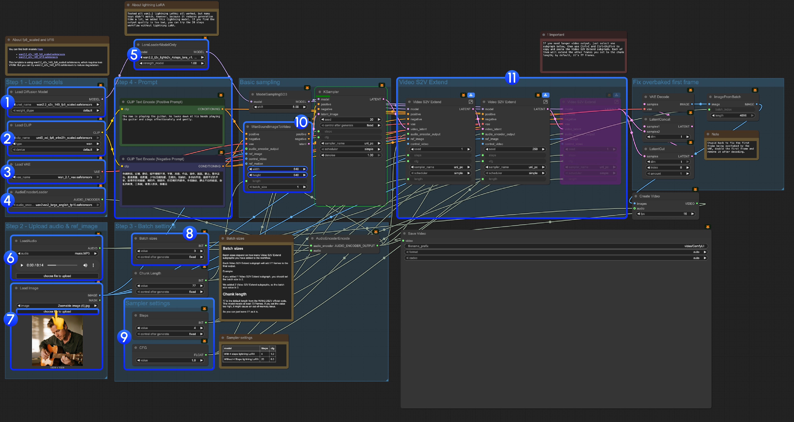

import UpdateReminder from "/snippets/ru/tutorials/update-reminder.mdx"

Мы рады сообщить, что Wan2.2-S2V, продвинутая модель генерации видео по аудио, теперь поддерживается в ComfyUI нативно! Эта мощная ИИ-модель превращает статические изображения и аудио в динамичное видео и подходит для диалогов, пения, выступлений и других творческих задач.

**Ключевые особенности модели**
- **Генерация видео по аудио**: превращает статические изображения и аудио в синхронизированное видео
- **Качество кинематографического уровня**: создаёт видео кинематографического качества с естественной мимикой и движениями
- **Генерация длиной в минуты**: поддерживает создание длинных видео
- **Поддержка разных форматов**: работает с персонажами в полный рост и по пояс
- **Расширенный контроль движения**: генерирует действия и окружение по текстовым инструкциям

Код Wan2.2 S2V: [GitHub](https://github.com/aigc-apps/VideoX-Fun)
Модель Wan2.2 S2V: [Hugging Face](https://huggingface.co/Wan-AI/Wan2.2-S2V-14B)

## Нативный рабочий процесс Wan2.2 S2V в ComfyUI

<UpdateReminder/>

### Генерация видео по аудио с Wan2.2-S2V {#video_wan2_2_14B_s2v}

Превращайте статические изображения и аудио в динамичные видео с идеальной синхронизацией и генерацией длиной в минуты.


<CardGroup cols={2}>
  <Card title="Запустить в Comfy Cloud" icon="cloud" href="https://cloud.comfy.org/?template=video_wan2_2_14B_s2v&utm_source=docs&utm_medium=referral&utm_campaign=wan2-2-s2v">
    Открыть в Comfy Cloud
  </Card>
  <Card title="Скачать рабочий процесс" icon="download" href="https://github.com/Comfy-Org/workflow_templates/blob/main/templates/video_wan2_2_14B_s2v.json">
    Скачайте JSON или найдите «Wan2.2 S2V» в библиотеке шаблонов
  </Card>
</CardGroup>

**Входные материалы**

Загрузите эти файлы в соответствующие узлы:

<CardGroup cols={2}>
  <Card title="video_wan2_2_14B_s2v_reference_image.jpg" icon="image" href="https://raw.githubusercontent.com/Comfy-Org/workflow_templates/main/input/video_wan2_2_14B_s2v_reference_image.jpg">
    `LoadImage`, узел 52 · `video_wan2_2_14B_s2v_reference_image.jpg`
  </Card>
  <Card title="video_wan2_2_14B_s2v_input_audio.MP3" icon="music" href="https://raw.githubusercontent.com/Comfy-Org/workflow_templates/main/input/video_wan2_2_14B_s2v_input_audio.MP3">
    `LoadAudio`, узел 58 · `video_wan2_2_14B_s2v_input_audio.MP3`
  </Card>
</CardGroup>

<div style={{display: 'grid', gridTemplateColumns: 'repeat(2, minmax(0, 1fr))', gap: '1rem', alignItems: 'start'}}>
  
</div>

### 2. Ссылки на модели

Модели можно найти в [нашем репозитории](https://huggingface.co/Comfy-Org/Wan_2.2_ComfyUI_Repackaged)

**diffusion_models**

<CardGroup cols={2}>
  <Card title="wan2.2_s2v_14B_fp8_scaled.safetensors" icon="download" href="https://huggingface.co/Comfy-Org/Wan_2.2_ComfyUI_Repackaged/blob/main/split_files/diffusion_models/wan2.2_s2v_14B_fp8_scaled.safetensors?download=true">
    Модель диффузии FP8 scaled. Поместите в <code>ComfyUI/models/diffusion_models/</code>
  </Card>
  <Card title="wan2.2_s2v_14B_bf16.safetensors" icon="download" href="https://huggingface.co/Comfy-Org/Wan_2.2_ComfyUI_Repackaged/blob/main/split_files/diffusion_models/wan2.2_s2v_14B_bf16.safetensors?download=true">
    Модель диффузии BF16. Поместите в <code>ComfyUI/models/diffusion_models/</code>
  </Card>
</CardGroup>

**audio_encoders**

<Card title="wav2vec2_large_english_fp16.safetensors" icon="download" href="https://huggingface.co/Comfy-Org/Wan_2.2_ComfyUI_Repackaged/blob/main/split_files/audio_encoders/wav2vec2_large_english_fp16.safetensors?download=true">
  Модель аудиоэнкодера. Поместите в <code>ComfyUI/models/audio_encoders/</code>
</Card>
**vae**

<Card title="wan_2.1_vae.safetensors" icon="download" href="https://huggingface.co/Comfy-Org/Wan_2.2_ComfyUI_Repackaged/blob/main/split_files/vae/wan_2.1_vae.safetensors?download=true">
  Модель VAE Wan2.1. Поместите в <code>ComfyUI/models/vae/</code>
</Card>
**text_encoders**

<Card title="umt5_xxl_fp8_e4m3fn_scaled.safetensors" icon="download" href="https://huggingface.co/Comfy-Org/Wan_2.1_ComfyUI_repackaged/blob/main/split_files/text_encoders/umt5_xxl_fp8_e4m3fn_scaled.safetensors?download=true">
  Текстовый энкодер FP8 scaled. Поместите в <code>ComfyUI/models/text_encoders/</code>
</Card>
```
ComfyUI/
├───📂 models/
│   ├───📂 diffusion_models/
│   │   ├─── wan2.2_s2v_14B_fp8_scaled.safetensors
│   │   └─── wan2.2_s2v_14B_bf16.safetensors
│   ├───📂 text_encoders/
│   │   └─── umt5_xxl_fp8_e4m3fn_scaled.safetensors 
│   ├───📂 audio_encoders/ # Создайте её, если не можете найти эту папку
│   │   └─── wav2vec2_large_english_fp16.safetensors 
│   └───📂 vae/
│       └── wan_2.1_vae.safetensors
```

### 3. Инструкции по рабочему процессу



#### 3.1 О Lightning LoRA

#### 3.2 О моделях fp8_scaled и bf16

Обе модели можно найти [здесь](https://huggingface.co/Comfy-Org/Wan_2.2_ComfyUI_Repackaged/tree/main/split_files/diffusion_models):

<CardGroup cols={2}>
  <Card title="wan2.2_s2v_14B_fp8_scaled.safetensors" icon="download" href="https://huggingface.co/Comfy-Org/Wan_2.2_ComfyUI_Repackaged/blob/main/split_files/diffusion_models/wan2.2_s2v_14B_fp8_scaled.safetensors?download=true">
    Модель диффузии FP8 scaled
  </Card>
  <Card title="wan2.2_s2v_14B_bf16.safetensors" icon="download" href="https://huggingface.co/Comfy-Org/Wan_2.2_ComfyUI_Repackaged/blob/main/split_files/diffusion_models/wan2.2_s2v_14B_bf16.safetensors?download=true">
    Модель диффузии BF16
  </Card>
</CardGroup>

В этом шаблоне используется `wan2.2_s2v_14B_fp8_scaled.safetensors`, для которого требуется меньше VRAM. Но вы можете попробовать `wan2.2_s2v_14B_bf16.safetensors`, чтобы снизить потерю качества.

#### 3.3 Пошаговые инструкции

**Шаг 1: Загрузить модели**
1. **Загрузить модель диффузии**: загрузите `wan2.2_s2v_14B_fp8_scaled.safetensors` или `wan2.2_s2v_14B_bf16.safetensors`
   - В предлагаемом рабочем процессе используется `wan2.2_s2v_14B_fp8_scaled.safetensors`, для которого требуется меньше VRAM
   - Но вы можете попробовать `wan2.2_s2v_14B_bf16.safetensors`, чтобы снизить потерю качества
2. **Загрузить CLIP**: загрузите `umt5_xxl_fp8_e4m3fn_scaled.safetensors`
3. **Загрузить VAE**: загрузите `wan_2.1_vae.safetensors`
4. **AudioEncoderLoader**: загрузите `wav2vec2_large_english_fp16.safetensors`
5. **LoraLoaderModelOnly**: загрузите `wan2.2_t2v_lightx2v_4steps_lora_v1.1_high_noise.safetensors` (Lightning LoRA)
   - Мы протестировали все lightning LoRA для wan2.2. Поскольку это не LoRA, специально обученная для Wan2.2 S2V, многие ключевые значения не совпадают, но мы добавили её, так как она значительно сокращает время генерации. Мы продолжим оптимизировать этот шаблон
   - Её использование приведёт к заметной потере динамики и качества
   - Если качество результата кажется вам слишком низким, попробуйте оригинальный рабочий процесс с 20 шагами
6. **LoadAudio**: загрузите предоставленный нами аудиофайл или собственное аудио
7. **Загрузить изображение**: загрузите референсное изображение
8. **Размеры батча**: задайте в соответствии с количеством добавленных узлов подграфа Video S2V Extend
   - Каждый подграф Video S2V Extend добавляет 77 кадров к итоговому результату
   - Например: если вы добавили 2 подграфа Video S2V Extend, размер батча должен быть 3, то есть общее количество итераций выборки
   - **Chunk Length**: оставьте значение по умолчанию 77

9. **Настройки сэмплера**: выберите настройки в зависимости от того, используете ли вы Lightning LoRA
   - С 4-шаговой Lightning LoRA: steps: 4, cfg: 1.0
   - Без 4-шаговой Lightning LoRA: steps: 20, cfg: 6.0
10. **Настройки размера**: задайте размеры выходного видео
11. **Video S2V Extend**: узлы подграфа расширения видео. Поскольку по умолчанию за одну выборку создаётся 77 кадров, а модель работает на 16 fps, каждое расширение даёт 77 / 16 = 4.8125 секунды видео
    - Нужно рассчитать количество узлов подграфа расширения видео так, чтобы оно соответствовало длине входного аудио. Например: если входное аудио длится 14 с, всего нужно 14x16=224 кадра, каждое расширение даёт 77 кадров, значит нужно 224/77 = 2.9, округляем вверх до 3 узлов подграфа расширения видео
12. Нажмите Ctrl-Enter или кнопку Run, чтобы выполнить рабочий процесс