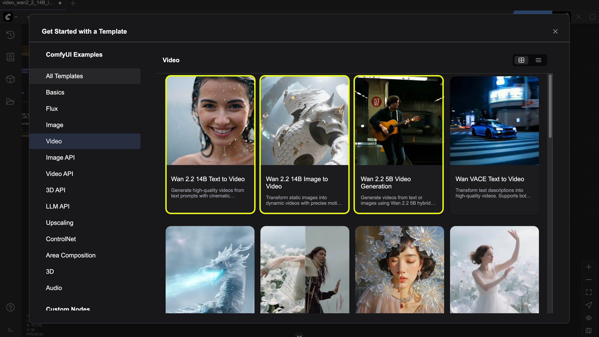
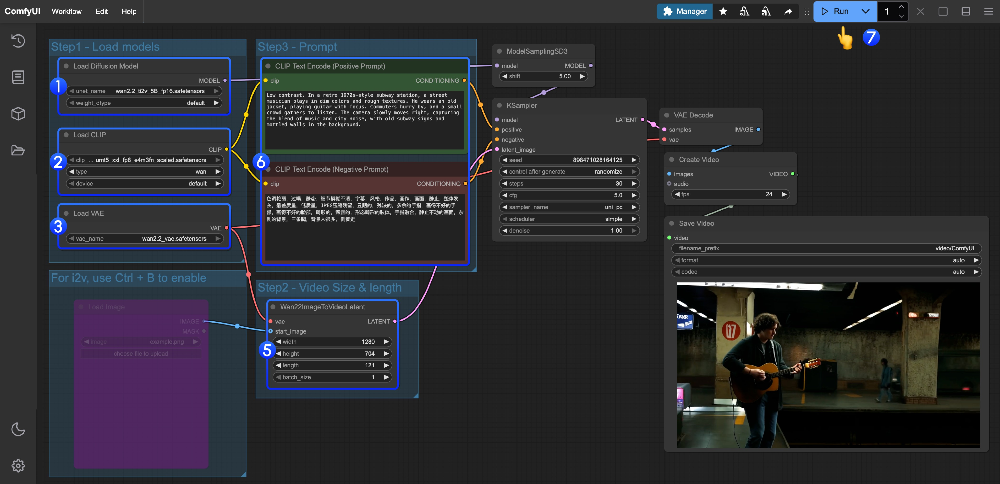
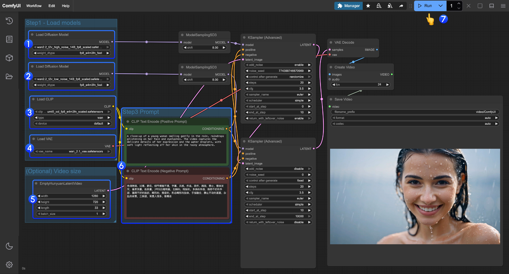
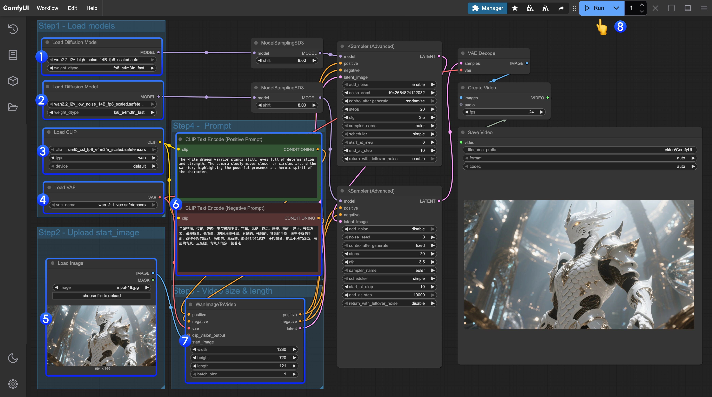
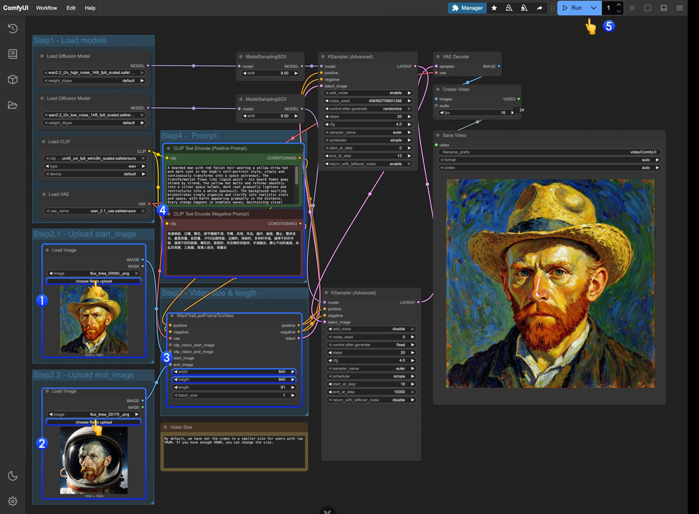

import UpdateReminder from "/snippets/ru/tutorials/update-reminder.mdx"

<iframe
  className="w-full aspect-video rounded-xl"
  src="https://www.youtube.com/embed/S45XQXFOutM?si=Qvfco7Cyr_3akZ3Hv"
  title="ComfyUI Selection Toolbox New Features"
  allow="accelerometer; clipboard-write; encrypted-media; gyroscope; picture-in-picture"
  allowFullScreen
></iframe>

Wan 2.2: это мультимодальная генеративная модель нового поколения, выпущенная WAN AI. В её основе лежит инновационная архитектура MoE (Mixture of Experts), состоящая из экспертных моделей высокого и низкого шума. Она позволяет разделять экспертные модели по шагам удаления шума, благодаря чему генерируется видео более высокого качества.

У Wan 2.2 есть три ключевые особенности: кинематографический контроль эстетики, глубоко интегрирующий профессиональные стандарты киноиндустрии и поддерживающий многомерное управление визуалом, таким как освещение, цвет и композиция; масштабное сложное движение, легко воспроизводящее разнообразные сложные перемещения и повышающее плавность и управляемость движения; точное смысловое соответствие, особенно сильное в сложных сценах и при генерации множества объектов, лучше передающее творческий замысел пользователя.
Модель поддерживает несколько режимов генерации, таких как текст в видео и изображение в видео, и подходит для создания контента, художественного творчества, обучения и других сценариев применения.

[Wan2.2 Prompt Guide](https://alidocs.dingtalk.com/i/nodes/EpGBa2Lm8aZxe5myC99MelA2WgN7R35y)

## Ключевые особенности модели

- **Кинематографический контроль эстетики**: профессиональный язык камеры, поддержка многомерного визуального управления, включая освещение, цвет и композицию.
- **Крупномасштабное сложное движение**: плавно воспроизводит различные сложные движения, повышает управляемость и естественность движения.
- **Точное соблюдение семантики**: понимание сложных сцен, генерация нескольких объектов, более точная реализация творческого замысла.
- **Эффективная технология сжатия**: версия 5B с VAE высокой степени сжатия, оптимизация памяти, поддержка смешанного обучения.

## Открытые версии моделей Wan2.2

Модели серии Wan2.2 распространяются по открытой лицензии Apache 2.0 и поддерживают коммерческое использование. Лицензия Apache 2.0 позволяет свободно использовать, изменять и распространять эти модели, в том числе в коммерческих целях, при условии сохранения исходного уведомления об авторских правах и текста лицензии.

| Тип модели | Имя модели | Параметры | Основная функция | Репозиторий модели |
|------------|------------|------------|---------------|-----------------|
| Гибридная модель | Wan2.2-TI2V-5B | 5B | Гибридная версия с поддержкой как «текст в видео», так и «изображение в видео»: одна модель закрывает две ключевые задачи | 🤗 [Wan2.2-TI2V-5B](https://huggingface.co/Wan-AI/Wan2.2-TI2V-5B) |
| Изображение в видео | Wan2.2-I2V-A14B | 14B | Превращает статичные изображения в динамичные видео, сохраняя согласованность содержимого и плавность динамики | 🤗 [Wan2.2-I2V-A14B](https://huggingface.co/Wan-AI/Wan2.2-I2V-A14B) |
| Текст в видео | Wan2.2-T2V-A14B | 14B | Генерирует высококачественные видео по текстовым описаниям с кинематографическим контролем эстетики и точным следованием смыслу | 🤗 [Wan2.2-T2V-A14B](https://huggingface.co/Wan-AI/Wan2.2-T2V-A14B) |

## Прямые трансляции ComfyOrg по Wan2.2

Чтобы разобраться с использованием Wan2.2 в ComfyUI, мы провели прямые трансляции: посмотрите их, чтобы узнать, как работать с моделями.

<iframe
  className="w-full aspect-video rounded-xl"
  src="https://www.youtube.com/embed/Z0yo16LzReA?si=I-BlUfktxqt9URQk"
  title="ComfyUI Wan2.2 Live Streams"
  allow="accelerometer; clipboard-write; encrypted-media; gyroscope; picture-in-picture"
  allowFullScreen
></iframe>

<iframe
  className="w-full aspect-video rounded-xl"
  src="https://www.youtube.com/embed/z62QLQ3XqSA?si=yUenvPa9Q4-VX28M"
  title="ComfyUI Wan2.2 Deep Dive"
  allow="accelerometer; clipboard-write; encrypted-media; gyroscope; picture-in-picture"
  allowFullScreen
></iframe>

<iframe
  className="w-full aspect-video rounded-xl"
  src="https://www.youtube.com/embed/0fyZhXga8P8?si=PMv9xQLP32wP8Ni9"
  title="ComfyUI Wan2.2 Deep Dive #2"
  allow="accelerometer; clipboard-write; encrypted-media; gyroscope; picture-in-picture"
  allowFullScreen
></iframe>

В этом руководстве используется версия [🤗 Comfy-Org/Wan_2.2_ComfyUI_Repackaged](https://huggingface.co/Comfy-Org/Wan_2.2_ComfyUI_Repackaged).

<UpdateReminder/>



## Пример рабочего процесса гибридной версии Wan2.2 TI2V 5B

<Tip>
  Версия Wan2.2 5B должна хорошо помещаться в 8 ГБ видеопамяти благодаря нативной выгрузке памяти в ComfyUI.
</Tip>

### Генерация видео Wan 2.2 5B {#video_wan2_2_5B_ti2v}

Быстрая генерация текст в видео и изображение в видео с моделью на 5B параметров. Оптимизирована для быстрого прототипирования и творческих экспериментов.


<CardGroup cols={2}>
  <Card title="Запустить в Comfy Cloud" icon="cloud" href="https://cloud.comfy.org/?template=video_wan2_2_5B_ti2v&utm_source=docs&utm_medium=referral&utm_campaign=wan2_2">
    Открыть в Comfy Cloud
  </Card>
  <Card title="Скачать рабочий процесс" icon="download" href="https://github.com/Comfy-Org/workflow_templates/blob/main/templates/video_wan2_2_5B_ti2v.json">
    Скачайте JSON или найдите «Wan2.2 5B» в библиотеке шаблонов
  </Card>
</CardGroup>

### 2. Скачать модели вручную

Все упомянутые модели можно найти в [Comfy-Org/Wan_2.2_ComfyUI_Repackaged](https://huggingface.co/Comfy-Org/Wan_2.2_ComfyUI_Repackaged).

**Модель диффузии**

<CardGroup cols={1}>
  <Card title="wan2.2_ti2v_5B_fp16.safetensors" icon="download" href="https://huggingface.co/Comfy-Org/Wan_2.2_ComfyUI_Repackaged/blob/main/split_files/diffusion_models/wan2.2_ti2v_5B_fp16.safetensors">
    Гибридная модель диффузии 5B. Поместите в <code>ComfyUI/models/diffusion_models/</code>
  </Card>
</CardGroup>

**VAE**

<CardGroup cols={1}>
  <Card title="wan2.2_vae.safetensors" icon="download" href="https://huggingface.co/Comfy-Org/Wan_2.2_ComfyUI_Repackaged/blob/main/split_files/vae/wan2.2_vae.safetensors">
    VAE Wan2.2. Поместите в <code>ComfyUI/models/vae/</code>
  </Card>
</CardGroup>

**Текстовый энкодер**

<CardGroup cols={1}>
  <Card title="umt5_xxl_fp8_e4m3fn_scaled.safetensors" icon="download" href="https://huggingface.co/Comfy-Org/Wan_2.1_ComfyUI_repackaged/blob/main/split_files/text_encoders/umt5_xxl_fp8_e4m3fn_scaled.safetensors">
    Текстовый энкодер FP8. Поместите в <code>ComfyUI/models/text_encoders/</code>
  </Card>
</CardGroup>

```
ComfyUI/
├───📂 models/
│   ├───📂 diffusion_models/
│   │   └───wan2.2_ti2v_5B_fp16.safetensors
│   ├───📂 text_encoders/
│   │   └─── umt5_xxl_fp8_e4m3fn_scaled.safetensors 
│   └───📂 vae/
│       └── wan2.2_vae.safetensors
```

### 3. Выполните шаги


1. Убедитесь, что узел `Load Diffusion Model` загружает модель `wan2.2_ti2v_5B_fp16.safetensors`.
2. Убедитесь, что узел `Load CLIP` загружает модель `umt5_xxl_fp8_e4m3fn_scaled.safetensors`.
3. Убедитесь, что узел `Load VAE` загружает модель `wan2.2_vae.safetensors`.
4. (Необязательно) Если нужно выполнить генерацию изображение в видео, можно нажать сочетание Ctrl+B, чтобы включить узел `Load image` и загрузить изображение.
5. (Необязательно) В узле `Wan22ImageToVideoLatent` можно настроить размеры и общее количество кадров видео (`length`).
6. (Необязательно) Если нужно изменить промпты (позитивный и негативный), сделайте это в узле `CLIP Text Encoder` на шаге 5.
7. Нажмите кнопку `Run` или используйте сочетание клавиш `Ctrl(cmd) + Enter`, чтобы выполнить генерацию видео.

## Пример рабочего процесса Wan2.2 14B T2V (текст в видео)

### Wan 2.2 14B: текст в видео {#video_wan2_2_14B_t2v}

Создавайте высококачественные видео из текстовых промптов с кинематографическим управлением эстетикой и динамичной генерацией движения с помощью Wan 2.2.


<CardGroup cols={2}>
  <Card title="Запустить в Comfy Cloud" icon="cloud" href="https://cloud.comfy.org/?template=video_wan2_2_14B_t2v&utm_source=docs&utm_medium=referral&utm_campaign=wan2_2">
    Открыть в Comfy Cloud
  </Card>
  <Card title="Скачать рабочий процесс" icon="download" href="https://github.com/Comfy-Org/workflow_templates/blob/main/templates/video_wan2_2_14B_t2v.json">
    Скачайте JSON или найдите «Wan2.2 14B T2V» в библиотеке шаблонов
  </Card>
</CardGroup>

### 2. Скачать модели вручную

Все упомянутые модели можно найти в репозитории [Comfy-Org/Wan_2.2_ComfyUI_Repackaged](https://huggingface.co/Comfy-Org/Wan_2.2_ComfyUI_Repackaged).

**Модели диффузии**

<CardGroup cols={2}>
  <Card title="wan2.2_t2v_high_noise_14B_fp8_scaled.safetensors" icon="download" href="https://huggingface.co/Comfy-Org/Wan_2.2_ComfyUI_Repackaged/blob/main/split_files/diffusion_models/wan2.2_t2v_high_noise_14B_fp8_scaled.safetensors">
    Модель диффузии с высоким уровнем шума. Поместите в <code>ComfyUI/models/diffusion_models/</code>
  </Card>
  <Card title="wan2.2_t2v_low_noise_14B_fp8_scaled.safetensors" icon="download" href="https://huggingface.co/Comfy-Org/Wan_2.2_ComfyUI_Repackaged/blob/main/split_files/diffusion_models/wan2.2_t2v_low_noise_14B_fp8_scaled.safetensors">
    Модель диффузии с низким уровнем шума. Поместите в <code>ComfyUI/models/diffusion_models/</code>
  </Card>
</CardGroup>

**VAE**

<CardGroup cols={1}>
  <Card title="wan_2.1_vae.safetensors" icon="download" href="https://huggingface.co/Comfy-Org/Wan_2.2_ComfyUI_Repackaged/blob/main/split_files/vae/wan_2.1_vae.safetensors">
    VAE от Wan2.1 (совместим с Wan2.2). Поместите в <code>ComfyUI/models/vae/</code>
  </Card>
</CardGroup>

**Текстовый энкодер**

<CardGroup cols={1}>
  <Card title="umt5_xxl_fp8_e4m3fn_scaled.safetensors" icon="download" href="https://huggingface.co/Comfy-Org/Wan_2.1_ComfyUI_repackaged/blob/main/split_files/text_encoders/umt5_xxl_fp8_e4m3fn_scaled.safetensors">
    Текстовый энкодер FP8. Поместите в <code>ComfyUI/models/text_encoders/</code>
  </Card>
</CardGroup>

```
ComfyUI/
├───📂 models/
│   ├───📂 diffusion_models/
│   │   ├─── wan2.2_t2v_low_noise_14B_fp8_scaled.safetensors
│   │   └─── wan2.2_t2v_high_noise_14B_fp8_scaled.safetensors
│   ├───📂 text_encoders/
│   │   └─── umt5_xxl_fp8_e4m3fn_scaled.safetensors 
│   └───📂 vae/
│       └── wan_2.1_vae.safetensors
```

### 3. Выполните шаги


1. Убедитесь, что первый узел `Load Diffusion Model` загружает модель `wan2.2_t2v_high_noise_14B_fp8_scaled.safetensors`.
2. Убедитесь, что второй узел `Load Diffusion Model` загружает модель `wan2.2_t2v_low_noise_14B_fp8_scaled.safetensors`.
3. Убедитесь, что узел `Load CLIP` загружает модель `umt5_xxl_fp8_e4m3fn_scaled.safetensors`.
4. Убедитесь, что узел `Load VAE` загружает модель `wan_2.1_vae.safetensors`.
5. (Необязательно) В узле `EmptyHunyuanLatentVideo` можно изменить настройки размера и общее количество кадров видео (`length`).
6. (Необязательно) Если нужно изменить промпты (положительный и отрицательный), сделайте это в узле `CLIP Text Encoder` на шаге 5.
7. Нажмите кнопку `Run` или используйте сочетание клавиш `Ctrl(cmd) + Enter`, чтобы выполнить генерацию видео.

## Пример рабочего процесса Wan2.2 14B I2V: изображение в видео

### Wan 2.2 14B: изображение в видео {#video_wan2_2_14B_i2v}

Преобразуйте статические изображения в динамичные видео с точным контролем движения и сохранением стиля с помощью Wan 2.2.


<CardGroup cols={2}>
  <Card title="Запустить в Comfy Cloud" icon="cloud" href="https://cloud.comfy.org/?template=video_wan2_2_14B_i2v&utm_source=docs&utm_medium=referral&utm_campaign=wan2_2">
    Открыть в Comfy Cloud
  </Card>
  <Card title="Скачать рабочий процесс" icon="download" href="https://github.com/Comfy-Org/workflow_templates/blob/main/templates/video_wan2_2_14B_i2v.json">
    Скачайте JSON или найдите «Wan2.2 14B I2V» в библиотеке шаблонов
  </Card>
</CardGroup>

**Входные материалы**

Загрузите этот файл в соответствующий узел `LoadImage`:

<CardGroup cols={2}>
  <Card title="video_wan2_2_14B_i2v_input_image.jpg" icon="image" href="https://raw.githubusercontent.com/Comfy-Org/workflow_templates/main/input/video_wan2_2_14B_i2v_input_image.jpg">
    Узел `LoadImage` 97 · `video_wan2_2_14B_i2v_input_image.jpg`
  </Card>
</CardGroup>

**Пример результата**

<div style={{display: 'grid', gridTemplateColumns: 'repeat(2, minmax(0, 1fr))', gap: '1rem', alignItems: 'start'}}>
  
  <video controls src="https://raw.githubusercontent.com/Comfy-Org/workflow_templates/main/output/video_wan2_2_14B_i2v.mp4" style={{width: '100%', height: 'auto', objectFit: 'contain'}}></video>
</div>

### 2. Скачать модели вручную

Все упомянутые модели можно найти в [Comfy-Org/Wan_2.2_ComfyUI_Repackaged](https://huggingface.co/Comfy-Org/Wan_2.2_ComfyUI_Repackaged).

**Модели диффузии**

<CardGroup cols={2}>
  <Card title="wan2.2_i2v_high_noise_14B_fp16.safetensors" icon="download" href="https://huggingface.co/Comfy-Org/Wan_2.2_ComfyUI_Repackaged/blob/main/split_files/diffusion_models/wan2.2_i2v_high_noise_14B_fp16.safetensors">
    Модель диффузии I2V с высоким уровнем шума. Поместите в <code>ComfyUI/models/diffusion_models/</code>
  </Card>
  <Card title="wan2.2_i2v_low_noise_14B_fp16.safetensors" icon="download" href="https://huggingface.co/Comfy-Org/Wan_2.2_ComfyUI_Repackaged/blob/main/split_files/diffusion_models/wan2.2_i2v_low_noise_14B_fp16.safetensors">
    Модель диффузии I2V с низким уровнем шума. Поместите в <code>ComfyUI/models/diffusion_models/</code>
  </Card>
</CardGroup>

**VAE**

<CardGroup cols={1}>
  <Card title="wan_2.1_vae.safetensors" icon="download" href="https://huggingface.co/Comfy-Org/Wan_2.2_ComfyUI_Repackaged/blob/main/split_files/vae/wan_2.1_vae.safetensors">
    VAE Wan2.1 (совместим с Wan2.2). Поместите в <code>ComfyUI/models/vae/</code>
  </Card>
</CardGroup>

**Текстовый энкодер**

<CardGroup cols={1}>
  <Card title="umt5_xxl_fp8_e4m3fn_scaled.safetensors" icon="download" href="https://huggingface.co/Comfy-Org/Wan_2.1_ComfyUI_repackaged/blob/main/split_files/text_encoders/umt5_xxl_fp8_e4m3fn_scaled.safetensors">
    Текстовый энкодер FP8. Поместите в <code>ComfyUI/models/text_encoders/</code>
  </Card>
</CardGroup>

```
ComfyUI/
├───📂 models/
│   ├───📂 diffusion_models/
│   │   ├─── wan2.2_i2v_low_noise_14B_fp16.safetensors
│   │   └─── wan2.2_i2v_high_noise_14B_fp16.safetensors
│   ├───📂 text_encoders/
│   │   └─── umt5_xxl_fp8_e4m3fn_scaled.safetensors 
│   └───📂 vae/
│       └── wan_2.1_vae.safetensors
```
### 3. Выполните шаги


1. Убедитесь, что первый узел `Load Diffusion Model` загружает модель `wan2.2_t2v_high_noise_14B_fp8_scaled.safetensors`.
2. Убедитесь, что второй узел `Load Diffusion Model` загружает модель `wan2.2_t2v_low_noise_14B_fp8_scaled.safetensors`.
3. Убедитесь, что узел `Load CLIP` загружает модель `umt5_xxl_fp8_e4m3fn_scaled.safetensors`.
4. Убедитесь, что узел `Load VAE` загружает модель `wan_2.1_vae.safetensors`.
5. В узле `Load Image` загрузите изображение, которое будет использоваться как начальный кадр.
6. Если нужно изменить промпты (позитивный и негативный), сделайте это в узле `CLIP Text Encoder` на шаге 6.
7. (Необязательно) В `EmptyHunyuanLatentVideo` можно настроить размеры и общее количество кадров видео (`length`).
8. Нажмите кнопку `Run` или используйте сочетание клавиш `Ctrl(cmd) + Enter`, чтобы запустить генерацию видео.

## Пример рабочего процесса Wan2.2 14B FLF2V

Рабочий процесс с первым и последним кадром использует те же расположения моделей, что и раздел I2V.

### Wan 2.2 14B: видео из первого и последнего кадра {#video_wan2_2_14B_flf2v}

Генерируйте плавные переходы в видео, задавая начальный и конечный кадры.


<CardGroup cols={2}>
  <Card title="Запустить в Comfy Cloud" icon="cloud" href="https://cloud.comfy.org/?template=video_wan2_2_14B_flf2v&utm_source=docs&utm_medium=referral&utm_campaign=wan2_2">
    Открыть в Comfy Cloud
  </Card>
  <Card title="Скачать рабочий процесс" icon="download" href="https://github.com/Comfy-Org/workflow_templates/blob/main/templates/video_wan2_2_14B_flf2v.json">
    Скачайте JSON или найдите «Wan2.2 14B FLF2V» в библиотеке шаблонов
  </Card>
</CardGroup>

**Входные материалы**

Загрузите эти файлы в соответствующие узлы `LoadImage`:

<CardGroup cols={2}>
  <Card title="video_wan2_2_14B_flf2v_start_image.png" icon="image" href="https://raw.githubusercontent.com/Comfy-Org/workflow_templates/main/input/video_wan2_2_14B_flf2v_start_image.png">
    Узел `LoadImage` 62 · `video_wan2_2_14B_flf2v_start_image.png`
  </Card>
  <Card title="video_wan2_2_14B_flf2v_end_image.png" icon="image" href="https://raw.githubusercontent.com/Comfy-Org/workflow_templates/main/input/video_wan2_2_14B_flf2v_end_image.png">
    Узел `LoadImage` 68 · `video_wan2_2_14B_flf2v_end_image.png`
  </Card>
</CardGroup>

<div style={{display: 'grid', gridTemplateColumns: 'repeat(2, minmax(0, 1fr))', gap: '1rem', alignItems: 'start'}}>
  
  
</div>

### 2. Следуйте шагам



1. Загрузите изображение, которое будет использоваться как начальный кадр, в первый узел `Load Image`.
2. Загрузите изображение, которое будет использоваться как конечный кадр, во второй узел `Load Image`.
3. Настройте параметры размера в узле `WanFirstLastFrameToVideo`.
    - По умолчанию задан относительно небольшой размер, чтобы пользователи с малым объёмом VRAM не расходовали слишком много ресурсов.
    - Если у вас достаточно VRAM, можно попробовать разрешение около 720P.
4. Напишите подходящие промпты в соответствии с вашими первым и последним кадрами.
5. Нажмите кнопку `Run` или используйте сочетание клавиш `Ctrl(cmd) + Enter`, чтобы выполнить генерацию видео.

## Ресурсы сообщества

### Версии GGUF

- [bullerwins/Wan2.2-I2V-A14B-GGUF/](https://huggingface.co/bullerwins/Wan2.2-I2V-A14B-GGUF/)
- [bullerwins/Wan2.2-T2V-A14B-GGUF](https://huggingface.co/bullerwins/Wan2.2-T2V-A14B-GGUF)
- [QuantStack/Wan2.2 GGUFs](https://huggingface.co/collections/QuantStack/wan22-ggufs-6887ec891bdea453a35b95f3)

**Пользовательский узел**
[City96/ComfyUI-GGUF](https://github.com/city96/ComfyUI-GGUF)

### WanVideoWrapper
[Kijai/ComfyUI-WanVideoWrapper](https://github.com/kijai/ComfyUI-WanVideoWrapper)

**Модели Wan2.2**
[Kijai/WanVideo_comfy_fp8_scaled](https://hf-mirror.com/Kijai/WanVideo_comfy_fp8_scaled)

**Модели Wan2.1**
[Kijai/WanVideo_comfy/Lightx2v](https://huggingface.co/Kijai/WanVideo_comfy/tree/main/Lightx2v)

**Lightx2v 4steps LoRA**
- [Wan2.2-T2V-A14B-4steps-lora-rank64-V1](https://huggingface.co/lightx2v/Wan2.2-Lightning/tree/main/Wan2.2-T2V-A14B-4steps-lora-rank64-V1)
