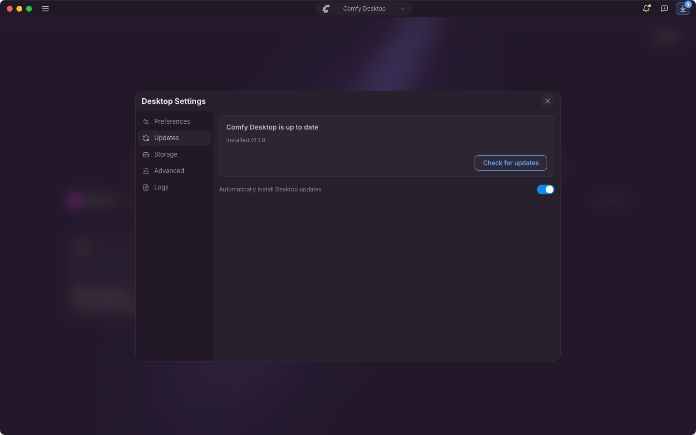

{/* translationSourceHash: b05f1a5d */}
Comfy Desktop sucht kurz nach dem Start und anschließend alle 10 Minuten während der Laufzeit nach Updates, und jede Prüfung lädt herunter, was sie findet. Beides lässt sich nicht deaktivieren. Die einzige Einstellung legt fest, ob ein gefundenes Update danach ohne Nachfrage installiert wird.

## Automatische Updates

**Automatically install Desktop updates** ist standardmäßig aktiviert. Die Titelleiste folgt dem Download: zuerst **Downloading update…**, dann **Desktop Update Ready**. Ist die Einstellung aktiviert, wendet Comfy Desktop das Update ohne Nachfrage an: unter macOS beim Beenden der App, unter Windows beim nächsten Start.

Klicken Sie stattdessen auf die Schaltfläche in der Titelleiste, um sofort in die neue Version neu zu starten. **Restart & Update** beendet Comfy Desktop und öffnet die neue Version, sodass alles, was in der App läuft, mit beendet wird. **Later** schließt den Dialog und überlässt das Anwenden des Updates dem automatischen Ablauf: Diese automatische Anwendung erfolgt nur, solange die Einstellung aktiviert ist.

## Manuelles Update

1. Klicken Sie auf ☰ und wählen Sie **Desktop Settings**.
2. Öffnen Sie den Tab **Updates**.

Die Karte beginnt mit dem Status, etwa **Comfy Desktop is up to date** oder **Update v1.2.0 ready to install**, gefolgt von der installierten Version, der letzten Prüfung und der neuesten Version, sofern eine neuere existiert. Die Hauptschaltfläche richtet sich nach diesem Status: **Check for updates**, **Download** oder **Restart & Update**. Während ein Download läuft, öffnet ein Klick auf die Schaltfläche in der Titelleiste die Desktop Settings, und der Tab **Updates** zeigt den Fortschritt.

Deaktivieren Sie **Automatically install Desktop updates**, und nichts wird von selbst installiert. Die Titelleiste zeigt dann **Desktop Update**, und die Updates-Karte zeigt **Update … available**. Die Datei wird trotzdem heruntergeladen; wenn sie bereit ist, klicken Sie auf die Schaltfläche **Desktop Update Ready** und wählen Sie **Restart & Update**.