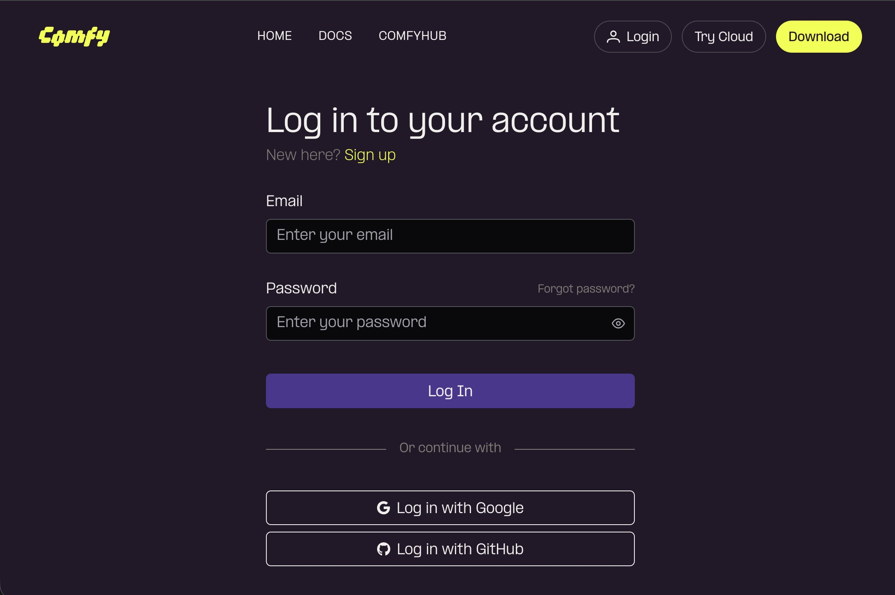
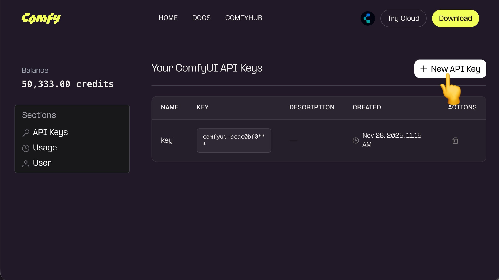
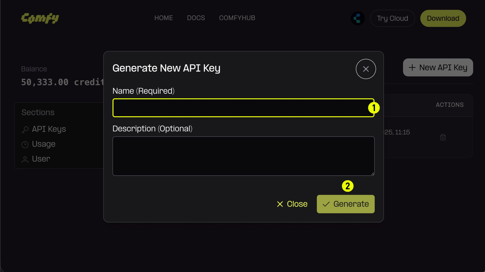
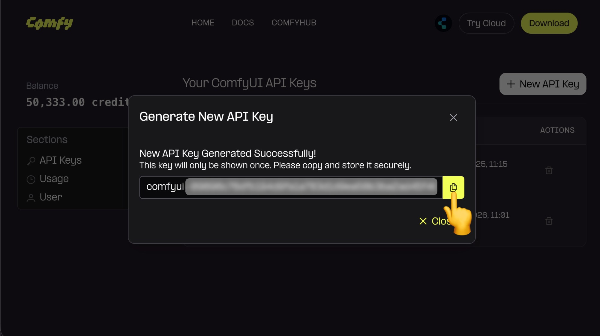

{/* translationSourceHash: 43c0e218 */}
<Steps>
  <Step title="Comfy Platform aufrufen und anmelden">
    Bitte rufen Sie die [Anmeldeseite der Comfy Platform](https://platform.comfy.org/login) auf und melden Sie sich mit dem entsprechenden Konto an.
    
  </Step>
  <Step title="Im Bereich API Keys auf `+ New` klicken, um einen API-Schlüssel zu erstellen">
    Klicken Sie im Bereich API Keys auf `+ New`, um einen API-Schlüssel zu erstellen.
    
  </Step>
  <Step title="Namen für den API-Schlüssel eingeben">

    
    1. (Erforderlich) Geben Sie den Namen des API-Schlüssels ein.
    2. Klicken Sie auf `Generate`, um ihn zu erstellen.
  </Step>
  <Step title="Erstellten API-Schlüssel speichern">
    
    <Warning>
      Da der API-Schlüssel nur direkt nach der Erstellung sichtbar ist, speichern Sie ihn bitte sofort nach dem Erstellen. Später kann er nicht mehr angezeigt werden, bewahren Sie ihn also sicher auf.
      Bitte geben Sie Ihren API-Schlüssel nicht an andere weiter. Sollte er einmal offengelegt worden sein, können Sie ihn löschen und einen neuen erstellen.
    </Warning>
  </Step>
</Steps>