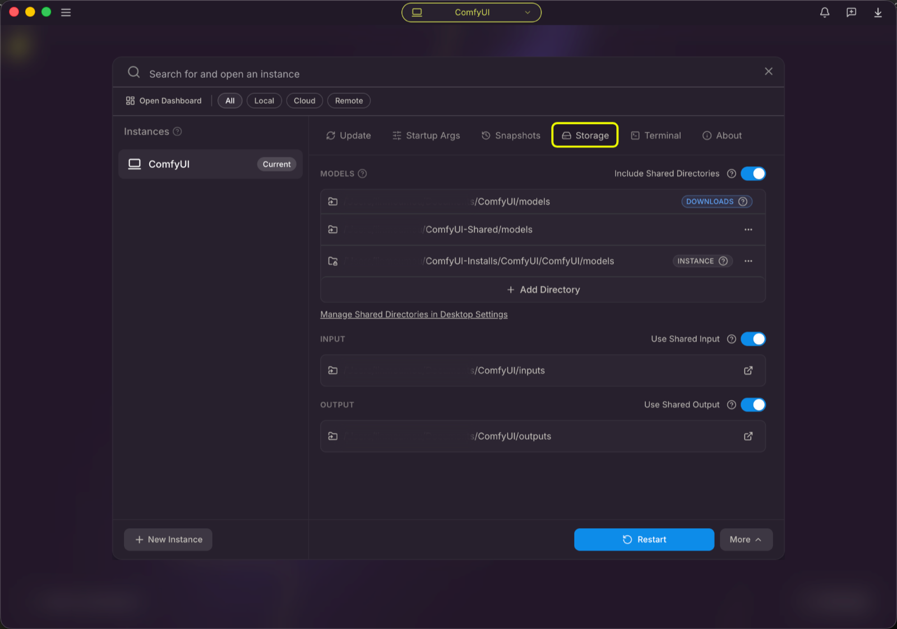

{/* translationSourceHash: 879b3e7e */}
## Zusätzliche Modellpfade hinzufügen

Wenn Sie Ihre Modelldateien außerhalb von `ComfyUI/models` verwalten möchten, kann das folgende Gründe haben:

- Sie haben mehrere ComfyUI-Instanzen und möchten gemeinsam genutzte Modelldateien verwenden, um Speicherplatz zu sparen
- Sie verwenden verschiedene GUI-Programme (etwa WebUI) und möchten dieselben Modelldateien nutzen
- Modelldateien werden nicht erkannt oder nicht gefunden

Wir bieten eine Möglichkeit, zusätzliche Modellsuchpfade über die Konfigurationsdatei `extra_model_paths.yaml` hinzuzufügen.

### Konfigurationsdatei öffnen

<Tabs>
  <Tab title="Portable/Manuelle Installation">
  Bei einer ComfyUI-Version wie [Portable](/de/installation/comfyui_portable_windows) oder [manueller Installation](/de/installation/manual_install) finden Sie im Stammverzeichnis von ComfyUI eine Beispieldatei namens `extra_model_paths.yaml.example`:
  ```
  ComfyUI/extra_model_paths.yaml.example
  ```

  Kopieren Sie sie, benennen Sie sie in `extra_model_paths.yaml` um und verwenden Sie sie. Behalten Sie sie im Stammverzeichnis von ComfyUI unter `ComfyUI/extra_model_paths.yaml`.
  Die Beispielkonfiguration finden Sie auch [hier](https://github.com/Comfy-Org/ComfyUI/blob/master/extra_model_paths.yaml.example)
  
  </Tab>
  <Tab title="Comfy Desktop">
  Wenn Sie die Anwendung [Comfy Desktop](/de/installation/desktop/windows) verwenden, klicken Sie oben in der Desktop-App auf das Kapselmenü, öffnen Sie dann den Tab **Storage** und fügen Sie dort Ihre Modellverzeichnisse hinzu. Das Kapselmenü gibt es nur in der Desktop-App, nicht wenn ComfyUI im Browser läuft.

  

  Oder öffnen Sie die Datei direkt unter:

  <Tabs>
    <Tab title="Windows">
      ```
      C:\Users\YourUsername\AppData\Roaming\ComfyUI\extra_models_config.yaml
      ```
    </Tab>
    <Tab title="macOS">
      ```
      ~/Library/Application Support/ComfyUI/extra_models_config.yaml
      ```
    </Tab>
  </Tabs>

  Behalten Sie die Datei im selben Verzeichnis und verschieben Sie diese Dateien nicht an andere Orte.
  </Tab>
</Tabs>

Wenn die Datei nicht existiert, können Sie sie mit einem beliebigen Texteditor selbst erstellen.

### Beispielstruktur

Angenommen, Sie möchten die folgenden Modellpfade zu ComfyUI hinzufügen:

```
📁 YOUR_PATH/
  ├── 📁models/
  |   ├── 📁 loras/
  |   │   └── xxxxx.safetensors
  |   ├── 📁 checkpoints/
  |   │   └── xxxxx.safetensors
  |   ├── 📁 vae/
  |   │   └── xxxxx.safetensors
  |   └── 📁 controlnet/
  |       └── xxxxx.safetensors
```

Dann können Sie die Datei `extra_model_paths.yaml` wie unten konfigurieren, damit ComfyUI die Modellpfade auf Ihrem Gerät erkennt:

```
my_custom_config:
    base_path: YOUR_PATH
    loras: models/loras/
    checkpoints: models/checkpoints/
    vae: models/vae/
    controlnet: models/controlnet/
```
oder

```
my_custom_config:
    base_path: YOUR_PATH/models/
    loras: loras
    checkpoints: checkpoints
    vae: vae
    controlnet: controlnet
```

<Warning>
  Fügen Sie bei der Desktop-Version die Konfiguration zum bestehenden Konfigurationspfad hinzu, ohne die bei der Installation erzeugte Pfadkonfiguration zu überschreiben. Sichern Sie die entsprechende Datei vor der Änderung, damit Sie sie im Fehlerfall wiederherstellen können.
</Warning>

Weitere Konfigurationsoptionen finden Sie in der Standarddatei [extra_model_paths.yaml.example](https://github.com/Comfy-Org/ComfyUI/blob/master/extra_model_paths.yaml.example). Nach dem Speichern müssen Sie **ComfyUI neu starten**, damit die Änderungen wirksam werden.

Unten sehen Sie das ursprüngliche Konfigurationsbeispiel:

```yaml
# Benennen Sie diese Datei in extra_model_paths.yaml um, damit ComfyUI sie lädt


# Konfiguration für a1111 ui
# Ändern Sie einfach base_path auf den Ort, an dem Ihre Installation liegt
a111:
    base_path: path/to/stable-diffusion-webui/

    checkpoints: models/Stable-diffusion
    configs: models/Stable-diffusion
    vae: models/VAE
    loras: |
         models/Lora
         models/LyCORIS
    upscale_models: |
                  models/ESRGAN
                  models/RealESRGAN
                  models/SwinIR
    embeddings: embeddings
    hypernetworks: models/hypernetworks
    controlnet: models/ControlNet

# Konfiguration für comfyui
# Ihr base_path sollte entweder eine bestehende Comfy-Installation sein oder ein zentraler Ordner, in dem Sie alle Ihre Modelle, LoRAs usw. ablegen

#comfyui:
#     base_path: path/to/comfyui/
#     # Mit is_default können Sie festlegen, dass diese Ordner zuerst aufgelistet und als Standardverzeichnisse verwendet werden, z. B. für Downloads
#     #is_default: true
#     checkpoints: models/checkpoints/
#     clip: models/clip/
#     clip_vision: models/clip_vision/
#     configs: models/configs/
#     controlnet: models/controlnet/
#     diffusion_models: |
#                  models/diffusion_models
#                  models/unet
#     embeddings: models/embeddings/
#     loras: models/loras/
#     upscale_models: models/upscale_models/
#     vae: models/vae/

#other_ui:
#    base_path: path/to/ui
#    checkpoints: models/checkpoints
#    gligen: models/gligen
#    custom_nodes: path/custom_nodes

```

Wenn sich Ihre WebUI beispielsweise unter `D:\stable-diffusion-webui\` befindet, können Sie die entsprechende Konfiguration wie folgt ändern:
```yaml
a111:
    base_path: D:\stable-diffusion-webui\
    checkpoints: models/Stable-diffusion
    configs: models/Stable-diffusion
    vae: models/VAE
    loras: |
         models/Lora
         models/LyCORIS
    upscale_models: |
                  models/ESRGAN
                  models/RealESRGAN
                  models/SwinIR
    embeddings: embeddings
    hypernetworks: models/hypernetworks
    controlnet: models/ControlNet
```

### Zusätzlichen Pfad für Custom Nodes hinzufügen

Neben externen Modellen können Sie auch Pfade für Custom Nodes hinzufügen, die nicht im Standardpfad von ComfyUI liegen.

<Tip>
  Beachten Sie, dass dies den Standardinstallationspfad für Custom Nodes nicht ändert, sondern beim Start von ComfyUI einen zusätzlichen Suchpfad hinzufügt. Sie müssen die Abhängigkeiten der Custom Nodes weiterhin in der entsprechenden Umgebung installieren, damit die Laufzeitumgebung vollständig ist.
</Tip>

Unten sehen Sie ein einfaches Konfigurationsbeispiel (macOS). Passen Sie es an Ihre tatsächliche Situation an, fügen Sie es der entsprechenden Konfigurationsdatei hinzu, speichern Sie die Datei und starten Sie ComfyUI neu, damit die Änderungen wirksam werden:

```yaml
my_custom_nodes:
  custom_nodes: /Users/your_username/Documents/extra_custom_nodes
```
