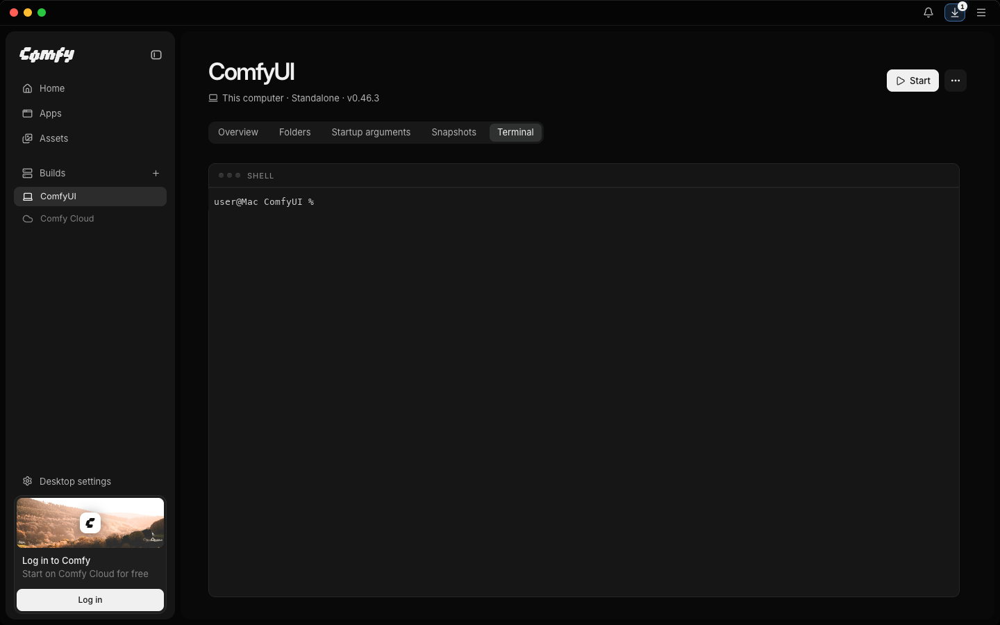
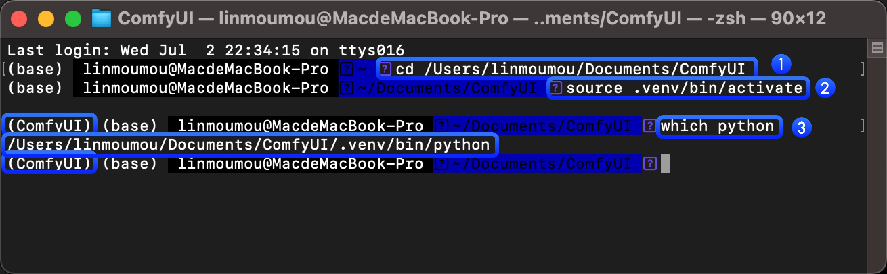

{/* translationSourceHash: c9c978a9 */}
## Python-Umgebung der Desktop-Version

Die Desktop-Installation erstellt eine virtuelle Python-Umgebung in Ihrem gewählten Installationsverzeichnis, üblicherweise einen ausgeblendeten Ordner `.venv`.

Wenn Sie Abhängigkeiten für ComfyUI-Plugins verwalten müssen, müssen Sie dies innerhalb dieser Umgebung tun. Die direkte Verwendung der System-Kommandozeile birgt das Risiko, Abhängigkeiten in der Systemumgebung zu installieren. Folgen Sie daher bitte den untenstehenden Anweisungen, um die passende Umgebung zu aktivieren.

### Wie verwenden Sie die Python-Umgebung der Desktop-Version?

<Tabs>
  <Tab title="Desktop (EMPFOHLEN)">
    Sie können das integrierte Terminal in der Desktop-App verwenden, um auf die Python-Umgebung zuzugreifen.
    
    1. Klicken Sie auf das Symbol in der Menüleiste, um das untere Panel zu öffnen
    2. Klicken Sie auf `Terminal`, um das Terminal zu öffnen
    3. Wenn Sie den Python-Installationsort für die entsprechende Umgebung prüfen möchten, können Sie den folgenden Befehl verwenden
    <Tabs>
      <Tab title="Windows">
      ```
        python -c "import sys; print(sys.executable)"
      ```
      </Tab>
      <Tab title="macOS">
        ```
        which python
        ```
      </Tab>
    </Tabs>

    <Warning>
      Sofern Sie die Bedeutung Ihrer aktuellen Operationen nicht kennen, können Ihre Aktionen Probleme mit Abhängigkeiten in der entsprechenden Umgebung verursachen. Bitte verwenden Sie diese Methode mit Vorsicht.
    </Warning>
  </Tab>
  <Tab title="Terminal">
    Sie können auch Ihr bevorzugtes Terminal verwenden, um auf die Python-Umgebung zuzugreifen, müssen aber zuerst die virtuelle Umgebung aktivieren.

    <Warning>
    Wenn Sie andere Terminals verwenden und mit den Operationen nicht vertraut sind, können Sie versehentlich Abhängigkeiten in der Systemumgebung installieren. Bitte verwenden Sie diese Methode mit Vorsicht.
    </Warning>

    

    <Warning>
    Der Screenshot zeigt ein macOS-Terminal. Wenn Sie Windows verwenden, beachten Sie bitte die folgenden Schritte, um die virtuelle Umgebung auf Ihrem System zu aktivieren.    
    </Warning>
    <Steps>
        <Step title="Terminal öffnen">
            Öffnen Sie Ihr bevorzugtes Terminal und wechseln Sie mit dem Befehl `cd` in Ihr ComfyUI-Installationsverzeichnis, zum Beispiel:
            ```
            cd <your comfyui install directory>/ComfyUI
            ```
        </Step>
        <Step title="Virtuelle Umgebung aktivieren">
            Geben Sie den folgenden Befehl im Terminal ein, um die virtuelle Umgebung zu aktivieren

            <Tabs>
              <Tab title="Windows">
                ```
                .venv/Scripts/activate
                ```
              </Tab>
              <Tab title="macOS">
                ```
                source .venv/bin/activate
                ```
              </Tab>
            </Tabs>
           
            Nach der Aktivierung sollten Sie im Terminal einen Prompt wie `(ComfyUI)` sehen, der anzeigt, dass Sie die virtuelle Umgebung aktiviert haben.
        </Step>
        <Step title="Aktuelle Python-Umgebung bestätigen">
            Verwenden Sie `which python`, um den aktuellen Python-Installationsort zu prüfen und zu bestätigen, dass es sich nicht um die Systemumgebung handelt.

            Nach Abschluss dieser Schritte haben Sie die entsprechende Python-Umgebung aktiviert, und Sie können in dieser Umgebung weiterhin Abhängigkeiten installieren.
        </Step>
    </Steps>
  </Tab>
</Tabs>