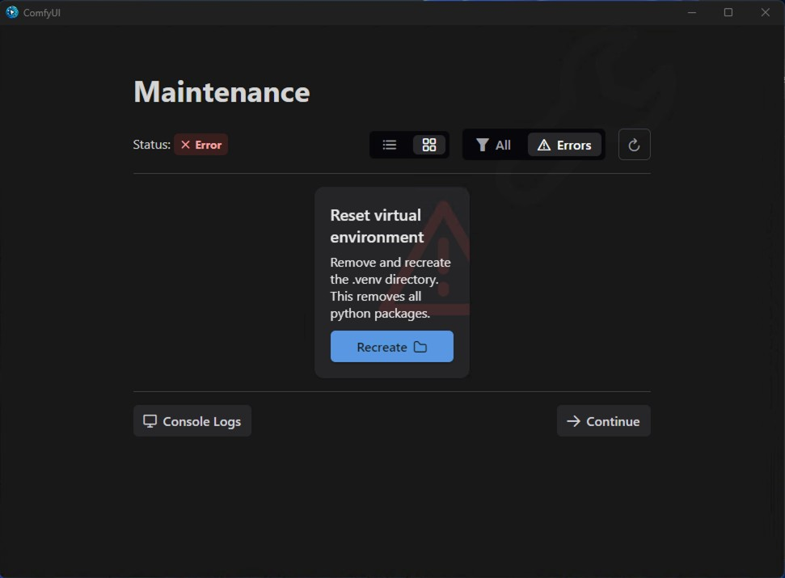
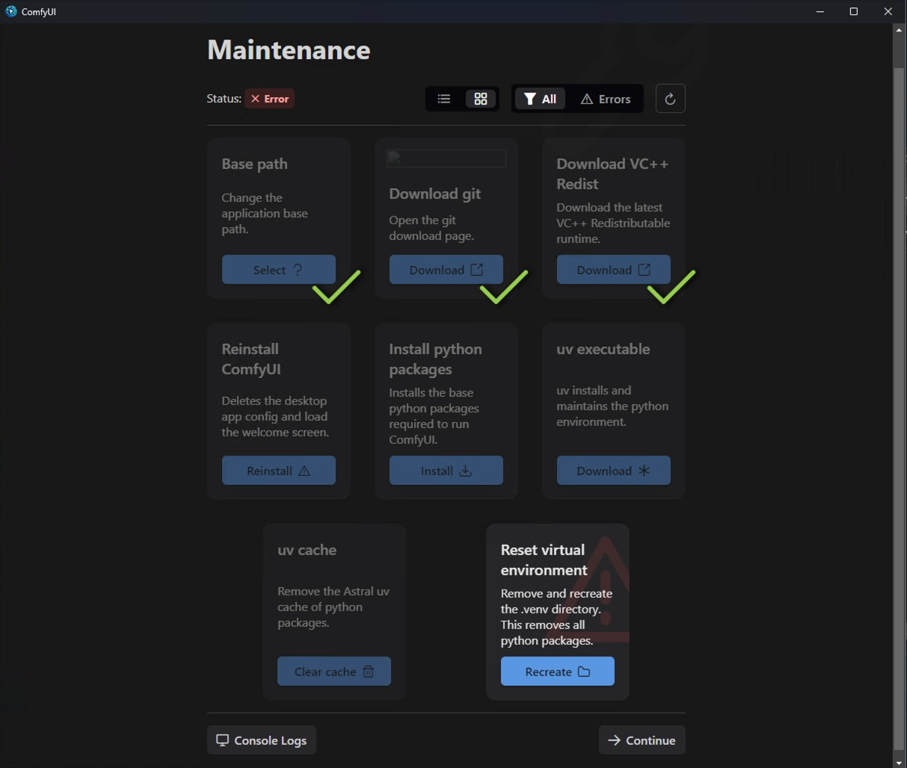

{/* translationSourceHash: 49eccc48 */}
Es gibt viele Gründe, warum bei der Installation von ComfyUI Probleme auftreten können. Vielleicht ist die Netzwerkverbindung beim Installieren von PyTorch (15 GB) fehlgeschlagen. Oder git ist nicht installiert. Die Wartungsseite wird automatisch geöffnet, wenn ein Problem erkannt wird, und bietet eine Möglichkeit, das Problem zu beheben.

Sie können damit die meisten Probleme beheben:

- Eine virtuelle Python-Umgebung erstellen
- Alle fehlenden Kernabhängigkeiten in Ihrer von Desktop verwalteten virtuellen Python-Umgebung neu installieren
- git und VC redis installieren
- Einen neuen Installationsort auswählen

Die standardmäßige Wartungsseite zeigt den aktuellen Fehlerinhalt an.

Durch Klicken auf `All` können Sie alle Inhalte anzeigen, die aktuell bearbeitet werden können.

