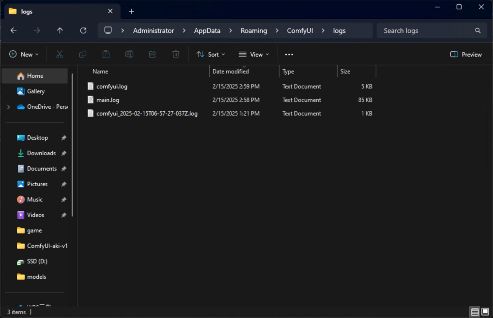
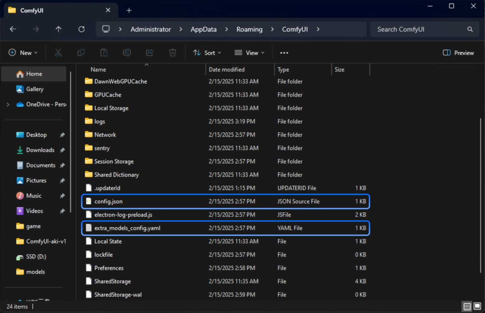

{/* translationSourceHash: e71c0b51 */}
### Feedback bei Installationsfehlern

Wenn bei der Installation Fehler auftreten, prüfen Sie bitte, ob ähnliche Fehlerberichte vorliegen, oder senden Sie uns Fehler über folgende Kanäle:

- GitHub Issues: https://github.com/Comfy-Org/Comfy-Desktop/issues
- Comfy Official Forum: https://forum.comfy.org/

Wenn Sie Fehlerberichte absenden, fügen Sie bitte die folgenden Protokolle und Konfigurationsdateien bei, damit wir das Problem lokalisieren und untersuchen können:

1. Protokolldateien

| Dateiname    | Beschreibung                                                                                     | Speicherort         |
|-------------|-------------------------------------------------------------------------------------------------|------------------|
| main.log    | Enthält Protokolle zum Start der Desktop-Anwendung und des Servers aus dem Electron-Prozess       | {log_path}       |
| comfyui.log | Enthält Protokolle zum normalen Betrieb von ComfyUI, z. B. die Terminalausgabe des ComfyUI-Kernprozesses | {log_path}       |

2. Konfigurationsdateien

| Dateiname                 | Beschreibung                                                                     | Speicherort          |
|--------------------------|---------------------------------------------------------------------------------|-------------------|
| extra_model_paths.yaml | Enthält zusätzliche Pfade, in denen ComfyUI nach Modellen und Custom Nodes sucht | {config_path}     |
| config.json              | Enthält die Anwendungskonfiguration. Diese Datei sollte nicht direkt bearbeitet werden     | {config_path}     |

