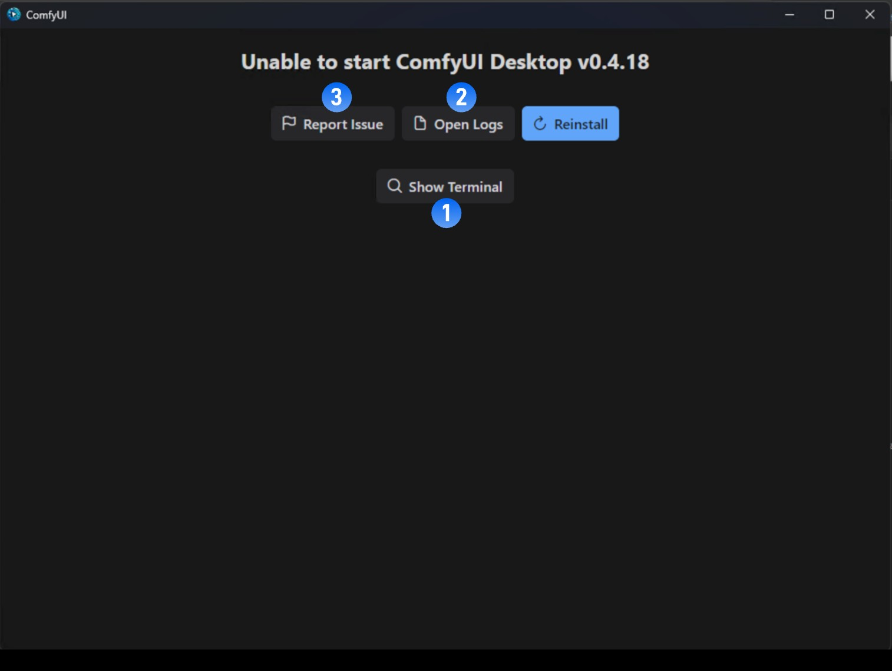
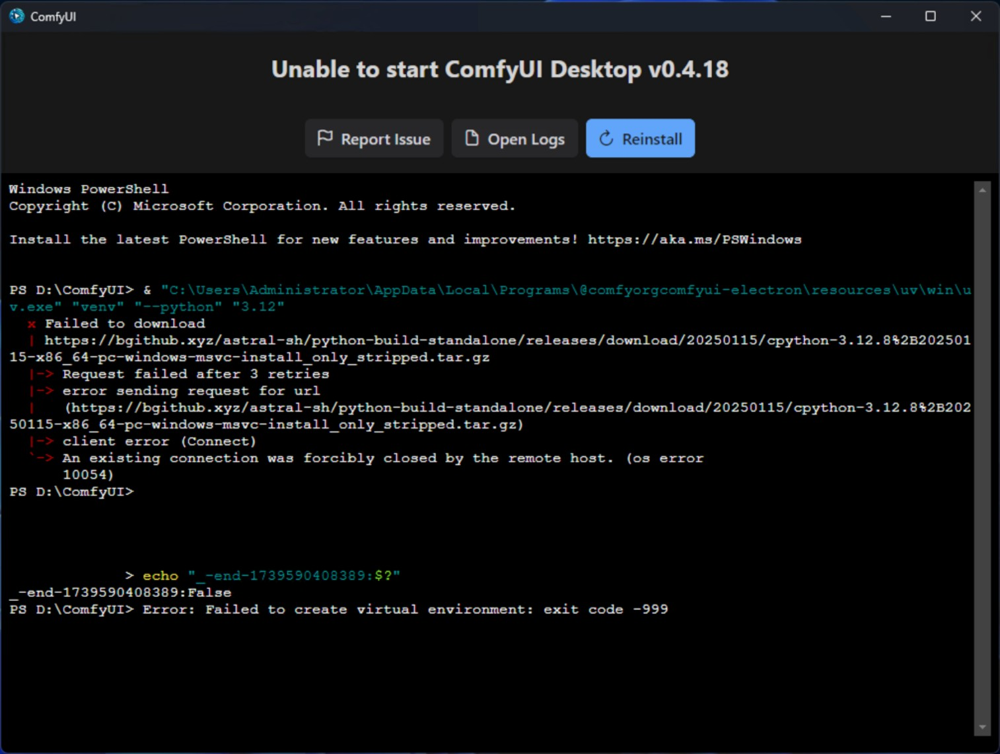
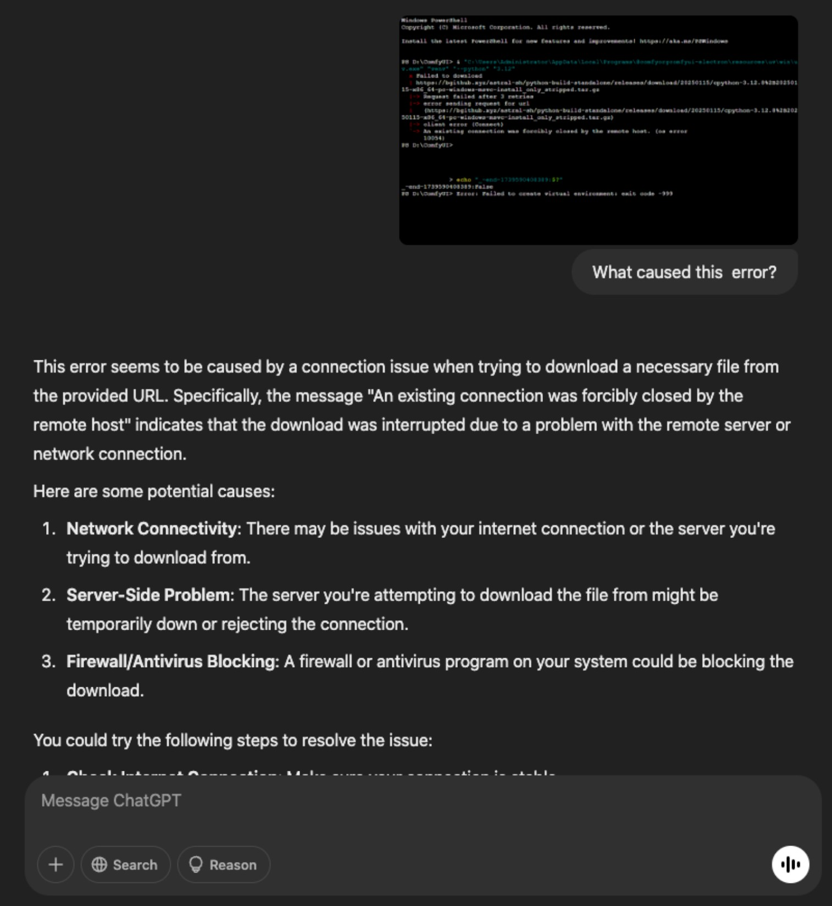

{/* translationSourceHash: b848ce9c */}
### Fehleridentifikation

Wenn die Installation fehlschlägt, sollten Sie den folgenden Bildschirm sehen:

Es wird empfohlen, diese Schritte auszuführen, um die Fehlerursache zu finden:
1. Klicken Sie auf `Show Terminal`, um die Fehlerausgabe anzuzeigen.
2. Klicken Sie auf `Open Logs`, um die Installationsprotokolle anzuzeigen.
3. Besuchen Sie das offizielle Forum, um nach Fehlerberichten zu suchen.
4. Klicken Sie auf `Reinstall`, um eine Neuinstallation zu versuchen.

Bevor Sie Feedback einreichen, wird empfohlen, die **Fehlerausgabe** und die **Protokolldateien** an Tools wie **GPT** zu übergeben.

Fragen Sie, wie oben gezeigt, GPT nach der Ursache des entsprechenden Fehlers oder entfernen Sie ComfyUI vollständig und versuchen Sie die Installation erneut.