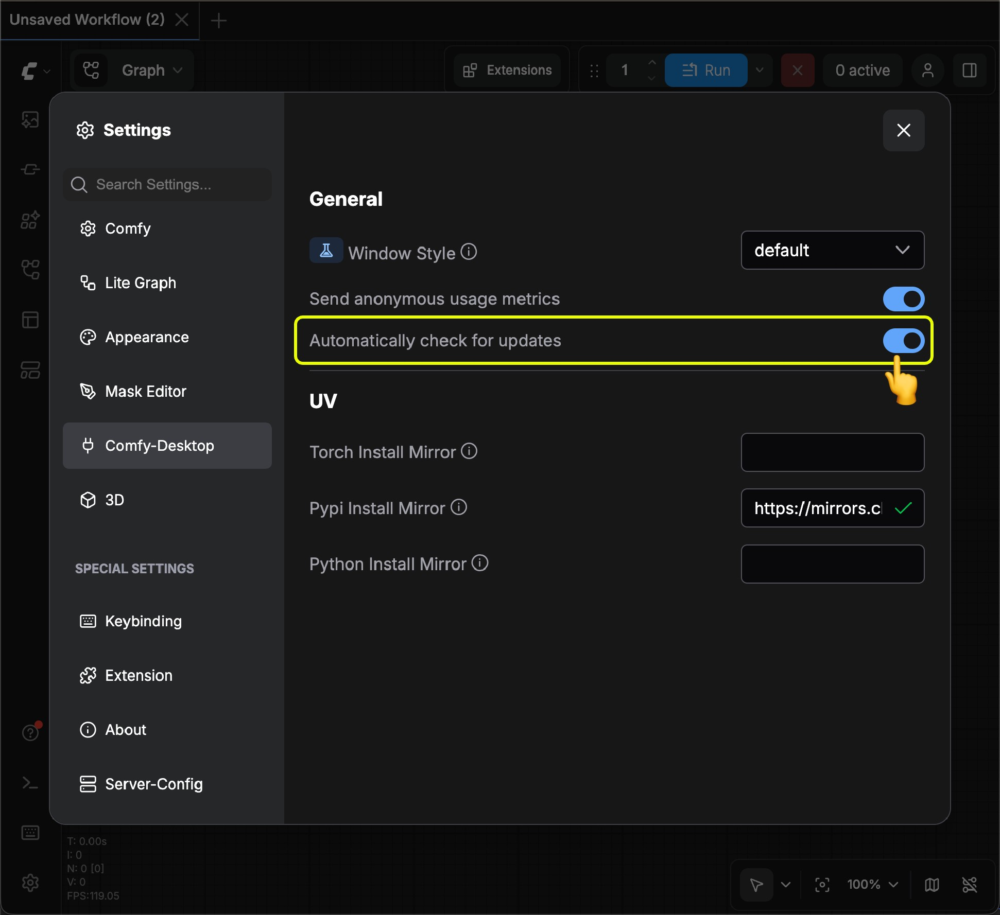
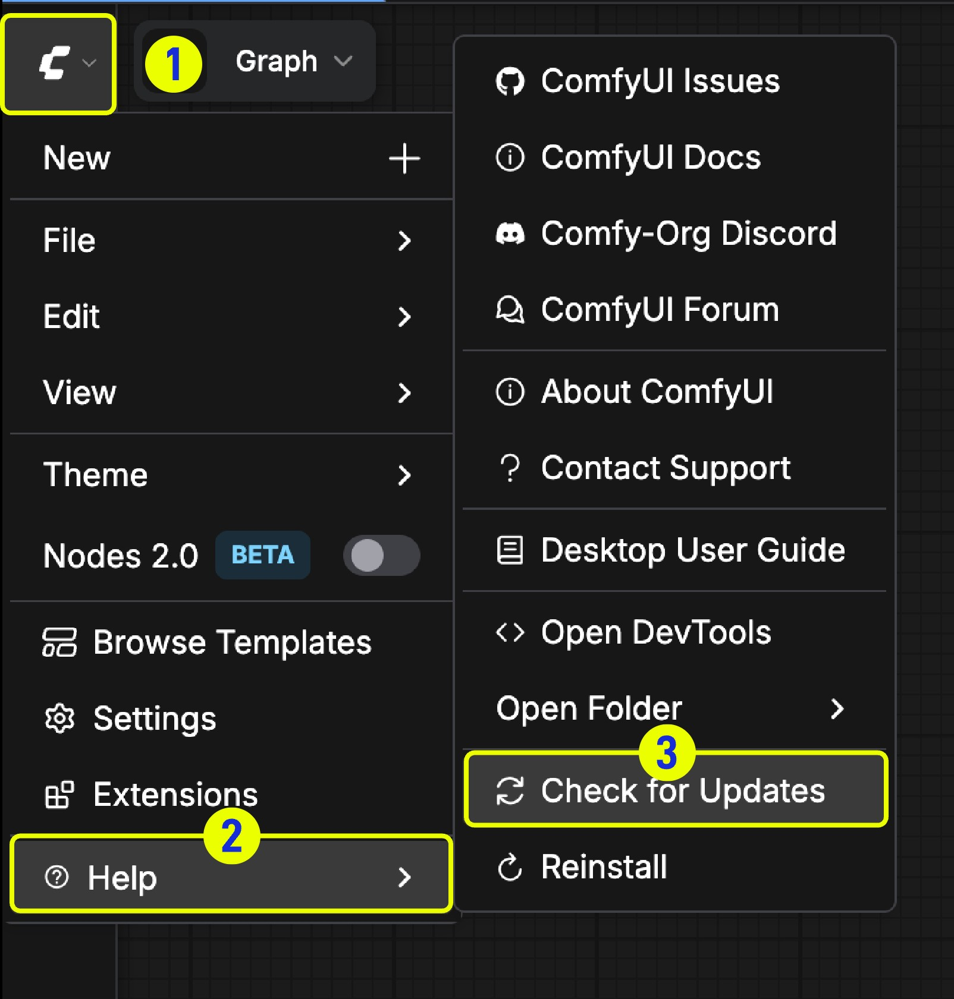

{/* translationSourceHash: 2770d24c */}
## Comfy Desktop aktualisieren

Derzeit verwendet Comfy Desktop die automatische Erkennung von Updates. Bitte stellen Sie sicher, dass automatische Updates in den Einstellungen aktiviert sind.

Sie können auch manuell nach verfügbaren Updates suchen: `Menu` --> `Help` --> `Check for Updates`

