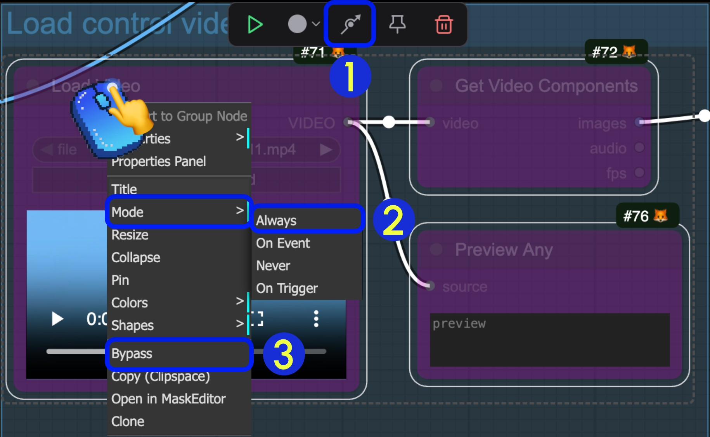

{/* translationSourceHash: 987c7169 */}
### Bypass-Status von Nodes umschalten

Wenn ein Node auf den Status Bypass gesetzt ist, werden die Daten, die durch den Node laufen, nicht vom Node beeinflusst und direkt ausgegeben. Wir setzen Nodes häufig auf den Bypass-Status, wenn wir sie nicht benötigen.
Hier sind drei Möglichkeiten, den Bypass-Status eines Nodes umzuschalten:

1. Nachdem Sie den Node ausgewählt haben, klicken Sie auf den Pfeil im Indikatorbereich der Auswahl-Toolbox, um den Bypass-Status des Nodes schnell umzuschalten.
2. Nachdem Sie den Node ausgewählt haben, klicken Sie mit der rechten Maustaste auf den Node und wählen Sie `Mode` -> `Always`, um in den Always-Modus zu wechseln.
3. Nachdem Sie den Node ausgewählt haben, klicken Sie mit der rechten Maustaste auf den Node und wählen Sie die Option `Bypass`, um den Bypass-Status umzuschalten.