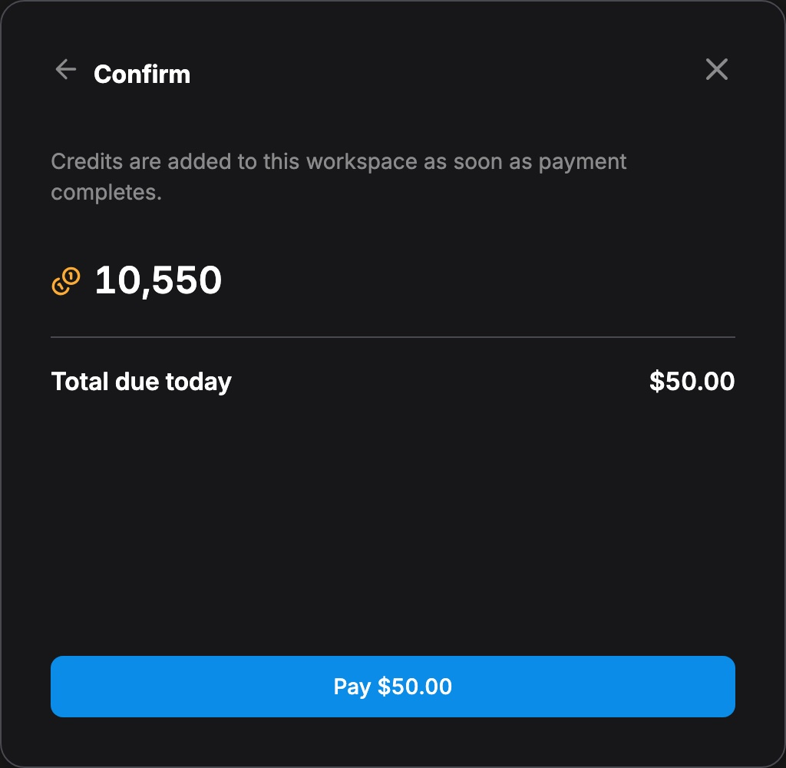
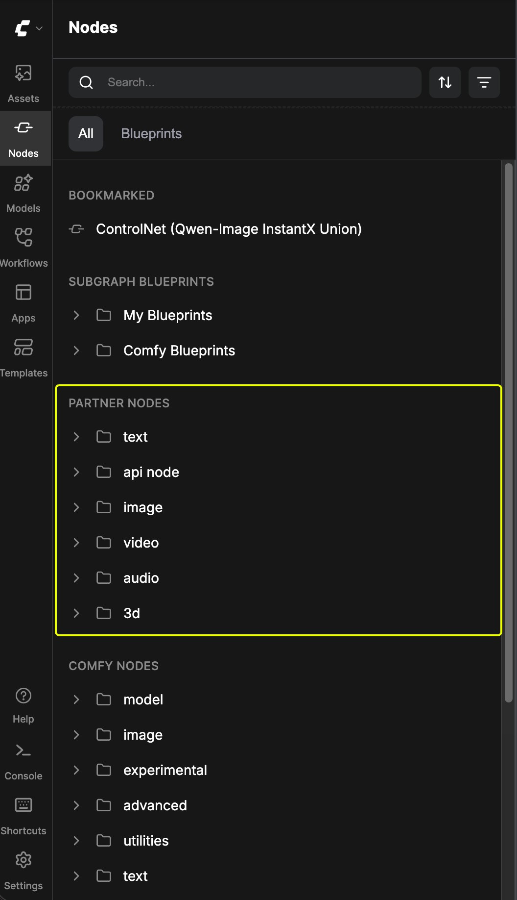

{/* translationSourceHash: c196b1a2 */}
## Voraussetzungen für die Verwendung von Partner-Nodes

Um Partner-Nodes verwenden zu können, müssen die folgenden Anforderungen erfüllt sein:

### 1. Anforderungen an die ComfyUI-Version

Bitte aktualisieren Sie Ihr ComfyUI auf die neueste Version, da wir künftig weitere API-Unterstützung hinzufügen werden und die entsprechenden Nodes aktualisiert werden. Halten Sie Ihr ComfyUI daher bitte aktuell.

<Tip>
Bitte beachten Sie den Unterschied zwischen Nightly- und Release-Versionen. Wir empfehlen die Verwendung der `nightly`-Version (dem neuesten Code-Commit), da die Release-Version möglicherweise nicht zeitnah aktualisiert wird.
Dies bezieht sich auf die Entwicklungsversion und die stabile Version. Da wir uns noch in einer schnellen Iteration befinden, ist dieses Dokument möglicherweise nicht immer aktuell. Achten Sie daher bitte auf die Versionsunterschiede.
</Tip>

### 2. Anforderungen an Konto und Credits

Sie müssen in Ihrem ComfyUI mit einem [Comfy-Konto](/de/interface/user) angemeldet sein und ein Guthaben von mehr als 0 [Credits](/interface/credits) haben.

Melden Sie sich über `Settings` -> `User` an:

Gehen Sie zu `Settings` -> `Credits`, um Credits zu kaufen.

Bitte lesen Sie die entsprechende Dokumentation zu Konto und Credits, um diese Voraussetzung zu erfüllen:
- [Comfy-Konto](/de/interface/user): Suchen Sie im Einstellungsmenü den Abschnitt `User`, um sich anzumelden.
- [Credits](/interface/credits): Nach der Anmeldung zeigt die Einstellungsoberfläche ein Credits-Menü an, in dem Sie Credits kaufen können. Wir verwenden ein Prepaid-System, sodass keine unerwarteten Kosten entstehen.

### 3. Anforderungen an die Netzwerkumgebung

Der API-Zugriff setzt voraus, dass Ihre aktuellen Anfragen über eine sichere Netzwerkumgebung erfolgen. Die aktuellen Anforderungen für den API-Zugriff lauten wie folgt:

 - Das lokale Netzwerk erlaubt den Zugriff nur von `127.0.0.1` oder `localhost`, und Sie können die Anmeldefunktion direkt verwenden.
- Wenn Sie über ein lokales Netzwerk oder eine Website zugreifen, die nicht auf der Whitelist steht, melden Sie sich bitte mit einem API-Schlüssel an. Siehe [Mit einem API-Schlüssel anmelden](/de/interface/user#logging-in-with-an-api-key).
- Sie sollten auf unseren API-Dienst normal zugreifen können (in einigen Regionen benötigen Sie möglicherweise einen Proxy-Dienst).
- Der Zugriff sollte in einer `https`-Umgebung erfolgen, um die Sicherheit der Anfragen zu gewährleisten.

<Note>
Der Zugriff in einem unsicheren Kontext birgt erhebliche Risiken und kann die folgenden Folgen haben:
1. Die Authentifizierung kann gestohlen werden, was zur Offenlegung Ihrer Kontoinformationen führt.
2. Ihr Konto kann böswillig verwendet werden, was zu finanziellen Verlusten führt.

Auch wenn wir diese Einschränkung künftig aufheben, raten wir aufgrund der hohen Risiken dringend davon ab, über unsichere Netzwerkanfragen auf API-Dienste zuzugreifen.
</Note>

### 4. Verwenden der entsprechenden Nodes

**Zum Workflow hinzufügen**: Fügen Sie den Partner-Node wie andere Nodes zu Ihrem Workflow hinzu.
**Ausführen**: Legen Sie die Parameter fest und führen Sie dann den Workflow aus.

