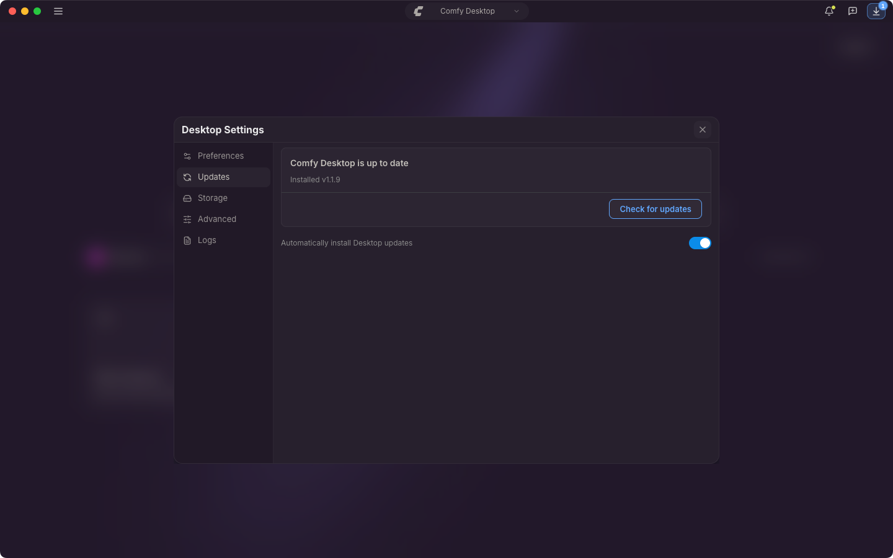

Comfy Desktop checks for updates a moment after it starts and every 10 minutes while it runs, and each check downloads what it finds. Neither can be turned off. The only setting controls whether an update then installs without asking.

## Automatic updates

**Automatically install Desktop updates** is on by default. The title bar follows the download: **Downloading update…** first, then **Desktop Update Ready**. With the setting on, Comfy Desktop applies the update without asking: when you quit the app on macOS, at the next launch on Windows.

Click the pill to restart into it right away instead. **Restart & Update** quits Comfy Desktop and reopens the new version, so anything running in the app closes with it. **Later** closes the prompt and leaves the update to apply on its own.

## Manual update

1. Click ☰ and choose **Desktop Settings**.
2. Open the **Updates** tab.

The card leads with the state, such as **Comfy Desktop is up to date** or **Update v1.2.0 ready to install**, followed by the installed version, the last check, and the latest version when a newer one exists. The main button follows that state: **Check for updates**, **Download**, or **Restart & Update**. While a download runs, clicking the title bar pill opens Desktop Settings, and the **Updates** tab shows the progress.

Turn off **Automatically install Desktop updates** and nothing installs on its own. The file still downloads, and the update waits for you to click the pill and choose **Restart & Update**.
