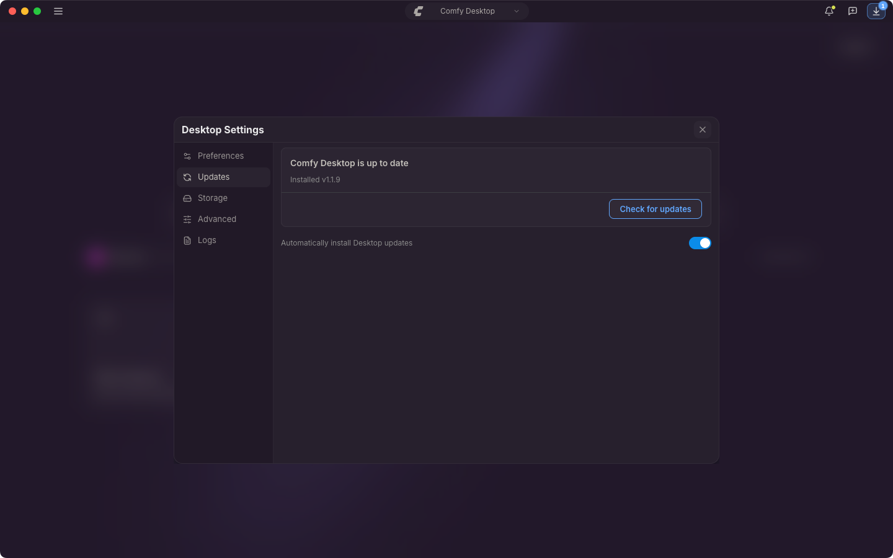

{/* translationSourceHash: 2dece496 */}
Comfy Desktop busca actualizaciones al arrancar y cada 10 minutos mientras se ejecuta, y cada búsqueda descarga lo que encuentra. Ninguna de las dos cosas se puede desactivar. El único ajuste decide si la actualización se instala después sin preguntar.

## Actualizaciones automáticas

**Automatically install Desktop updates** está activada de forma predeterminada. La barra de título muestra el progreso: primero **Downloading update…** y después **Desktop Update Ready**. Con el ajuste activado, Comfy Desktop aplica la actualización sin preguntar: al cerrar la aplicación en macOS y en el siguiente arranque en Windows.

Haz clic en ese botón de la barra de título para reiniciar antes. **Restart & Update** cierra Comfy Desktop y lo vuelve a abrir con la nueva versión, así que lo que esté ejecutándose en la app se cierra con ella. **Later** solo cierra el aviso y deja que la actualización se aplique sola.

## Actualización manual

1. Haz clic en ☰ y elige **Desktop Settings**.
2. Abre la pestaña **Updates**.

La tarjeta muestra primero el estado, por ejemplo **Comfy Desktop is up to date** o **Update v1.2.0 ready to install**, y después la versión instalada, la última comprobación y la versión más reciente cuando existe una nueva. El botón principal cambia con ese estado: **Check for updates**, **Download** o **Restart & Update**. Mientras se descarga, hacer clic en el botón de la barra de título abre Desktop Settings y la pestaña **Updates** muestra el progreso.

Si desactivas **Automatically install Desktop updates**, la actualización no se instala sola. El archivo se sigue descargando y la actualización espera a que hagas clic en el botón de la barra de título y elijas **Restart & Update**.
