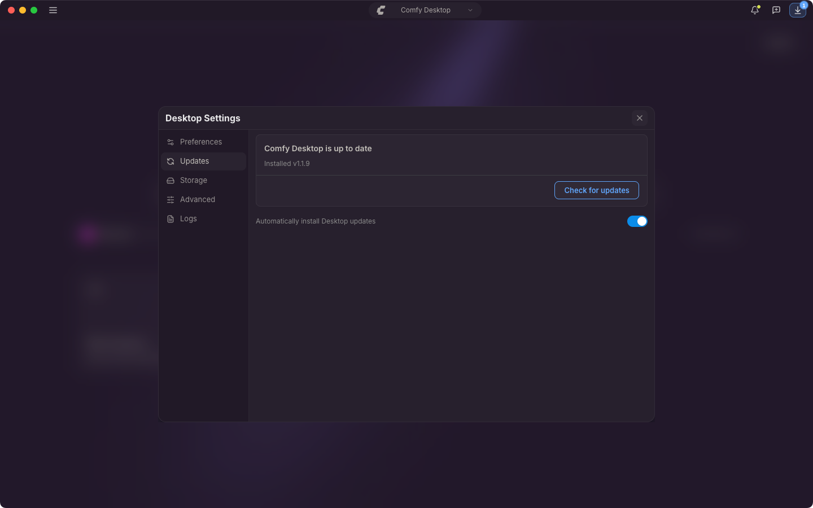

{/* translationSourceHash: 2dece496 */}
Comfy Desktop は起動直後と、実行中は 10 分おきにアップデートを確認し、見つかったものはその場でダウンロードします。どちらもオフにできません。唯一の設定は、その後アップデートを確認なしでインストールするかどうかだけです。

## 自動アップデート

**Automatically install Desktop updates** は既定でオンです。タイトルバーにダウンロードの進行が出ます。まず **Downloading update…**、完了すると **Desktop Update Ready** です。この設定がオンのとき、Comfy Desktop は確認なしで適用します。macOS ではアプリを終了したとき、Windows では次回起動時です。

すぐに再起動したい場合は、タイトルバーのこのボタンをクリックします。**Restart & Update** は Comfy Desktop を終了して新しいバージョンで起動し直すため、アプリ内で実行中のものも一緒に閉じます。**Later** は確認を閉じるだけで、アップデートはその後自動的に適用されます。

## 手動アップデート

1. ☰ をクリックし、**Desktop Settings** を選択します。
2. **Updates** タブを開きます。

カードには状態が先に出ます。たとえば **Comfy Desktop is up to date** や **Update v1.2.0 ready to install** で、続いてインストール済みのバージョン、最後に確認した時刻、新しいバージョンがある場合は最新バージョンが並びます。メインボタンはその状態に応じて **Check for updates**、**Download**、**Restart & Update** と変わります。ダウンロード中にタイトルバーのボタンをクリックすると Desktop Settings が開き、**Updates** タブで進捗を確認できます。

カードの下の **Automatically install Desktop updates** をオフにすると、自動ではインストールされません。ファイルのダウンロードは続き、タイトルバーのボタンをクリックして **Restart & Update** を選ぶまで待機します。
