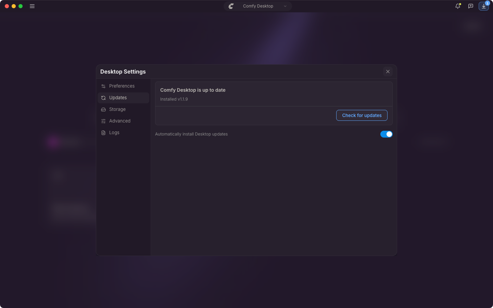

{/* translationSourceHash: b05f1a5d */}
Comfy Desktop은 시작 직후 한 번, 실행 중에는 10분마다 업데이트를 확인하고, 찾은 버전은 그때 내려받습니다. 둘 다 끌 수 없습니다. 유일한 설정은 업데이트를 묻지 않고 설치할지 여부입니다.

## 자동 업데이트

**Automatically install Desktop updates**는 기본적으로 켜져 있습니다. 제목 표시줄에 다운로드 진행이 표시됩니다. 먼저 **Downloading update…**, 완료되면 **Desktop Update Ready**입니다. 이 설정이 켜져 있으면 Comfy Desktop이 묻지 않고 적용합니다. macOS에서는 앱을 종료할 때, Windows에서는 다음 실행 시 적용됩니다.

바로 다시 시작하려면 제목 표시줄의 이 버튼을 클릭합니다. **Restart & Update**는 Comfy Desktop을 종료하고 새 버전으로 다시 열기 때문에 앱에서 실행 중이던 작업도 함께 종료됩니다. **Later**는 확인 창만 닫고, 업데이트는 이후에 자동으로 적용됩니다. 이 자동 적용은 이 설정이 켜져 있을 때만 됩니다.

## 수동 업데이트

1. ☰를 클릭하고 **Desktop Settings**를 선택합니다.
2. **Updates** 탭을 엽니다.

카드에는 상태가 먼저 나옵니다. 예를 들어 **Comfy Desktop is up to date** 또는 **Update v1.2.0 ready to install**이고, 이어서 설치된 버전, 마지막 확인 시각, 새 버전이 있을 때는 최신 버전이 표시됩니다. 기본 버튼은 그 상태에 따라 **Check for updates**, **Download**, **Restart & Update**로 바뀝니다. 다운로드 중에 제목 표시줄 버튼을 클릭하면 Desktop Settings가 열리고 **Updates** 탭에서 진행률을 볼 수 있습니다.

카드 아래의 **Automatically install Desktop updates**를 끄면 자동으로 설치되지 않습니다. 제목 표시줄에는 **Desktop Update**가, Updates 카드에는 **Update … available**이 표시됩니다. 파일은 계속 내려받으며, 준비가 되면 **Desktop Update Ready**를 클릭해 **Restart & Update**를 선택하세요.
