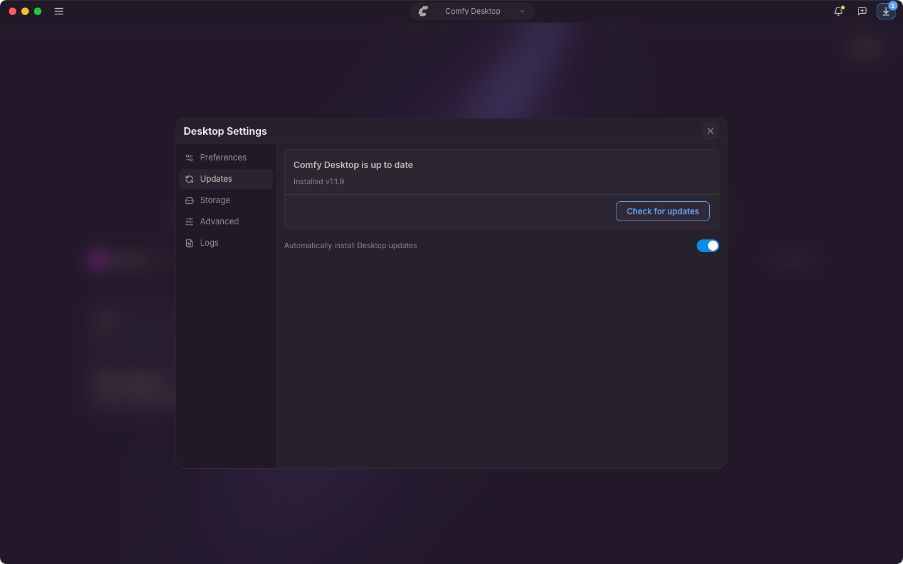

{/* translationSourceHash: b05f1a5d */}
Comfy Desktop проверяет наличие обновлений вскоре после запуска и каждые 10 минут во время работы, причём каждая проверка скачивает найденное. Отключить нельзя ни то, ни другое. Единственная настройка определяет, устанавливается ли обновление после этого без запроса.

## Автоматические обновления

Параметр **Automatically install Desktop updates** включён по умолчанию. Заголовок окна следует за загрузкой: сначала **Downloading update…**, затем **Desktop Update Ready**. Когда настройка включена, Comfy Desktop применяет обновление без запроса: при выходе из приложения в macOS, при следующем запуске в Windows.

Вместо этого нажмите на плашку, чтобы сразу перезапуститься в новую версию. **Restart & Update** закрывает Comfy Desktop и открывает новую версию, поэтому всё, что работает в приложении, закрывается вместе с ним. **Later** закрывает запрос и оставляет обновление для автоматического применения: автоматическое применение происходит только пока эта настройка включена.

## Обновить вручную

1. Нажмите ☰ и выберите **Desktop Settings**.
2. Откройте вкладку **Updates**.

Карточка начинается с состояния, например **Comfy Desktop is up to date** или **Update v1.2.0 ready to install**, затем указаны установленная версия, время последней проверки и последняя версия, если существует более новая. Основная кнопка соответствует этому состоянию: **Check for updates**, **Download** или **Restart & Update**. Пока идёт загрузка, нажатие на плашку в заголовке окна открывает Настройки рабочего стола, а вкладка **Updates** показывает прогресс.

Отключите **Automatically install Desktop updates**, и ничего не установится само. В заголовке окна отображается **Desktop Update**, а карточка Updates показывает **Update … available**. Файл всё равно скачивается; когда он готов, нажмите на плашку **Desktop Update Ready** и выберите **Restart & Update**.