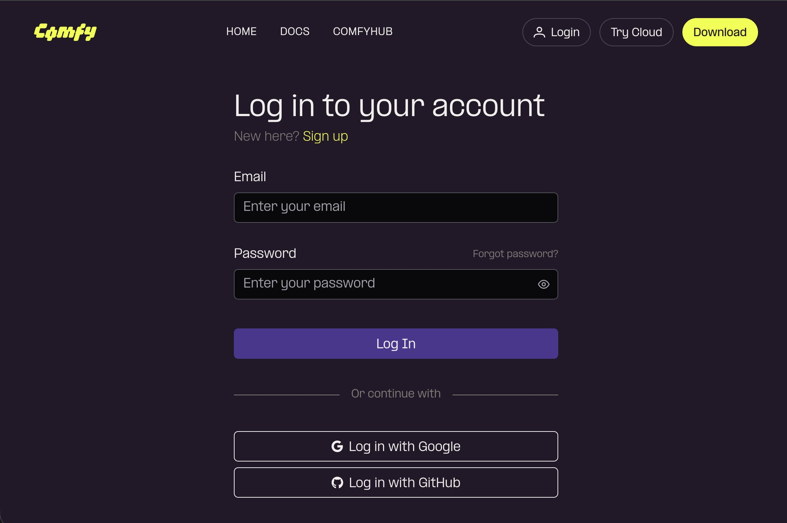
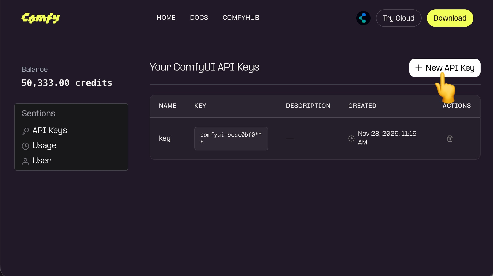
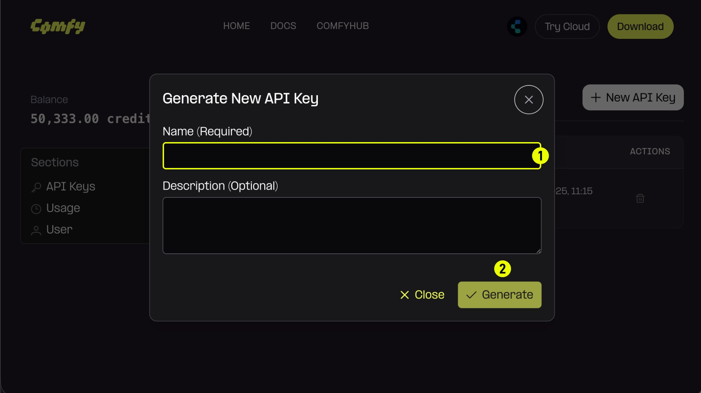
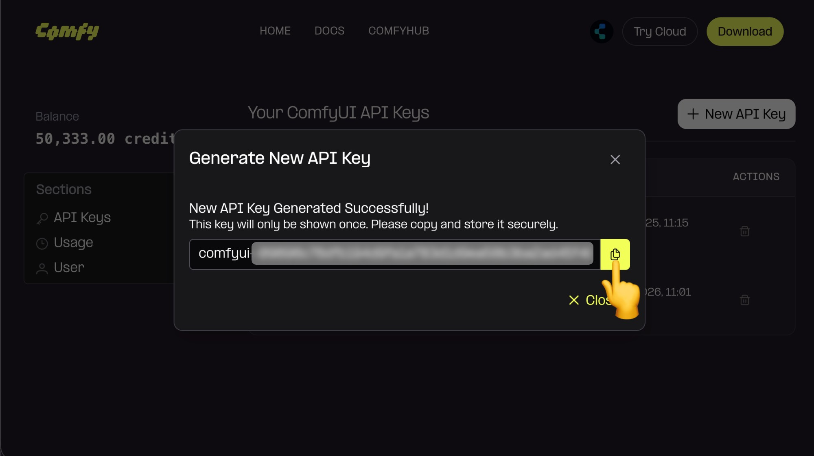

{/* translationSourceHash: 43c0e218 */}
<Steps>
  <Step title="Перейти на платформу Comfy и войти">
    Откройте [страницу входа на платформу Comfy](https://platform.comfy.org/login) и войдите под соответствующей учётной записью
    
  </Step>
  <Step title="Нажать `+ New` в разделе API Keys, чтобы создать API-ключ">
    Нажмите `+ New` в разделе API Keys, чтобы создать API-ключ
    
  </Step>
  <Step title="Ввести название API-ключа">

    
    1. (Обязательно) Введите название API-ключа,
    2. Нажмите `Generate`, чтобы создать его
  </Step>
  <Step title="Сохранить полученный API-ключ">
    
    <Warning>
      API-ключ отображается только при первом создании, поэтому сразу сохраните его после создания. Позже посмотреть его нельзя, так что храните его в безопасном месте.
      Не передавайте свой API-ключ другим. Если он утёк, удалите его и создайте новый.
    </Warning>
  </Step>
</Steps>