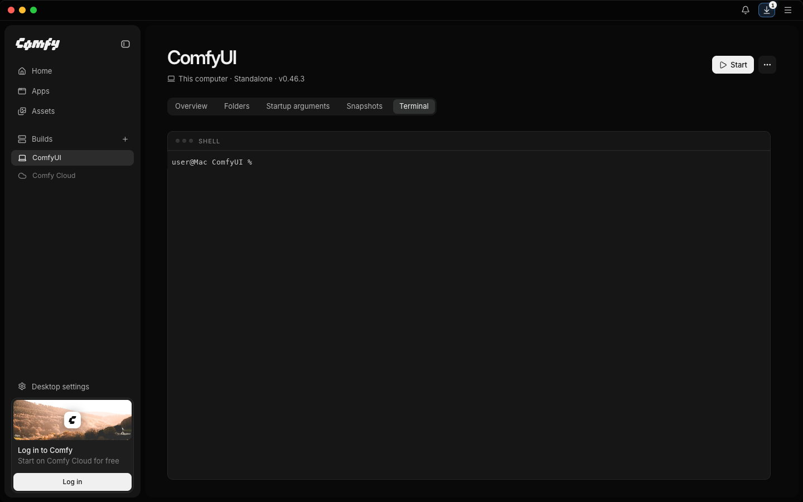
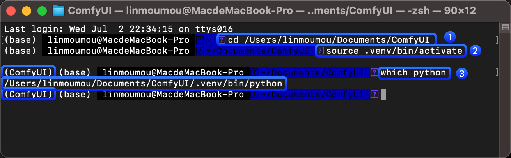

{/* translationSourceHash: c9c978a9 */}
## Python-окружение десктопного приложения

При установке десктопной версии в выбранном вами каталоге установки создаётся виртуальное окружение Python, обычно это скрытая папка `.venv`.

Если вам нужно установить зависимости для плагинов ComfyUI, делать это следует внутри данного окружения. При использовании системной командной строки напрямую есть риск установить зависимости в системное окружение, поэтому следуйте приведённым ниже инструкциям, чтобы активировать нужное окружение.

### Как использовать Python-окружение десктопного приложения?

<Tabs>
  <Tab title="Десктопное приложение (рекомендуется)">
    Вы можете использовать встроенный терминал в десктопном приложении для доступа к Python-окружению.
    
    1. Нажмите на иконку в строке меню, чтобы открыть нижнюю панель
    2. Нажмите `Terminal`, чтобы открыть терминал
    3. Если вы хотите проверить расположение установки Python для соответствующего окружения, используйте следующую команду
    <Tabs>
      <Tab title="Windows">
      ```
        python -c "import sys; print(sys.executable)"
      ```
      </Tab>
      <Tab title="macOS">
        ```
        which python
        ```
      </Tab>
    </Tabs>

    <Warning>
      Если вы не понимаете смысла выполняемых действий, они могут привести к проблемам с зависимостями в соответствующем окружении. Используйте этот метод с осторожностью.
    </Warning>
  </Tab>
  <Tab title="Терминал">
    Вы также можете использовать предпочитаемый вами терминал для доступа к Python-окружению, но сначала потребуется активировать виртуальное окружение.

    <Warning>
    При использовании других терминалов, если вы не знакомы с операциями, вы можете случайно установить зависимости в системное окружение. Используйте этот метод с осторожностью.
    </Warning>

    

    <Warning>
    На скриншоте показан терминал macOS. Если вы используете Windows, обратитесь к приведённым ниже шагам, чтобы активировать виртуальное окружение в вашей системе.    
    </Warning>
    <Steps>
        <Step title="Открыть терминал">
            Откройте предпочитаемый терминал и с помощью команды `cd` перейдите в каталог установки ComfyUI, например:
            ```
            cd <your comfyui install directory>/ComfyUI
            ```
        </Step>
        <Step title="Активировать виртуальное окружение">
            Введите в терминале следующую команду, чтобы активировать виртуальное окружение

            <Tabs>
              <Tab title="Windows">
                ```
                .venv/Scripts/activate
                ```
              </Tab>
              <Tab title="macOS">
                ```
                source .venv/bin/activate
                ```
              </Tab>
            </Tabs>
           
            После активации вы должны увидеть в терминале приглашение вида `(ComfyUI)`, что означает, что виртуальное окружение активировано.
        </Step>
        <Step title="Подтвердить текущее Python-окружение">
            Используйте `which python`, чтобы проверить текущее расположение установки Python и убедиться, что это не системное окружение.

            После выполнения этих шагов соответствующее Python-окружение активировано, и вы можете продолжить установку зависимостей в этом окружении.
        </Step>
    </Steps>
  </Tab>
</Tabs>