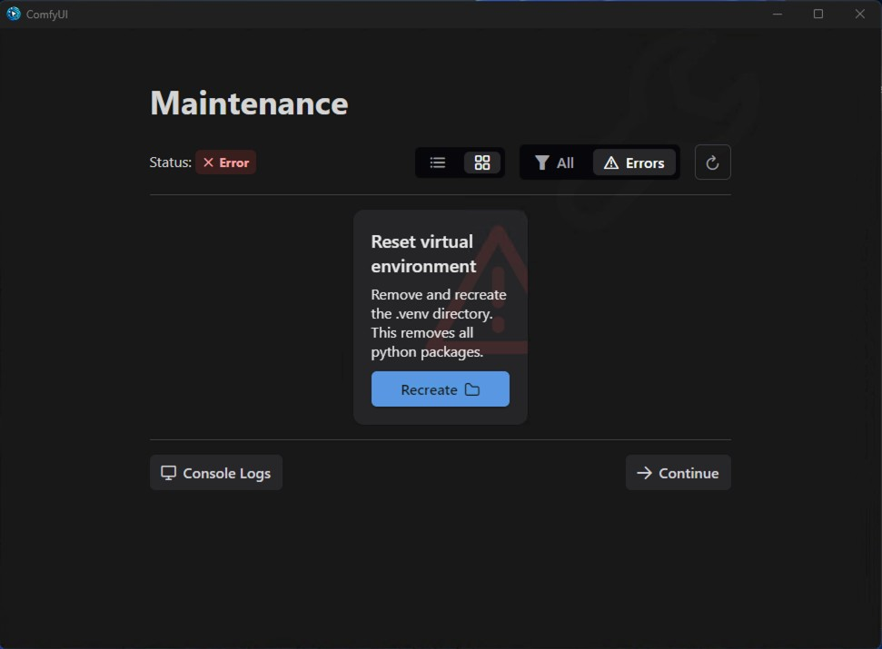
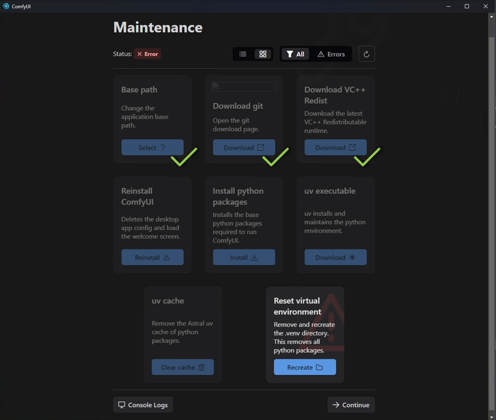

{/* translationSourceHash: 49eccc48 */}
Есть множество причин, по которым у вас могут возникнуть проблемы с установкой ComfyUI. Возможно, при установке pytorch (15 GB) произошла ошибка сетевого подключения. Или у вас не установлен git. Страница обслуживания автоматически открывается при обнаружении проблемы и предлагает способ её решения.

С её помощью можно решить большинство проблем:

- Создать виртуальную среду Python
- Переустановить все отсутствующие основные зависимости в вашу виртуальную среду Python, управляемую Desktop
- Установить git, VC redis
- Выбрать новое место установки

По умолчанию страница обслуживания отображает текущее содержимое ошибки

Нажатие `All` позволяет просмотреть всё содержимое, с которым можно работать в данный момент

