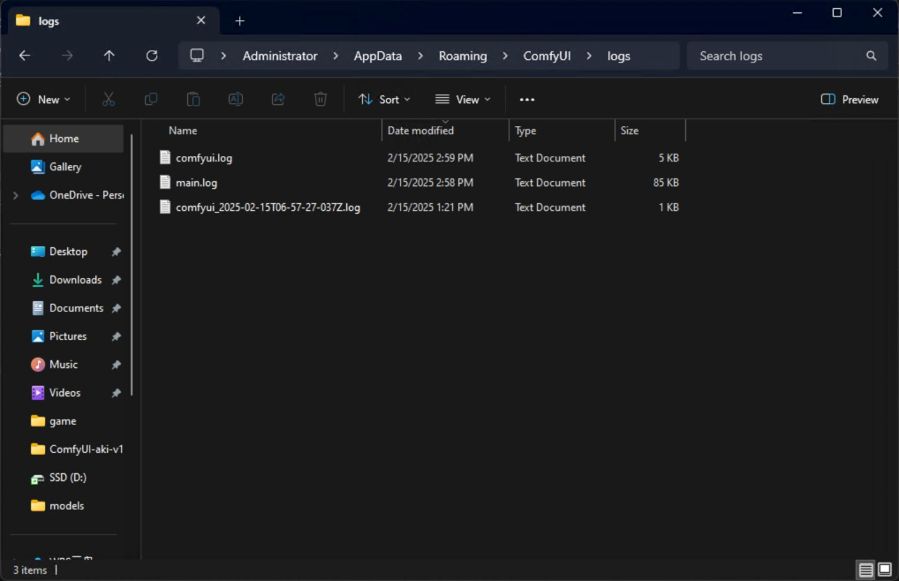
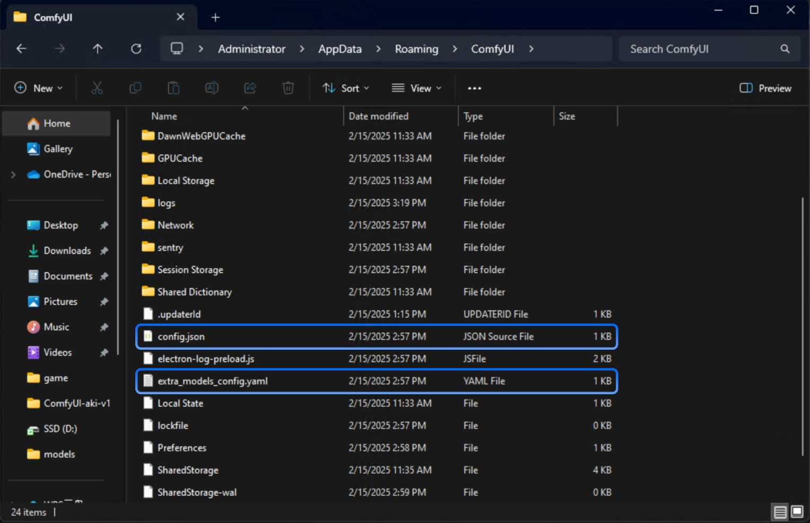

{/* translationSourceHash: e71c0b51 */}
### Обратная связь при сбое установки

Если при установке возникли ошибки, проверьте, нет ли похожих сообщений об ошибках, или сообщите нам о них через:

- GitHub Issues: https://github.com/Comfy-Org/Comfy-Desktop/issues
- Официальный форум Comfy: https://forum.comfy.org/

При отправке сообщений об ошибках обязательно приложите следующие логи и файлы конфигурации, чтобы помочь нам найти и исследовать проблему:

1. Файлы логов

| Имя файла    | Описание                                                                                     | Расположение         |
|-------------|-------------------------------------------------------------------------------------------------|------------------|
| main.log    | Содержит логи, связанные с запуском десктопного приложения и сервера из процесса Electron       | {log_path}       |
| comfyui.log | Содержит логи обычной работы ComfyUI, например вывод терминала основного процесса ComfyUI | {log_path}       |

2. Файлы конфигурации

| Имя файла                 | Описание                                                                     | Расположение          |
|--------------------------|---------------------------------------------------------------------------------|-------------------|
| extra_model_paths.yaml | Содержит дополнительные пути, по которым ComfyUI будет искать модели и пользовательские узлы | {config_path}     |
| config.json              | Содержит конфигурацию приложения. Этот файл не следует редактировать напрямую     | {config_path}     |

