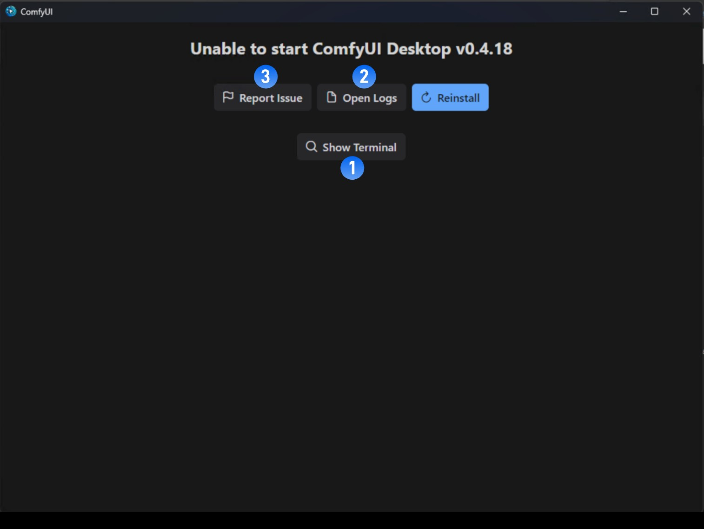
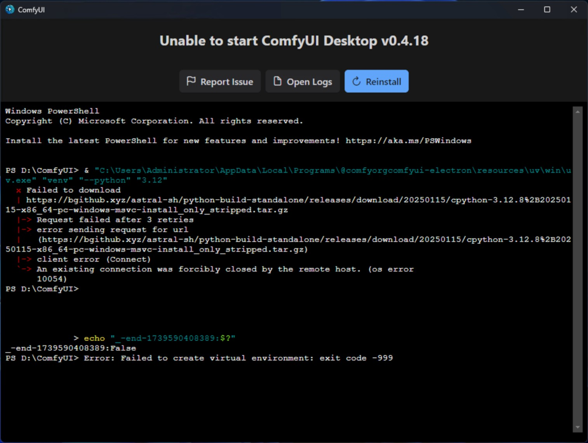
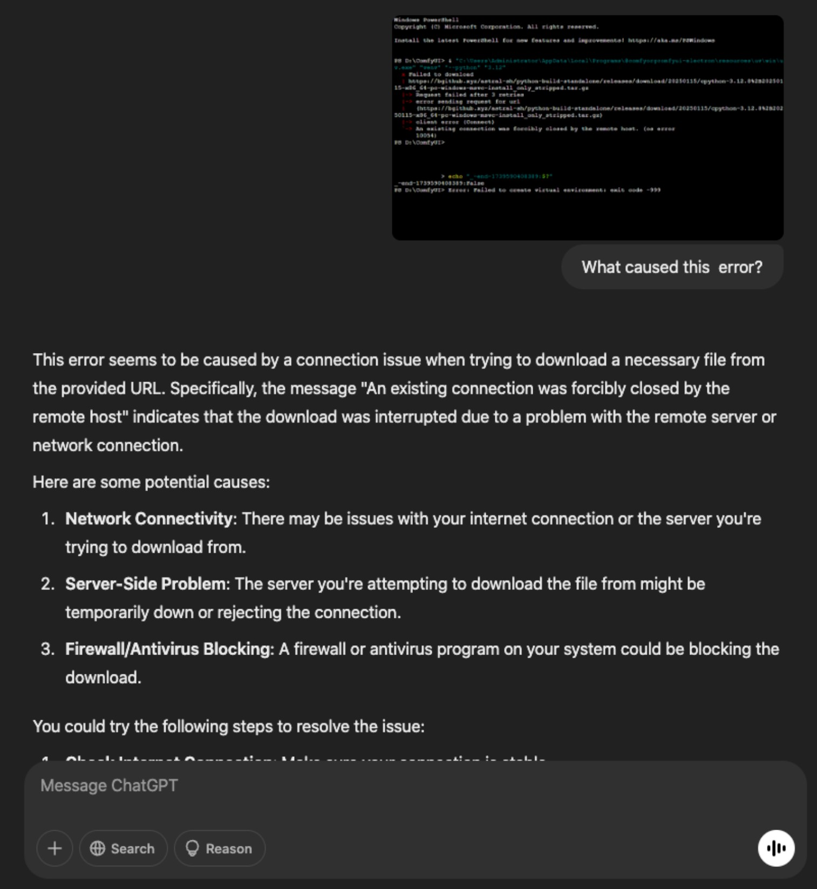

{/* translationSourceHash: b848ce9c */}
### Определение ошибки

Если установка завершается ошибкой, вы увидите следующий экран

Чтобы найти причину ошибки, рекомендуется выполнить следующие шаги:
1. Нажмите `Show Terminal`, чтобы просмотреть вывод ошибки
2. Нажмите `Open Logs`, чтобы просмотреть логи установки  
3. Посетите официальный форум и поищите сообщения об ошибках
4. Нажмите `Reinstall`, чтобы попробовать переустановить

Перед отправкой обратной связи рекомендуется передать **вывод ошибки** и **файлы логов** таким инструментам, как **GPT**

Как показано выше, спросите у GPT о причине соответствующей ошибки или полностью удалите ComfyUI и повторите установку.